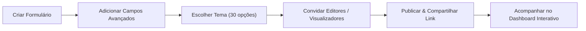

# Olivelas IAM Forms · Documentação de Negócio

<!-- section: cabecalho -->
| Metadado | Detalhe |
| :--- | :--- |
| **Sistema** | Olivelas IAM Forms |
| **Público-alvo** | Gestores de Operações, Recursos Humanos, Líderes de Equipe, Criadores de Pesquisa e Auditores |
| **Escopo** | Funcionamento funcional, jornada do usuário, gestão de equipes, dashboards e integrações |
| **Documentação Técnica** | [Olivelas IAM Forms · Documentação Técnica](olivelas-iam-forms-tecnica.md) |
| **Versão** | 1.0.0 |

---

<!-- section: o-que-e -->
## 1. O que é o Olivelas IAM Forms?

O **Olivelas IAM Forms** é uma plataforma corporativa para criação e gerenciamento de formulários dinâmicos e pesquisas, com visual moderno inspirado no Google Forms, porém com recursos essenciais de governança corporativa que o Google Forms tradicional não oferece:

- **Controle de Acessos Corporativo (IAM)**: Apenas usuários autorizados criam formulários e acessam os relatórios gerenciais.
- **Compartilhamento Granular por Formulário**: O dono de um formulário pode convidar outros membros de sua equipe por e-mail com permissão de **Editor** (para alterar perguntas) ou apenas **Visualizador** (para acompanhar respostas em tempo real).
- **Tipos de Campos Mais Ricos**: Suporte a números inteiros rigorosos, números quebrados/decimais, blocos puramente informativos (sem caixa de digitação), uploads de fotos com prévia, avaliações em estrelas e interruptores.
- **Dashboards Interativos em Tempo Real**: Geração de gráficos de pizza, donut, barras e linhas que podem ser editados, salvos e compartilhados publicamente ou mantidos em sigilo.
- **Sincronização com Google**: Integração nativa para alimentar planilhas no Google Sheets e armazenar arquivos no Google Drive.
- **30 Temas Visuais & 3 Idiomas**: Personalização visual rica e troca instantânea de idioma entre Português, Inglês e Espanhol.

---

<!-- section: para-que-serve -->
## 2. Para que Serve?

O sistema atende múltiplos cenários corporativos:

1. **Censos e Pesquisas de Clima Organizacional**: Coleta estruturada com garantia de anonimato ou identificação corporativa.
2. **Vistorias Operacionais e Checklists**: Uso em campo via celular, com validação de medições quebradas/decimais e envio de fotos como evidência.
3. **Inscrições e Formulários Públicos de Eventos**: Links abertos distribuíveis para qualquer pessoa preencher sem necessidade de login.
4. **Painéis Executivos de Apuração**: Dashboards para diretoria acompanharem metas e distribuições de respostas em tempo real.

---

<!-- section: como-funciona -->
## 3. Como Funciona a Solução?

### 3.1 A Jornada do Criador de Formulários

1. O usuário acessa a plataforma e cria um formulário com título e instruções.
2. Adiciona perguntas escolhendo entre diversos tipos (Inteiros, Quebrados, Upload, Textos, Estrelas, etc.).
3. Personaliza o design escolhendo um dos 30 temas visuais disponíveis.
4. Caso precise de ajuda de colegas, convida outros colaboradores por e-mail como **Editores** ou **Visualizadores**.
5. Disponibiliza o link público para os respondentes.
6. Os resultados chegam em tempo real, alimentando os gráficos do Dashboard e a planilha do Google Sheets.

### 3.2 A Jornada do Respondente
1. O respondente clica no link público do formulário (`/f/codigo-compartilhado`).
2. Visualiza a página limpa e adaptada para celulares ou computadores.
3. Preenche as respostas com validações claras (ex: o sistema não permite digitar letras ou vírgulas em campos inteiros).
4. Clica em "Enviar Resposta" e recebe uma animação comemorativa e a mensagem de confirmação personalizada.

---

<!-- section: telas-e-interacoes -->
## 4. Telas & Interações do Sistema

| Tela | O que o Usuário faz | Ações de CRUD Disponíveis |
| :--- | :--- | :--- |
| **Página Inicial (Landing Page)** | Apresentação institucional e comparativo com Google Forms | Navegar para login ou teste de formulário público |
| **Tela de Login** | Acesso com e-mail e senha ou botões de perfis rápidos de teste | Entrar como Administrador, Criador, Editor ou Visualizador |
| **Painel Geral (Overview)** | Visão dos indicadores principais e atalhos rápidos | Visualizar KPIs e formulários recentes |
| **Meus Formulários** | Listagem geral de formulários criados ou compartilhados | **Criar**, **Editar**, **Duplicar**, **Compartilhar** e **Excluir** formulários |
| **Construtor de Formulário** | Montagem visual de perguntas inspirada no Google Forms | Adicionar perguntas, reordenar, editar validações e alternar temas |
| **Gerenciador de Respostas** | Planilha ao vivo com respostas e métricas | Visualizar envios, **Excluir resposta**, **Exportar CSV** e **Sincronizar Google Sheets** |
| **Dashboards Interativos** | Painéis analíticos com gráficos customizáveis | **Criar dashboard**, **Adicionar gráficos (Pizza, Barras, Linhas)** e **Excluir** |
| **Gestão de Usuários (IAM)** | Administração de contas e colaboradores | **Cadastrar**, **Editar papéis (Admin, Criador, Visualizador)** e **Excluir** |
| **Grupos & HBAC** | Organização por departamentos e equipes | **Criar grupos**, **Definir cores**, **Associar membros** e **Excluir** |
| **Tokens de API** | Geração de chaves para integrações de sistemas | **Gerar token com escopos**, **Copiar chave** e **Revogar token** |
| **Integrações Google** | Painel de controle de Drive, Sheets e Google Forms | Conectar conta, disparar sincronização e **Importar Google Forms** |
| **Trilha de Auditoria** | Histórico auditável de conformidade | Filtrar e consultar eventos por data, ação e responsável |

---

<!-- section: regras-de-negocio -->
## 5. Regras de Negócio & Governança

### 5.1 Papéis e Permissões Globais
- **Administrador Global**: Acesso total a todas as áreas, incluindo criação e exclusão de qualquer formulário, gestão de todos os usuários e controle de segurança.
- **Criador**: Cria e edita formulários e dashboards próprios. Pode convidar colaboradores para seus próprios formulários.
- **Visualizador**: Acesso somente leitura a formulários e dashboards atribuídos à sua conta.

### 5.2 Compartilhamento Granular por Formulário
O criador de um formulário possui autonomia para conceder acesso a outros usuários cadastrados informando o e-mail:
- **Papel de Editor**: Permite modificar o texto das perguntas, adicionar novas perguntas, reordenar campos e consultar ou excluir respostas.
- **Papel de Visualizador**: Permite apenas abrir a tela de respostas e o relatório analítico, sem permissão de alterar a estrutura do questionário.

---

<!-- section: integracoes -->
## 6. Integrações com o Ecossistema Google

1. **Google Sheets (Planilhas)**:
   - Toda resposta submetida no formulário é enviada em tempo real para a planilha corporativa correspondente.
   - Permite que equipes financeiras e administrativas continuem trabalhando com fórmulas e tabelas dinâmicas habituais.
2. **Google Drive**:
   - Imagens de crachás, comprovantes e fotos de vistorias são direcionadas com segurança para o Google Drive.
3. **Importador do Google Forms**:
   - Facilita a migração de questionários antigos do Google Forms diretamente para o Olivelas IAM Forms com apenas um clique.

---

<!-- section: duvidas-frequentes -->
## 7. Dúvidas Frequentes (FAQ)

**1. O respondente precisa ter conta ou login no Olivelas IAM Forms para responder?**
> Não. Por padrão, os formulários são públicos e qualquer pessoa com o link pode responder sem login. Caso a empresa queira restringir o preenchimento apenas a colaboradores logados, basta ativar a opção "Exigir Login" nas configurações do formulário.

**2. O que acontece se um respondente tentar digitar um número quebrado em um campo de número inteiro?**
> O sistema bloqueia imediatamente o envio e avisa com uma mensagem clara que aquele campo aceita apenas números inteiros (sem casas decimais).

**3. Como funciona a personalização visual com 30 temas?**
> Na aba "Temas (30)" do construtor, você escolhe entre 30 identidades visuais sofisticadas (Google Classic, Olivelas Indigo, Cyberpunk Neon, Rose Gold, Mint Pastel, etc.). O formulário público e o painel adotam instantaneamente as cores do tema selecionado.

**4. Posso compartilhar o dashboard com pessoas de fora da empresa?**
> Sim. Cada dashboard possui uma chave de "Disponibilizar via Link Público". Quando ativada, qualquer pessoa com o link pode visualizar os gráficos em tempo real, sem poder alterar os dados.

---

<!-- section: suporte-e-contato -->
## 8. Suporte e Contato

- **Equipe de Governança e TI**: suporte-iam@olivelas.com.br
- **Horário de Atendimento**: Segunda a Sexta, das 08h00 às 18h00 (BRT)
- **Status do Serviço**: Monitorado via Trilha de Auditoria no próprio painel
