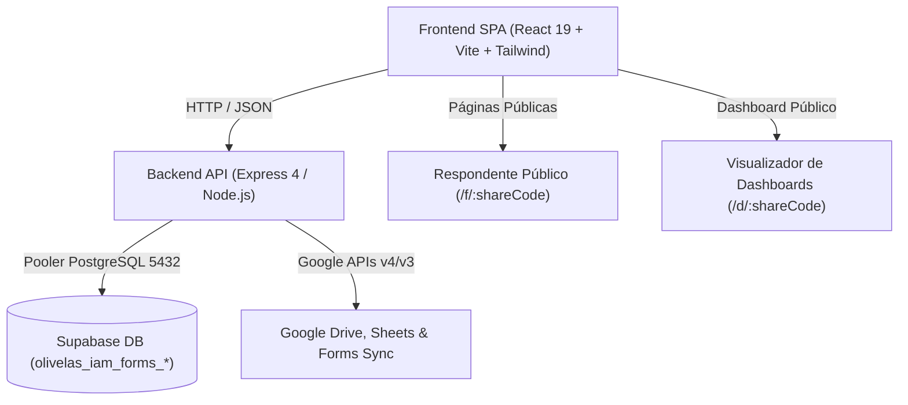

# Olivelas IAM Forms · Documentação Técnica

<!-- section: cabecalho -->
| Metadado | Detalhe |
| :--- | :--- |
| **Sistema** | Olivelas IAM Forms (Enterprise Forms, IAM/HBAC & Analytics Engine) |
| **Público-alvo** | Engenheiros de Software, DevOps, Arquitetos e Desenvolvedores Frontend/Backend |
| **Escopo** | Arquitetura técnica, modelo de dados relacional, APIs REST, motor de 30 temas, validações de alta precisão e integrações com o ecossistema Google |
| **Documentação Irmã** | [Olivelas IAM Forms · Documentação de Negócio](olivelas-iam-forms-negocio.md) |
| **Versão** | 1.0.0 |
| **Ambiente de Dados** | Supabase PostgreSQL 17.11 (Pooler ca-central-1) |
| **Prefixo de Tabelas** | `olivelas_iam_forms_` |

---

<!-- section: visao-geral -->
## 1. Visão Geral

O **Olivelas IAM Forms** é uma plataforma corporativa completa de criação, distribuição e análise de formulários dinâmicos inspirada na agilidade do Google Forms, porém com recursos essenciais para ambientes corporativos regulados e complexos:

1. **Gestão de Identidades e Acessos (IAM & HBAC)**: Usuários com papéis globais (`admin`, `creator`, `viewer`), grupos departamentais e permissões granulares por formulário (Proprietário, Editor de perguntas e Visualizador de respostas convidado por e-mail).
2. **Campos de Alta Precisão**: Validação de números inteiros puros (rejeição de casas decimais), números quebrados/decimais com controle de precisão e limites, blocos puramente informativos (sem caixa de digitação), uploads de arquivos com prévia instantânea, ratings com estrelas, switches e seleções dinâmicas.
3. **Dashboards Interativos em Tempo Real**: Construtor completo de gráficos (Pizza, Donut, Barras Verticais, Barras Horizontais, Linhas e Cartões de KPI) integrados a respostas ou importações externas.
4. **Integrações com Google**: Sincronização direta com Google Sheets (inserção de linhas em tempo real), Google Drive (upload seguro) e importador de pesquisas legadas do Google Forms.
5. **Motor de 30 Temas Visuais & 3 Idiomas**: Paleta selecionada com 30 identidades visuais de alta fidelidade e suporte nativo a Português (PT-BR), Inglês (EN) e Espanhol (ES).



---

<!-- section: estrutura -->
## 2. Estrutura do Repositório & Camadas

A arquitetura adota separação limpa entre cliente React SPA e servidor de API Express integrado, além de scripts automatizados de migração e sementes:

```
olivelas-iam-forms/
├── scripts/
│   ├── run-migrations.ts       # Runner de migrações DDL conectado ao Supabase
│   ├── seed.ts                 # Semente com usuários, grupos, formulários e dashboard demo
│   └── find-region.ts          # Utilitário de descoberta de pooler AWS
├── src/
│   ├── i18n/                   # Sistema multi-idioma (PT-BR, EN, ES)
│   ├── layouts/                # DashboardLayout com alternador de temas e persona
│   ├── lib/                    # Cliente de API centralizado (api.ts)
│   ├── pages/                  # Telas completas da aplicação
│   │   ├── LandingPage.tsx
│   │   ├── LoginPage.tsx
│   │   ├── DashboardOverviewPage.tsx
│   │   ├── FormsListPage.tsx
│   │   ├── FormBuilderPage.tsx
│   │   ├── FormResponsesPage.tsx
│   │   ├── PublicFormPage.tsx
│   │   ├── DashboardsListPage.tsx
│   │   ├── DashboardBuilderPage.tsx
│   │   ├── PublicDashboardPage.tsx
│   │   ├── UsersManagementPage.tsx
│   │   ├── GroupsManagementPage.tsx
│   │   ├── ApiTokensPage.tsx
│   │   ├── GoogleIntegrationsPage.tsx
│   │   └── AuditLogsPage.tsx
│   ├── routes/                 # Roteador central React Router v7
│   ├── server/                 # Backend API em Express + Node
│   │   ├── db.ts               # Pool de conexão PostgreSQL
│   │   ├── index.ts            # Entrypoint do servidor na porta 3001
│   │   ├── routes/             # Endpoints modulares (auth, users, forms, etc.)
│   │   └── services/google.ts  # Serviço de integração Google Drive/Sheets/Forms
│   ├── stores/                 # Gerenciamento de autenticação e RBAC
│   ├── types/                  # Definições centrais em TypeScript
│   └── utils/themes.ts         # Catálogo completo dos 30 temas visuais
├── supabase/
│   └── migrations/             # Scripts SQL com prefixo olivelas_iam_forms_
├── .env                        # Credenciais de conexão Supabase
├── index.html                  # HTML entrypoint
├── package.json                # Dependências e scripts
├── tailwind.config.js          # Configuração Tailwind e cores variáveis
└── vite.config.ts              # Configuração Vite com proxy reverso /api
```

---

<!-- section: modelo-de-dados -->
## 3. Modelo de Dados

Todas as 13 tabelas do sistema foram criadas com o prefixo obrigatório **`olivelas_iam_forms_`** para garantir total isolamento de esquemas existentes no Supabase:

| Tabela | Finalidade | Chave Primária | Relacionamentos Principais |
| :--- | :--- | :--- | :--- |
| `olivelas_iam_forms_users` | Gestão de identidades, credenciais e papéis globais | UUID (`id`) | 1:N com grupos, formulários e tokens |
| `olivelas_iam_forms_groups` | Grupos organizacionais e departamentais | UUID (`id`) | 1:N com user_groups |
| `olivelas_iam_forms_user_groups` | Associação HBAC entre usuários e grupos | Composta (`user_id`, `group_id`) | N:N users e groups |
| `olivelas_iam_forms_forms` | Cabeçalho e configurações dos formulários | UUID (`id`) | Pertence a `users` (`owner_id`) |
| `olivelas_iam_forms_fields` | Perguntas e elementos dos formulários | UUID (`id`) | Pertence a `forms` (`form_id`) |
| `olivelas_iam_forms_collaborators` | Permissões granulares de editores/visualizadores por e-mail | UUID (`id`) | Pertence a `forms` e referência `users` |
| `olivelas_iam_forms_responses` | Cabeçalho de submissões de respondentes | UUID (`id`) | Pertence a `forms` |
| `olivelas_iam_forms_answers` | Respostas atômicas por campo | UUID (`id`) | Pertence a `responses` e `fields` |
| `olivelas_iam_forms_dashboards` | Painéis analíticos interativos | UUID (`id`) | Pertence a `users` e `forms` |
| `olivelas_iam_forms_dashboard_widgets` | Gráficos (Pizza, Linha, Barras, Métricas) | UUID (`id`) | Pertence a `dashboards` |
| `olivelas_iam_forms_api_tokens` | Tokens Bearer HBAC com hash SHA-256 e escopos | UUID (`id`) | Pertence a `users` |
| `olivelas_iam_forms_google_integrations` | Credenciais e status de Drive, Sheets e Forms | UUID (`id`) | Pertence a `users` |
| `olivelas_iam_forms_audit_logs` | Trilha de auditoria e conformidade de ações | UUID (`id`) | Referência opcional a `users` |

---

<!-- section: abstracao-central -->
## 4. Abstração Central & Controle de Acesso (HBAC)

### 4.1 Hierarquia de Papéis
1. **Administrador Global (`admin`)**: Possui controle irrestrito sobre todos os formulários, gerenciamento de usuários, grupos, auditoria, configurações e geração de tokens.
2. **Criador (`creator`)**: Cria e gerencia seus próprios formulários e dashboards, convida colaboradores por e-mail para seus forms e consulta respostas.
3. **Visualizador (`viewer`)**: Possui acesso restrito de leitura aos formulários ou relatórios onde foi expressamente incluído.

### 4.2 Colaboração Granular em Formulários
O proprietário de qualquer formulário pode conceder permissões a outros usuários informando seu e-mail:
- **`editor`**: Pode alterar o título, adicionar, reordenar ou remover perguntas e opções, além de visualizar e gerenciar respostas.
- **`viewer`**: Pode apenas visualizar o histórico e o relatório analítico das respostas, sem permissão de alteração estrutural nas perguntas.

---

<!-- section: interface -->
## 5. Interface Exposta & API Endpoints

A API opera sob o prefixo `/api` e suporta autenticação por cabeçalho `x-user-email` para a sessão da aplicação web ou `Authorization: Bearer <token>` para clientes externos.

### 5.1 Endpoints Principais
| Método | Endpoint | Papel Mínimo | Descrição |
| :--- | :--- | :--- | :--- |
| `POST` | `/api/auth/login` | Público | Autenticação por e-mail e senha ou troca rápida demo |
| `GET` | `/api/auth/me` | Autenticado | Retorna dados e permissões do usuário logado |
| `GET` | `/api/forms` | Autenticado | Lista formulários com cálculo de papel (`owner`, `editor`, `viewer`) |
| `POST` | `/api/forms` | Creator / Admin | Cria novo formulário com configurações e tema inicial |
| `GET` | `/api/forms/:id` | Editor / Viewer | Obtém estrutura completa do formulário, perguntas e colaboradores |
| `PUT` | `/api/forms/:id` | Owner / Editor | Atualiza configurações, senha, expiração ou tema do form |
| `DELETE` | `/api/forms/:id` | Owner / Admin | Exclui o formulário e suas respostas vinculadas |
| `GET` | `/api/forms/public/:shareCode`| Público | Retorna perguntas para o respondente público |
| `POST` | `/api/forms/:id/responses` | Público | Submete uma resposta com validações rigorosas |
| `GET` | `/api/forms/:id/responses` | Viewer / Editor | Lista todas as respostas submetidas com respostas mapeadas |
| `GET` | `/api/forms/:id/responses/export/csv` | Viewer / Editor | Exporta planilha CSV compatível com Excel e Google Sheets |
| `POST` | `/api/forms/:id/collaborators` | Owner / Admin | Convida colaborador por e-mail como `editor` ou `viewer` |
| `GET` | `/api/dashboards` | Autenticado | Lista dashboards criados |
| `GET` | `/api/dashboards/public/:shareCode`| Público | Acesso aos gráficos e widgets de dashboard compartilhado |
| `POST` | `/api/tokens` | Admin / Creator | Gera novo token de API com escopos HBAC |
| `POST` | `/api/google/sync-sheets` | Autenticado | Sincroniza respostas de um formulário para o Google Sheets |
| `POST` | `/api/google/import-form` | Autenticado | Converte pesquisa do Google Forms em formulário Olivelas |

---

<!-- section: regras -->
## 6. Motor de Regras & Validação de Campos

O sistema valida dinamicamente os tipos de campos na submissão de respostas (`POST /api/forms/:id/responses`):

| Tipo | Chave | Regra de Validação | Exemplo Válido | Exemplo Inválido |
| :--- | :--- | :--- | :--- | :--- |
| **Texto Curto** | `text` | Limite de caracteres e regex opcional | "Maria Silva" | Vazio (se obrigatório) |
| **Texto Longo** | `textarea` | Até 4.000 caracteres | "Relato detalhado..." | Vazio (se obrigatório) |
| **Número Inteiro** | `integer` | Rejeita terminantemente vírgulas e pontos decimais; valida limites `min` e `max` | `42` | `42.5` ou `"42,1"` |
| **Número Quebrado** | `decimal` | Aceita decimais com controle de passo (`step`) e precisão de casas | `3.14` ou `"7,5"` | `"abc"` |
| **Seleção Única** | `radio` | Deve coincidir com uma das opções configuradas | "Presencial" | "Opção Inexistente" |
| **Múltipla Seleção** | `checkbox`| Array de strings correspondente às opções cadastradas | `["Google Drive", "Meet"]` | Não-array |
| **Lista Suspensa** | `dropdown`| String contida na lista de opções | "Hub Tech" | Opção fora da lista |
| **Bloco Informativo**| `info_text`| Campo sem entrada de dados; apenas renderização de texto e avisos | — | — |
| **Upload de Imagem** | `file_upload`| Checagem de MIME type (PNG, JPG, WEBP, PDF) e tamanho máximo (até 10MB) | Base64 ou buffer | Executáveis `.exe` |
| **Avaliação Estrelas**| `rating` | Inteiro de 1 a 5 (ou 1 a 10) | `5` | `6` |
| **Interruptor** | `switch` | Booleano `true` ou `false` | `true` | `"talvez"` |

---

<!-- section: integracoes -->
## 7. Integrações Externas

### 7.1 Google Drive & Google Sheets
Baseado no padrão funcional do projeto `olivelas-gdrive-sync`, a classe `GoogleIntegrationService` utiliza o SDK oficial `googleapis`:
- **Google Sheets**: A cada novo envio de resposta, o serviço pode registrar automaticamente os valores na planilha vinculada através do método `spreadsheets.values.append`.
- **Google Drive**: Realiza upload de imagens e anexos corporativos diretamente para pastas gerenciadas na conta de serviço ou OAuth.
- **Google Forms Import**: Lê o esquema de formulários do Google e gera automaticamente os campos correspondentes no Olivelas IAM Forms.

---

<!-- section: configuracao -->
## 8. Configuração & Variáveis de Ambiente

As configurações sensíveis ficam no arquivo `.env` na raiz do projeto:

```env
# Conexão direta com Supabase PostgreSQL
host=aws-0-ca-central-1.pooler.supabase.com
port=5432
database=postgres
user=postgres.pkbjoxzqllextmtmjoia
password=YOUR_DATABASE_PASSWORD_HERE

# Chaves REST Supabase
VITE_SUPABASE_URL=https://pkbjoxzqllextmtmjoia.supabase.co
VITE_SUPABASE_ANON_KEY=YOUR_SUPABASE_ANON_KEY
SUPABASE_SECRET_KEY=YOUR_SUPABASE_SERVICE_ROLE_KEY

# Configurações de Porta do Servidor
SERVER_PORT=3001
```

---

<!-- section: execucao-local -->
## 9. Execução Local & Operação

### 9.1 Instalação e Execução Simultânea
```bash
# Instalar pacotes
npm install

# Executar migração do banco de dados (criação das tabelas com prefixo olivelas_iam_forms_)
npm run db:migrate

# Executar semente de dados inicial (Usuários, grupos, formulário censo e dashboard)
npm run db:seed

# Executar servidor backend (porta 3001) e cliente Vite (porta 5173) simultaneamente
npm run dev
```

### 9.2 Build de Produção
```bash
npm run build
```
O build estático é compilado em `dist/`, pronto para hospedagem ou entrega CDN.

---

<!-- section: glossario -->
## 10. Glossário
- **IAM**: *Identity and Access Management* — Controle de identidades corporativas e senhas.
- **HBAC**: *Host/Hierarchical Based Access Control* — Controle hierárquico e baseado em grupos e escopos.
- **RBAC**: *Role-Based Access Control* — Controle de acessos baseado em perfis (Admin, Criador, Visualizador).
- **Share Code**: Código exclusivo alfanumérico curto utilizado para compartilhamento de formulários (`/f/:shareCode`) e dashboards (`/d/:shareCode`).
