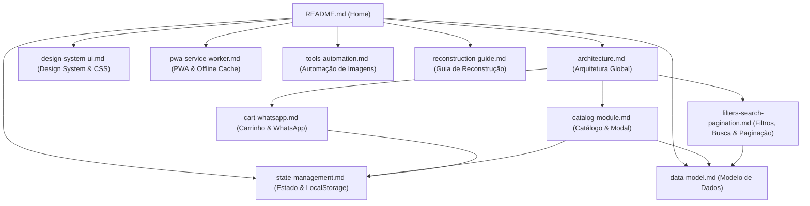

# PB&Cia — Documentação Técnica & Base de Conhecimento

Bem-vindo à documentação oficial e base de conhecimento arquitetural do sistema **PB&Cia (Pão de Batata & Cia)**.

Esta documentação foi estruturada no formato de **Wiki Técnica Navegável**, permitindo que engenheiros de software, arquitetos e agentes de IA compreendam, mantenham, estendam ou reconstruam este sistema do zero com fidelidade absoluta.

---

## 🗺️ Mapa de Navegação da Wiki

---

## 📚 Índice por Assunto

| Documento | Descrição |
| :--- | :--- |
| [**1. Arquitetura Global**](architecture.md) | Visão geral do sistema, paradigma Jamstack/Zero-Backend, ciclo de vida da aplicação e orquestração em `app.js`. |
| [**2. Modelo de Dados**](data-model.md) | Estrutura de `data/produtos.json`, tipos TypeScript, dicionário de campos, chaves compostas e inventário de categorias. |
| [**3. Gerenciamento de Estado**](state-management.md) | Persistência em `localStorage`, resiliência a favoritos órfãos, controle de tema claro/escuro e schemas de armazenamento. |
| [**4. Módulo de Catálogo & Modal**](catalog-module.md) | Engenharia de `catalog.js` e `modal.js`, renderização de cards, skeletons de carregamento e deep linking via URL. |
| [**5. Filtros, Busca & Paginação**](filters-search-pagination.md) | Mecanismo de busca sem acentos (NFD), slider de faixa de preço, ordenação e algoritmo de paginação em grade completa. |
| [**6. Carrinho & WhatsApp**](cart-whatsapp.md) | Fluxo do carrinho em `cart.js`, gaveta lateral animada, cálculo de subtotais e formatação de mensagens para `whatsapp.js`. |
| [**7. Design System & UI**](design-system-ui.md) | Tokens CSS em `variables.css`, temas Light/Dark, estrutura de layout, componentes e breakpoints responsivos. |
| [**8. PWA & Service Worker**](pwa-service-worker.md) | Estratégia de cache híbrida em `sw.js` (Cache-First + Network-First), manifesto PWA e contingência offline. |
| [**9. Ferramentas & Automação**](tools-automation.md) | CLI de download de imagens no Openverse (`fetch-images.mjs`), validação binária por magic numbers e atribuição CC. |
| [**10. Guia de Reconstrução do Zero**](reconstruction-guide.md) | Passo a passo para recriar o projeto do zero, checklist funcional, contratos de interfaces e catálogo de workarounds. |
| [**11. Registro de Sessão & Prompts**](ai-reverse-engineering-session.md) | Histórico de prompts executados, diretrizes de engenharia reversa e dossiê inicial compilado. |

---

## ⚡ Princípios Fundamentais do Projeto

1. **Zero-Backend:** Execução 100% no navegador (Client-Side) com dados alimentados por arquivo JSON estático.
2. **Vanilla ES Modules:** Código modular nativo sem necessidade de ferramentas de build (Webpack/Vite/Babel).
3. **Resiliência Offline:** Funciona sem internet através de Service Worker com fallback para `offline.html`.
4. **Checkout Assistido:** Conversão de itens do carrinho em mensagens de texto pré-formatadas para o WhatsApp Comercial.
