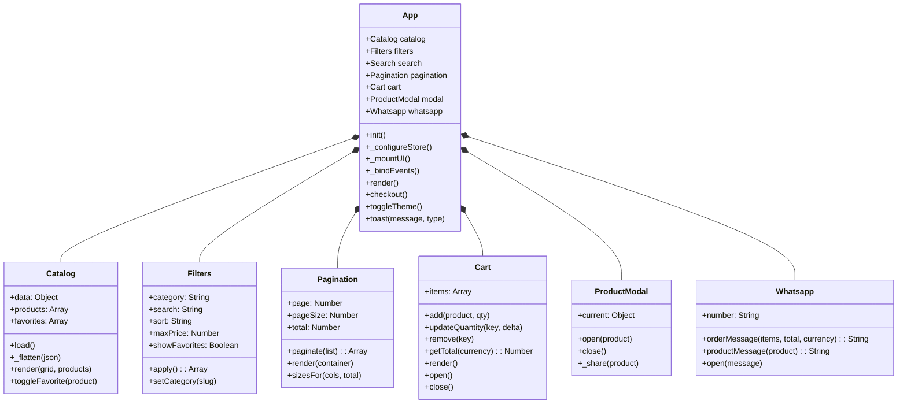
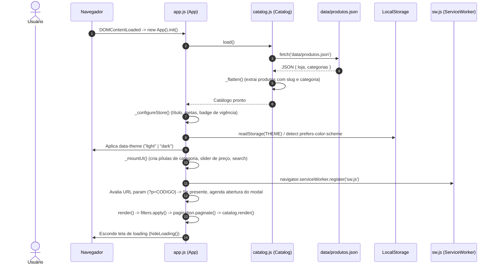

# Arquitetura Global do Sistema

## 🎯 Objetivo
Este documento especifica a arquitetura estrutural de alto nível da aplicação **PB&Cia**, detalhando os princípios de design de software adotados, os limites do sistema, o ciclo de vida do bootstrap da aplicação e como a classe orquestradora `App` inicializa e sincroniza todos os subsistemas no navegador.

---

## 🌐 Visão Geral

O PB&Cia é uma aplicação web do tipo **Single Page Application (SPA)** estática (Jamstack / Zero-Backend) e **Progressive Web App (PWA)** voltada para catálogo de produtos alimentícios e pedidos via WhatsApp.

### Características Arquiteturais Centrais
- **Sem Backend Dinâmico:** Não há servidores de aplicação (Node/PHP/Python) ou bancos de dados relacionais em runtime. Toda a fonte da verdade reside no arquivo estático [`data/produtos.json`](data-model.md).
- **Vanilla ES Modules:** Utiliza módulos JavaScript nativos suportados diretamente pelos navegadores modernos (`<script type="module" src="assets/js/app.js">`). Não há etapa de compilação ou empacotamento com Webpack/Vite.
- **Client-Side State:** O estado do usuário (carrinho de compras, produtos favoritos, tema visual ativo) é gerenciado na memória da sessão e persistido no `localStorage` do navegador.
- **Service Worker Caching:** Estratégia de cache híbrida que permite navegação offline completa e instalação como aplicativo móvel ou desktop.

---

## 🧩 Responsabilidades dos Módulos



| Módulo / Arquivo | Responsabilidade Primária |
| :--- | :--- |
| [`app.js`](../assets/js/app.js) | **Orquestrador Central:** Carrega o catálogo, inicializa instâncias de classes, vincula eventos globais do DOM, gerencia deep linking (`?p=...`), toasts e tema. |
| [`catalog.js`](catalog-module.md) | **Modelo de Dados & Renderização de Grid:** Carrega o JSON, achata categorias em produtos, cria cards, trata erros de imagem e gerencia favoritos. |
| [`filters.js`](filters-search-pagination.md) | **Pipeline de Filtragem:** Combina filtros de categoria, busca textual sem acentos, faixa de preço, ordenação e filtro de favoritos. |
| [`pagination.js`](filters-search-pagination.md) | **Cálculo de Paginação Inteligente:** Fatie a lista de produtos exibindo múltiplos das colunas CSS visíveis. |
| [`search.js`](filters-search-pagination.md) | **Busca com Debounce:** Captura digitação no input do header e aciona o pipeline de filtros com atraso de 250ms. |
| [`cart.js`](cart-whatsapp.md) | **Gerenciador de Carrinho:** Adiciona/remove itens, calcula subtotais e volumes, abre/fecha a gaveta lateral. |
| [`modal.js`](catalog-module.md) | **Modal de Detalhes:** Apresenta ficha técnica do produto, aciona compartilhamento nativo e deep link. |
| [`whatsapp.js`](cart-whatsapp.md) | **Formatador de Pedidos:** Gera mensagens padronizadas em texto para a API do WhatsApp. |
| [`utils.js`](../assets/js/utils.js) | **Helpers Compartilhados:** Funções de DOM (`el`, `$`), storage seguro, escape HTML, formatação monetária e normalização de texto. |

---

## 🔄 Fluxo Interno de Inicialização (Bootstrap Sequence)

Quando o documento HTML é carregado, o script `app.js` é executado no evento `DOMContentLoaded`.



---

## 🔗 Relação com Outros Módulos

- **Consome dados de:** [`data-model.md`](data-model.md) para popular o estado da loja.
- **Persiste estado em:** [`state-management.md`](state-management.md) para salvar preferências.
- **Estilizado por:** [`design-system-ui.md`](design-system-ui.md) através das classes CSS declaradas no DOM.
- **Cached por:** [`pwa-service-worker.md`](pwa-service-worker.md) para permitir inicialização offline.

---

## 💻 Exemplo de Código do Ponto de Entrada (`app.js`)

```javascript
// Trecho de inicialização do ciclo de vida em assets/js/app.js
document.addEventListener('DOMContentLoaded', () => {
  const app = new App();
  app.init();
  // Expõe a instância no escopo global para depuração ou testes
  window.__app = app;
});
```

---

## 📖 Referências Cruzadas
- [Modelo de Dados & Esquema JSON](data-model.md)
- [Gerenciamento de Estado & LocalStorage](state-management.md)
- [Módulo de Catálogo & Modal](catalog-module.md)
- [Filtros, Busca & Paginação](filters-search-pagination.md)
- [Carrinho & Integração WhatsApp](cart-whatsapp.md)
- [PWA & Service Worker](pwa-service-worker.md)
