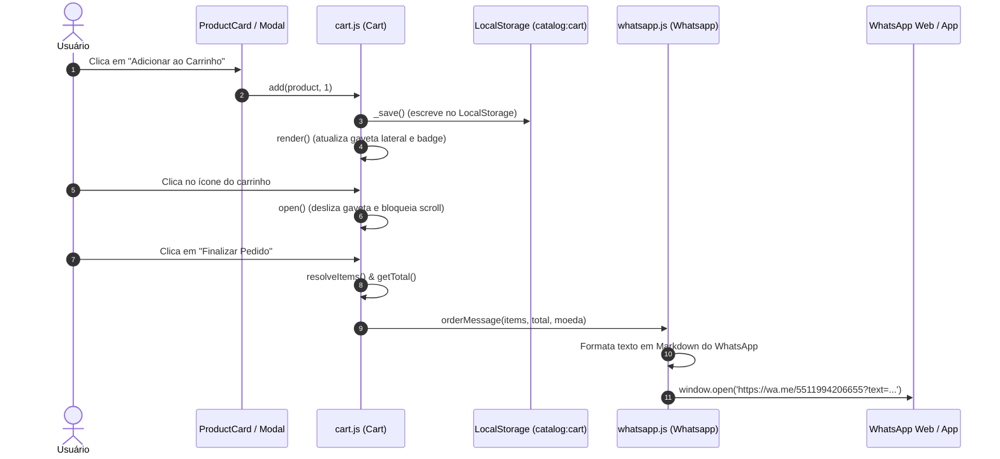

# Carrinho de Compras & Integração WhatsApp

## 🎯 Objetivo
Este documento detalha o subsistema transacional do sistema **PB&Cia**, composto pela classe `Cart` (em [`assets/js/cart.js`](../assets/js/cart.js)) e pela classe `Whatsapp` (em [`assets/js/whatsapp.js`](../assets/js/whatsapp.js)), descrevendo a gestão de itens no carrinho, cálculo dinâmico de subtotais e volumes, controle da gaveta lateral animada e geração de mensagens estruturadas para checkout via WhatsApp.

---

## 🌐 Visão Geral

O fluxo de checkout é do tipo **Checkout Assistido / Conversacional**. Em vez de exigir gateway de pagamento online, cartões de crédito ou autenticação de usuário, o carrinho consolida os itens escolhidos e gera uma mensagem formatada que é aberta diretamente no aplicativo oficial do WhatsApp com o número comercial da PB&Cia.



---

## 🛒 Detalhamento da Classe `Cart` (`cart.js`)

### 1. Estrutura de Métodos

| Método | Assinatura | Descrição |
| :--- | :--- | :--- |
| `add` | `add(product, quantity = 1)` | Incrementa a quantidade se o produto já existir no carrinho ou insere um novo registro `{ key, code, quantity }`. |
| `updateQuantity` | `updateQuantity(key, delta)` | Ajusta a quantidade por $\pm 1$, garantindo o limite mínimo de 1 unidade. |
| `remove` | `remove(key)` | Remove o item especificado do carrinho e re-renderiza. |
| `clear` | `clear()` | Esvazia todos os itens do carrinho e persiste o estado. |
| `getCount` | `getCount(): number` | Retorna a soma de todas as unidades de pacotes selecionadas. |
| `getTotal` | `getTotal(currency): number` | Calcula o somatório financeiro: $\sum (\text{precoPacote} \times \text{quantidade})$. |
| `resolveItems` | `resolveItems(): Array` | Faz o join em memória dos itens do carrinho com os objetos de produto atualizados do catálogo. |

### 2. Badge de Contagem no Cabeçalho
O contador numérico no botão do carrinho no topo da página é atualizado pelo método `updateBadge`:
- Exibe `'0'` quando vazio;
- Exibe o número exato até `99`;
- Exibe `'99+'` para quantidades iguais ou superiores a 100.

---

## 📱 Detalhamento da Classe `Whatsapp` (`whatsapp.js`)

### 1. Higienização do Número de Telefone
O construtor remove quaisquer caracteres que não sejam dígitos numéricos:
```javascript
constructor(number) {
  this.number = String(number).replace(/[^\d]/g, '');
}
```

---

### 2. Formatação de Mensagens

#### A. Pedido Completo do Carrinho (`orderMessage`)
Gera uma lista numerada contendo o nome do produto, código, quantidade de pacotes e o total estimado formatado em padrão monetário brasileiro:

```javascript
orderMessage(items, total, currency = 'BRL') {
  let msg = ['Olá!', '', 'Gostaria de realizar o seguinte pedido:', ''];

  items.forEach((item, i) => {
    msg.push(`${i + 1}. ${item.product.nome}`);
    msg.push(`   Código: ${item.product.codigo}`);
    msg.push(`   Quantidade: ${item.quantity}`);
    msg.push('');
  });

  msg.push(`Total estimado: ${formatBRL(total, currency)}`);
  msg.push('');
  msg.push('Gostaria de confirmar o pedido.');

  return msg.join('\n');
}
```

##### Exemplo de Mensagem Gerada
```text
Olá!

Gostaria de realizar o seguinte pedido:

1. Pão de Batata Sem Recheio
   Código: 00006
   Quantidade: 2

2. Pão Tipo Croissant 4 Queijos
   Código: 00097
   Quantidade: 1

Total estimado: R$ 129,00

Gostaria de confirmar o pedido.
```

---

#### B. Consulta de Produto Individual (`productMessage`)
Utilizada para orçamentos ou dúvidas diretas de um item específico:

```text
Olá!

Tenho interesse no seguinte produto:

Nome: Pão de Batata Frango c/ Requeijão
Código: 00039
Peso: 130 g
R$ 50,50
Quantidade por pacote: 10

Gostaria de mais informações.
```

---

### 3. Disparo via URL `wa.me`
O método `open(message)` codifica o texto via `encodeURIComponent` e abre a janela em aba independente:

```javascript
open(message) {
  const url = `https://wa.me/${this.number}?text=${encodeURIComponent(message)}`;
  window.open(url, '_blank', 'noopener,noreferrer');
  return url;
}
```

---

## 📖 Referências Cruzadas
- [Arquitetura Global](architecture.md)
- [Modelo de Dados](data-model.md)
- [Gerenciamento de Estado](state-management.md)
- [Design System & Estilização do Carrinho](design-system-ui.md)
