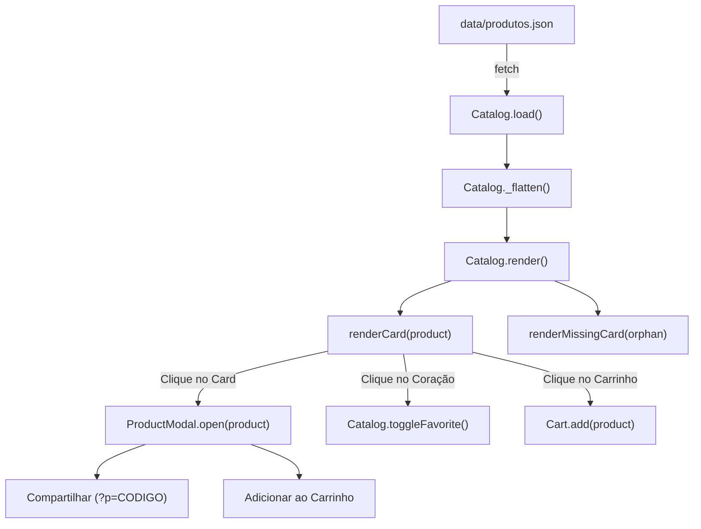

# Módulo de Catálogo & Modal de Produto

## 🎯 Objetivo
Este documento descreve a engenharia dos módulos de visualização de produtos: a classe `Catalog` (em [`assets/js/catalog.js`](../assets/js/catalog.js)) e a classe `ProductModal` (em [`assets/js/modal.js`](../assets/js/modal.js)), cobrindo a renderização do grid, estados de carregamento (skeletons), tratamento de imagens quebradas e *deep linking* via URL.

---

## 🌐 Visão Geral

O catálogo é o núcleo visual da aplicação. Ele transforma os dados JSON brutos em cartões interativos no DOM e gerencia o diálogo modal de detalhes do produto.



---

## 🧩 Detalhamento da Classe `Catalog` (`catalog.js`)

### 1. Achatamento de Categorias (`_flatten`)
Os produtos chegam aninhados sob suas respectivas categorias. O método `_flatten` cria uma lista única com atributos injetados:

```javascript
_flatten(json) {
  this.products = [];
  json.categorias.forEach((cat) => {
    cat.produtos.forEach((p) => {
      this.products.push({
        ...p,
        categoria: cat.categoria,
        categoriaSlug: cat.slug,
      });
    });
  });
}
```

### 2. Tratamento Resiliente de Imagens Quebradas
Se a URL de uma imagem apontar para um arquivo inexistente ou falhar na rede, a tag `` dispara o evento `error`.  
Para evitar loops infinitos de erro ou cartões vazios quebrados:
1. O listener intercepta o erro;
2. Verifica se o produto já foi registrado no `Set` de `this.placeholders`;
3. Substitui o elemento pelo placeholder local ultra-leve `assets/images/placeholder.webp`:

```javascript
if (product.imagem) {
  img.addEventListener('error', () => {
    if (!this.placeholders.has(key)) {
      this.placeholders.add(key);
      img.replaceWith(this._placeholderEl());
    }
  });
}
```

### 3. Skeletons de Carregamento (`renderSkeletons`)
Enquanto a requisição inicial ocorre, o grid exibe 8 cartões animados simulando a estrutura visual com gradientes pulsantes em CSS:

```javascript
renderSkeletons(grid, count = 8) {
  const frag = document.createDocumentFragment();
  for (let i = 0; i < count; i++) {
    frag.appendChild(el('div', { class: 'skeleton-card' }, [
      el('div', { class: 'skeleton-card__image' }),
      el('div', { class: 'skeleton-card__body' }, [
        el('div', { class: 'skeleton-line skeleton-line--sm' }),
        el('div', { class: 'skeleton-line skeleton-line--lg' }),
        el('div', { class: 'skeleton-line skeleton-line--md' }),
        el('div', { class: 'skeleton-line skeleton-line--lg' }),
      ]),
    ]));
  }
  grid.innerHTML = '';
  grid.appendChild(frag);
}
```

---

## 🔍 Detalhamento da Classe `ProductModal` (`modal.js`)

### 1. Estrutura do Modal
O modal é renderizado dinamicamente dentro de `.product-modal`, contendo:
- Imagem ampliada em alta resolução;
- Tag da categoria;
- Nome completo e código identificador;
- Preço destacado em tipografia de 24px/32px;
- Ficha técnica (peso individual, quantidade de unidades por pacote);
- Botão primário para adicionar ao carrinho;
- Botão secundário para compartilhar.

### 2. Acessibilidade e Bloqueio de Scroll
Ao abrir o modal:
- A classe `.active` é adicionada ao overlay e à caixa modal com efeito de escala (*scale(1)* e *fade-in*);
- O scroll da página principal é travado com `document.body.style.overflow = 'hidden'`;
- Listeners de tecla `Escape` e clique no overlay fecham o diálogo e restauram o scroll.

### 3. Deep Linking & Compartilhamento Social
O método `_share(product)` gera uma URL apontando para a página com o parâmetro de busca `?p=CODIGO`:

$$\text{URL} = \text{location.origin} + \text{location.pathname} + \text{"?p="} + \text{encodeURIComponent(product.codigo)}$$

Quando qualquer usuário acessa o site por este link direto, o método `App.init()` detecta o parâmetro e abre automaticamente a ficha técnica do produto correspondente após o carregamento inicial.

```javascript
_share(product) {
  const loja = this.catalog.getLoja();
  const url = `${location.origin}${location.pathname}?p=${encodeURIComponent(product.codigo)}`;
  const text = `${loja.nome} - ${product.nome} - ${formatCurrency(product.precoPacote, loja.moeda)}`;
  shareProduct(text, url);
}
```

---

## 📖 Referências Cruzadas
- [Modelo de Dados & Esquema JSON](data-model.md)
- [Gerenciamento de Estado](state-management.md)
- [Filtros, Busca & Paginação](filters-search-pagination.md)
- [Design System & Estilização do Modal](design-system-ui.md)
