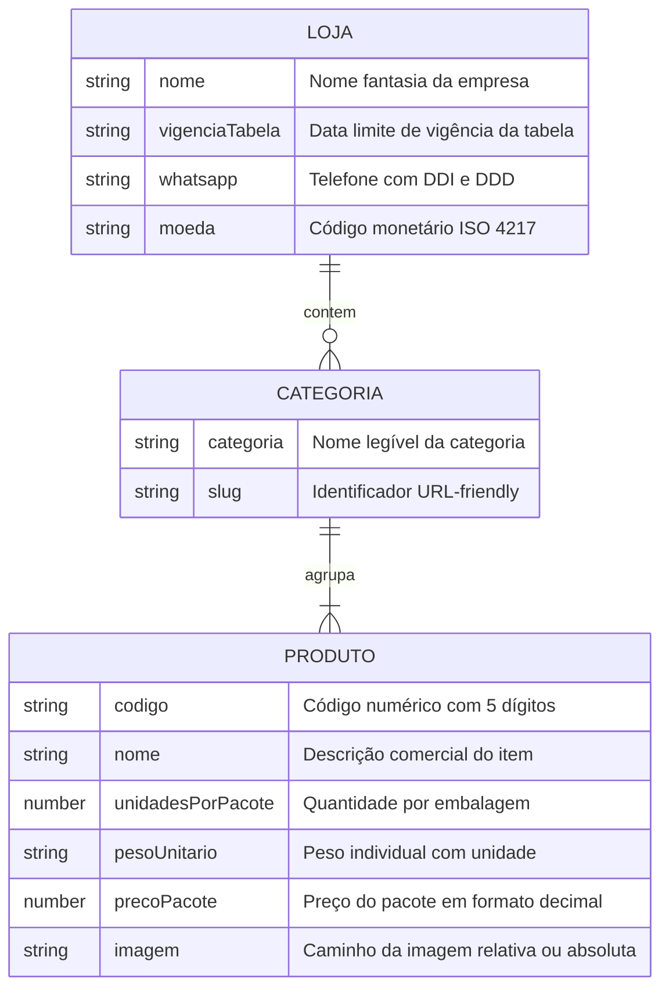

# Modelo de Dados & Esquema JSON

## 🎯 Objetivo
Este documento define o modelo de dados estático utilizado pelo sistema **PB&Cia**, documentando o esquema estrutural do arquivo [`data/produtos.json`](../data/produtos.json), os tipos de dados, as regras de unicidade de chave primária composta, o histórico de alterações e o processo de achatamento (*flattening*) realizado em tempo de execução.

---

## 🌐 Visão Geral

O sistema utiliza um modelo de dados centrado em um arquivo JSON estático versionado junto com o código-fonte. Esse documento é lido via requisição HTTP (`fetch`) no momento do carregamento da aplicação e mantido em memória no objeto singleton `Catalog`.



---

## 📋 Especificação Formal do Esquema (TypeScript Interfaces)

```typescript
/**
 * Metadados institucionais da loja e vigência da tabela de preços
 */
export interface StoreMetadata {
  /** Nome comercial exibido no Header, Hero, Meta tags e mensagens de WhatsApp */
  nome: string;
  /** Data no formato DD/MM/YYYY que define o prazo de validade comercial dos preços */
  vigenciaTabela: string;
  /** Número de telefone no padrão internacional sem pontuação (Ex: '5511994206655') */
  whatsapp: string;
  /** Código de moeda para formatação monetária (Padrão: 'BRL') */
  moeda: 'BRL' | string;
}

/**
 * Entidade de produto bruto conforme serializada no arquivo JSON
 */
export interface RawProduct {
  /** Código identificador com preenchimento em zeros à esquerda (5 caracteres) */
  codigo: string;
  /** Nome descritivo comercial do produto */
  nome: string;
  /** Número de unidades contidas em cada pacote comercial */
  unidadesPorPacote: number;
  /** Peso individual por unidade (Ex: '100 g', '1.2 kg') */
  pesoUnitario: string;
  /** Preço total de 1 pacote em formato de ponto flutuante (Ex: 33.50) */
  precoPacote: number;
  /** Caminho relativo da imagem ou URL remota */
  imagem: string;
}

/**
 * Agrupador de categoria contendo a lista de produtos pertencentes
 */
export interface Category {
  /** Nome de exibição da categoria (Ex: 'Pão de Batata') */
  categoria: string;
  /** Slug único normalizado para identificação e navegação (Ex: 'pao-de-batata') */
  slug: string;
  /** Lista de produtos vinculados */
  produtos: RawProduct[];
}

/**
 * Estrutura raiz do arquivo data/produtos.json
 */
export interface CatalogSchema {
  loja: StoreMetadata;
  categorias: Category[];
}

/**
 * Entidade em memória após o processo de achatamento (_flatten)
 */
export interface FlattenedProduct extends RawProduct {
  /** Categoria pai associada */
  categoria: string;
  /** Slug da categoria pai associada */
  categoriaSlug: string;
}
```

---

## 🔑 Regras de Identificação e Chave Primária Composta

No segmento de panificação e distribuição de alimentos congelados, pode ocorrer de produtos com o mesmo código base serem distribuídos em categorias diferentes ou formatos promocionais distintos.

Para garantir que cada item renderizado possua um identificador único para o carrinho de compras e controle de cache de imagens, a classe `Catalog` adota a regra:

$$\text{Chave Composta} = \text{codigo} + \text{"-"} + \text{categoriaSlug}$$

### Exemplo de Resolução de Chaves
- Produto: `"Pão de Batata Sem Recheio"`, Código: `"00006"`, Categoria Slug: `"pao-de-batata"`  
  $\rightarrow$ **Key:** `"00006-pao-de-batata"`
- Produto: `"Pão de Batata Requeijão Mini"`, Código: `"00009"`, Categoria Slug: `"linha-mini-salgados-e-paes"`  
  $\rightarrow$ **Key:** `"00009-linha-mini-salgados-e-paes"`

---

## 📦 Inventário Completo de Categorias Mapeadas

O arquivo [`data/produtos.json`](../data/produtos.json) cataloga **62 produtos** divididos em **16 categorias**:

| # | Categoria | Slug | Quantidade de Itens | Exemplos de Produtos |
| :-: | :--- | :--- | :-: | :--- |
| 1 | Pão de Batata | `pao-de-batata` | 6 | Sem Recheio, 4 Queijos, Calabresa, Frango c/ Requeijão |
| 2 | Salgados Lanche | `salgados-lanche` | 2 | Pão Tipo Bauru Presunto/Queijo/Tomate, Doguinho |
| 3 | Croissant | `croissant` | 3 | 4 Queijos, Frango c/ Requeijão, Presunto e Queijo |
| 4 | Pizza Folhada | `pizza-folhada` | 3 | 4 Queijos, Calabresa, Frango c/ Requeijão |
| 5 | Salgados Fritos | `salgados-fritos` | 10 | Bolinho de Carne, Coxinha, Croquete, Kibe |
| 6 | Salgados para Assar | `salgados-para-assar` | 5 | Empadas (Frango, Palmito), Esfihas (Carne, Frango, Queijo) |
| 7 | Linha Mini Salgados e Pães | `linha-mini-salgados-e-paes` | 6 | Mini Bolinha de Queijo, Mini Coxinha, Mini Kibe |
| 8 | Empanada | `empanada` | 2 | Empanada de Carne, Empanada de Frango |
| 9 | Tortas e Quiches | `tortas-e-quiches` | 5 | Torta Frango, Torta Palmito, Quiches (Alho Poró, Espinafre) |
| 10 | Torta Grande | `torta-grande` | 2 | Torta Grande Palmito, Torta Grande Frango |
| 11 | Quadrado Folhado | `quadrado-folhado` | 3 | Frango c/ Requeijão, Misto, Queijo |
| 12 | Pão de Queijo | `pao-de-queijo` | 6 | Pão de Queijo 15g, 25g, 40g, 70g, 90g, Gourmet |
| 13 | Linha Integral | `linha-integral` | 1 | Esfiha Integral Escarola |
| 14 | Broa | `broa` | 1 | Broa Caxambu |
| 15 | Pastéis de Forno | `pasteis-de-forno` | 4 | Pastel Frango, Queijo, Carne, Palmito |
| 16 | Doce | `doce` | 3 | Mini Quindim, Mini Churros Doce de Leite, Croissant Chocolate |

---

## 🔄 Histórico de Alterações dos Dados (`produtos.json` vs `produtos.bak.json`)

Existe um arquivo de backup no projeto chamado [`data/produtos.bak.json`](../data/produtos.bak.json). A comparação técnica entre os dois arquivos revela as seguintes evoluções:

1. **Vigência da Tabela:** A vigência foi estendida de `31/07/2026` (no backup) para `31/10/2026` (na versão atual).
2. **Imagens Padrão:** No backup, o campo `"imagem"` estava vazio `""`. Na versão atual, todos os produtos foram preenchidos provisoriamente com `"assets/images/logo.png"` para garantir exibição visual consistente enquanto as fotos específicas são populadas pelas ferramentas de automação.

---

## 💻 Exemplo Real de Registro no JSON

```json
{
  "loja": {
    "nome": "PB&Cia - Pão de Batata & Cia",
    "vigenciaTabela": "31/10/2026",
    "whatsapp": "5511994206655",
    "moeda": "BRL"
  },
  "categorias": [
    {
      "categoria": "Pão de Batata",
      "slug": "pao-de-batata",
      "produtos": [
        {
          "codigo": "00006",
          "nome": "Pão de Batata Sem Recheio",
          "unidadesPorPacote": 10,
          "pesoUnitario": "100 g",
          "precoPacote": 33.5,
          "imagem": "assets/images/logo.png"
        }
      ]
    }
  ]
}
```

---

## 📖 Referências Cruzadas
- [Arquitetura Global do Sistema](architecture.md)
- [Módulo de Catálogo & Modal](catalog-module.md)
- [Gerenciamento de Estado](state-management.md)
- [Ferramental de Ingestão de Imagens](tools-automation.md)
