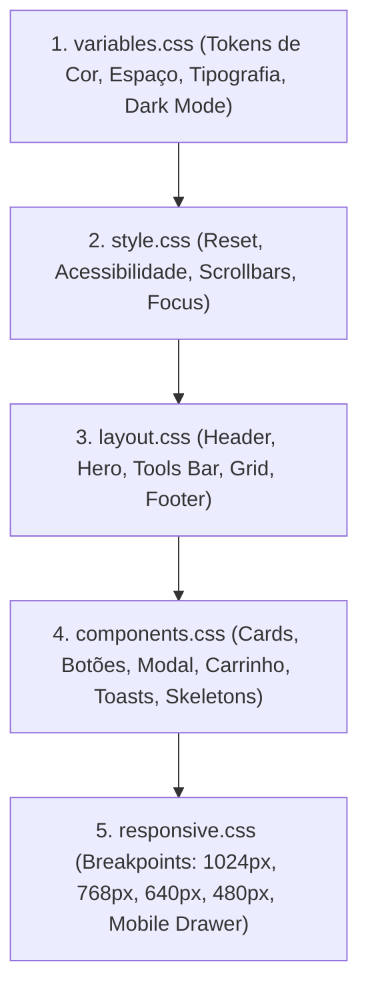

# Design System & Arquitetura Visual (CSS)

## 🎯 Objetivo
Este documento especifica a arquitetura de estilos do sistema **PB&Cia**, detalhando os tokens de design CSS em [`assets/css/variables.css`](../assets/css/variables.css), o reset e acessibilidade em [`assets/css/style.css`](../assets/css/style.css), o layout estrutural em [`assets/css/layout.css`](../assets/css/layout.css), a biblioteca de componentes visuais em [`assets/css/components.css`](../assets/css/components.css) e as regras responsivas em [`assets/css/responsive.css`](../assets/css/responsive.css).

---

## 🌐 Visão Geral

O projeto não utiliza frameworks externos como Tailwind, Bootstrap ou styled-components. O visual é inteiramente construído com **CSS Puro Moderno** estruturado em 5 camadas modulares:



---

## 🎨 Tokens de Design & Temas (`variables.css`)

### 1. Paleta de Cores e Modos de Visualização

| Token CSS | Light Mode | Dark Mode (`[data-theme="dark"]`) | Função / Aplicação |
| :--- | :---: | :---: | :--- |
| `--color-primary` | `#1a1a2e` | `#e2e8f0` | Cor de contraste principal e textos de títulos |
| `--color-secondary` | `#e94560` | `#f472b6` | Cor de destaque primária da marca (Rosa/Vermelho PB&Cia) |
| `--color-secondary-hover` | `#d63851` | `#ec4899` | Estado hover de botões primários |
| `--color-accent` | `#0f3460` | `#818cf8` | Azul profundo para detalhes secundários e toasts informativos |
| `--color-success` | `#10b981` | `#10b981` | Sucesso, botão de WhatsApp e checkout |
| `--bg-primary` | `#ffffff` | `#0f172a` | Fundo principal da página |
| `--bg-secondary` | `#f8fafc` | `#1e293b` | Fundo de cartões e inputs |
| `--bg-tertiary` | `#f1f5f9` | `#334155` | Fundo de skeletons e divisores |
| `--text-primary` | `#0f172a` | `#f1f5f9` | Cor padrão de texto de leitura |
| `--text-secondary` | `#475569` | `#94a3b8` | Textos de apoio e subtítulos |
| `--text-tertiary` | `#94a3b8` | `#64748b` | Códigos de produtos e placeholders |
| `--border-color` | `#e2e8f0` | `#334155` | Linhas de divisão de tabelas e bordas de cards |

---

### 2. Escala de Camadas (`z-index`)

Para garantir que diálogos modais, gavetas de carrinho, cabeçalhos fixos e notificações flutuantes não se sobreponham de maneira incorreta:

```css
--z-header: 100;    /* Cabeçalho fixo no topo */
--z-dropdown: 110;  /* Barra de ferramentas sticky e botão voltar ao topo */
--z-overlay: 150;   /* Backdrop blur escuro atrás de modais e drawers */
--z-cart: 190;      /* Gaveta lateral do carrinho */
--z-modal: 200;     /* Diálogo modal de detalhes de produto */
--z-toast: 300;     /* Notificações flutuantes e loading screen */
```

---

## 🏗️ Estrutura de Layout (`layout.css`)

```
+-------------------------------------------------------------------------------+
| HEADER FIXO (height: 72px, position: fixed)                                  |
| [Logo + Nome]             [Campo de Busca Central]             [Tema|Fav|Cart]|
+-------------------------------------------------------------------------------+
| HERO SECTION                                                                  |
| [Badge: Tabela Vigente] -> Título PB&Cia (Gradiente) -> Subtítulo -> [Botão]  |
+-------------------------------------------------------------------------------+
| STICKY TOOLS BAR (top: 72px)                                                  |
| [Botão Categorias Mobile]                 [Select Ordenar] [Slider de Preço]  |
+-------------------------------------------------------------------------------+
| CATALOG LAYOUT (display: grid, 260px 1fr)                                     |
| +-------------------------+ +-----------------------------------------------+ |
| | SIDEBAR (Sticky 260px)  | | CATALOG MAIN                                  | |
| | - Todos                 | | [Info Resultados]   [Select Itens por Página] | |
| | - Pão de Batata         | |                                               | |
| | - Salgados Lanche       | | PRODUCTS GRID (repeat(4, 1fr))                | |
| | - Croissant             | | [ Card ]   [ Card ]   [ Card ]   [ Card ]     | |
| | - ...                   | |                                               | |
| |                         | | PAGINATION                                    | |
| |                         | | [ < ]  [ 1 ]  [ 2 ]  [ ... ]  [ 8 ]  [ > ]    | |
| +-------------------------+ +-----------------------------------------------+ |
+-------------------------------------------------------------------------------+
| FOOTER ESCURO                                                                 |
| [Logo + Vigência]                         [CTA WhatsApp]  [Crédito: @pycriador]|
+-------------------------------------------------------------------------------+
```

---

## 📱 Breakpoints Responsivos & Transformação em Drawer (`responsive.css`)

### Comportamento da Barra Lateral de Categorias
- **Em Desktop ($> 768\text{px}$):** A barra lateral de categorias ocupa uma coluna fixa de `260px` à esquerda da grade. O botão de abrir categorias na barra sticky permanece oculto (`display: none`).
- **Em Mobile/Tablet ($\le 768\text{px}$):**
  1. A barra lateral transforma-se em um **Drawer Lateral Retrátil** (`position: fixed; transform: translateX(-110%)`);
  2. O botão "Categorias" torna-se visível na barra de ferramentas;
  3. Ao clicar no botão, o Drawer desliza para a tela (`transform: translateX(0)`) com uma camada escura de fundo (`.sidebar-overlay.active`);
  4. Quando o usuário seleciona uma categoria, o evento `onSidebarSelect` fecha a gaveta automaticamente para desobstruir a visão dos produtos.

---

## ♿ Acessibilidade & Redução de Movimento

O sistema respeita as preferências de acessibilidade declaradas pelo usuário no sistema operacional:

```css
@media (prefers-reduced-motion: reduce) {
  html {
    scroll-behavior: auto;
  }
  *,
  *::before,
  *::after {
    animation-duration: 0.01ms !important;
    transition-duration: 0.01ms !important;
  }
}
```

---

## 📖 Referências Cruzadas
- [Arquitetura Global](architecture.md)
- [Módulo de Catálogo & Cards](catalog-module.md)
- [Carrinho & Gaveta Lateral](cart-whatsapp.md)
- [PWA & Layout Offline](pwa-service-worker.md)
