# Filtros, Busca & Paginação Responsiva

## 🎯 Objetivo
Este documento detalha o subsistema de descoberta e navegação de produtos, composto pelas classes `Filters` (em [`assets/js/filters.js`](../assets/js/filters.js)), `Search` (em [`assets/js/search.js`](../assets/js/search.js)) e `Pagination` (em [`assets/js/pagination.js`](../assets/js/pagination.js)), explicando a normalização de texto sem diacríticos, o pipeline de filtragem e a regra matemática de paginação para grades visuais perfeitas.

---

## 🌐 Visão Geral

O sistema combina múltiplos filtros independentes em um pipeline síncrono que processa a lista de produtos em memória e entrega para a paginação fatiar os resultados exibidos na tela.

```mermaid
flowchart LR
    RawList["Lista Completa (62 produtos)"] --> CatFilter["1. Filtro Categoria"]
    CatFilter --> FavFilter["2. Filtro Favoritos"]
    FavFilter --> SearchFilter["3. Filtro Busca Textual (NFD)"]
    SearchFilter --> PriceFilter["4. Filtro Preço Máximo"]
    PriceFilter --> SortFilter["5. Ordenação (Sort)"]
    SortFilter --> FilteredList["Lista Filtrada"]
    
    FilteredList --> MeasureCols["_measureColumns()"]
    MeasureCols --> SizesFor["Pagination.sizesFor()"]
    SizesFor --> Paginate["Pagination.paginate()"]
    Paginate --> DOMGrid["Renderização no Grid"]
```



---

## 🔍 Mecanismo de Busca Textual (`Search` & `normalizeText`)

O campo de busca no cabeçalho dispara o evento `input` encapsulado por `debounce(fn, 250)` para evitar re-renderizações a cada tecla digitada.

### Normalização Unicode (Sem Acentos)
A função `normalizeText(text)` em `utils.js` decompõe os caracteres acentuados em sua forma canônica (NFD) e remove a faixa de diacríticos Unicode (`\u0300-\u036f`):

```javascript
export function normalizeText(text = '') {
  return String(text).normalize('NFD').replace(/[\u0300-\u036f]/g, '').toLowerCase();
}
```

A busca avalia se o termo digitado está contido no **nome do produto**, no **código de 5 dígitos** ou na **categoria**:
```javascript
if (this.search) {
  const q = normalizeText(this.search);
  list = list.filter((p) => {
    return (
      normalizeText(p.nome).includes(q) ||
      normalizeText(p.codigo).includes(q) ||
      normalizeText(p.categoria).includes(q)
    );
  });
}
```

---

## ⚙️ Pipeline de Filtragem & Ordenação (`Filters.apply()`)

O método `apply()` executa sequencialmente as 5 regras de transformação:

1. **Categoria:** Filtra por slug (ex: `'pao-de-batata'`) ou ignora caso seja `'todos'`.
2. **Favoritos:** Filtra produtos presentes na lista de favoritos e anexa itens órfãos se existirem.
3. **Busca Textual:** Aplica a correspondência normalizada.
4. **Faixa de Preço:** Filtra produtos onde `p.precoPacote <= this.maxPrice`.
5. **Critério de Ordenação:**
   - `'menor-preco'`: `a.precoPacote - b.precoPacote` (Crescente por preço)
   - `'maior-preco'`: `b.precoPacote - a.precoPacote` (Decrescente por preço)
   - `'az'`: `a.nome.localeCompare(b.nome, 'pt-BR')` (Alfabética A-Z)
   - `'za'`: `b.nome.localeCompare(a.nome, 'pt-BR')` (Alfabética Z-A)
   - `'relevancia'`: Mantém a ordenação original do catálogo JSON.

---

## 📐 Algoritmo de Paginação em Grade Completa (`Pagination`)

Um dos refinamentos visuais mais importantes do projeto é garantir que **a grade de produtos nunca termine com uma linha com apenas 1 ou 2 cartões deslocados**, mantendo sempre linhas completas.

### Cálculo Dinâmico de Opções de Tamanho de Página
O método `Pagination.sizesFor(cols, total)` gera opções de quantidade de itens por página que são múltiplos de $2 \times \text{cols}$:

$$\text{Passo (Step)} = \text{cols} \times 2$$

```javascript
static sizesFor(cols, total) {
  const step = cols * 2;
  if (!step || step < 1 || total < 1) return [Math.max(1, total)];
  const opts = [];
  for (let s = step; s <= total; s += step) {
    opts.push(s);
  }
  if (opts[opts.length - 1] !== total) opts.push(total);
  return opts;
}
```

#### Exemplo em Tela Desktop (4 Colunas)
- Número de colunas: $4$
- Passo: $4 \times 2 = 8$
- Total de produtos filtrados: $62$
- Opções geradas para o `<select>`: `[8, 16, 24, 32, 40, 48, 56, 62]`

#### Exemplo em Celular (2 Colunas)
- Número de colunas: $2$
- Passo: $2 \times 2 = 4$
- Opções geradas: `[4, 8, 12, 16, 20, ... 62]`

### Janela de Navegação com Reticências (`_pageWindow()`)
Para evitar uma barra de paginação com dezenas de botões, o sistema calcula uma janela enxuta contendo a página inicial, a final, a página atual e suas vizinhas diretas:

```javascript
_pageWindow() {
  const total = this.pageCount;
  const current = this.page;
  const pages = new Set([1, total, current, current - 1, current + 1]);
  const sorted = [...pages].filter((p) => p >= 1 && p <= total).sort((a, b) => a - b);

  const result = [];
  let prev = 0;
  sorted.forEach((p) => {
    if (p - prev > 1) result.push('...');
    result.push(p);
    prev = p;
  });
  return result;
}
```

Exemplo para página atual 5 de um total de 12:  
`[1, "...", 4, 5, 6, "...", 12]`

---

## 📖 Referências Cruzadas
- [Arquitetura Global](architecture.md)
- [Modelo de Dados](data-model.md)
- [Módulo de Catálogo & Modal](catalog-module.md)
- [Design System & Grid Layout](design-system-ui.md)
