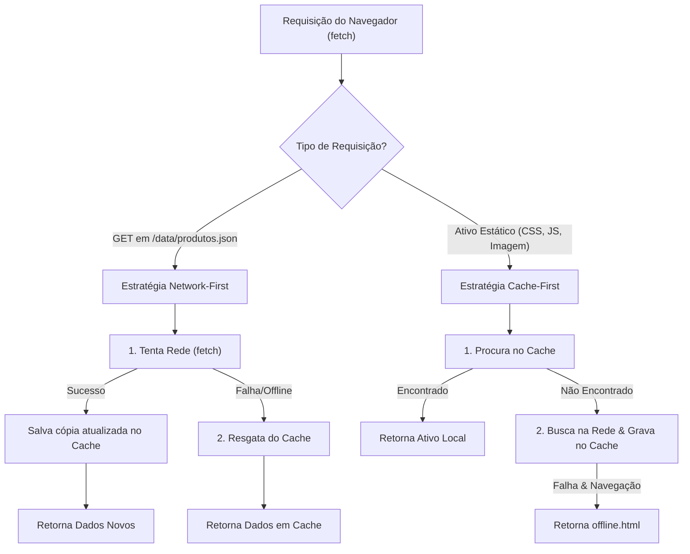

# PWA, Service Worker & Estratégia de Cache

## 🎯 Objetivo
Este documento detalha o suporte a **Progressive Web App (PWA)** e a resiliência offline do sistema **PB&Cia**, descrevendo a estratégia híbrida de caching implementada em [`sw.js`](../sw.js), o manifesto de instalação em [`manifest.webmanifest`](../manifest.webmanifest) e as páginas de contingência [`offline.html`](../offline.html) e [`404.html`](../404.html).

---

## 🌐 Visão Geral

O sistema foi concebido para funcionar tanto online quanto em ambientes com instabilidade de rede ou ausência completa de sinal de internet (muito comum em representantes de vendas e feirantes visitando cozinhas industriais ou estoques subterrâneos).



---

## ⚡ Estratégia de Cache Híbrida em `sw.js`

O nome do cache atual é versionado como:
```javascript
const CACHE_NAME = 'pbecia-catalog-v2';
```

### 1. Pré-cache de Ativos Estáticos (`STATIC_ASSETS`)
Durante a fase de instalação (`install`), o Service Worker faz o download e armazena preventivamente todos os arquivos essenciais para a execução do app:
- `/`, `index.html`, `offline.html`, `manifest.webmanifest`
- Todos os arquivos CSS em `assets/css/`
- Todos os arquivos JavaScript em `assets/js/`
- Imagens institucionais (`favicon.png`, `apple-touch-icon.png`, `logo.png`, `placeholder.webp`)
- O arquivo inicial de dados `data/produtos.json`

---

### 2. Por que a Estratégia é Híbrida?
- **Para Ativos de Código (CSS/JS/HTML):** Adota-se **Cache-First**. Isso garante carregamento instantâneo em 0 milissegundos sem esperar pela rede.
- **Para a Tabela de Preços (`/data/produtos.json`):** Adota-se **Network-First**. Como preços e vigências podem sofrer alterações comerciais, o catálogo tenta sempre obter a versão mais nova da rede quando online, recorrendo ao cache apenas quando o usuário está desconectado.

```javascript
// Trecho de sw.js tratando a requisição de dados
if (url.pathname.includes('/data/')) {
  event.respondWith(
    fetch(request)
      .then((response) => {
        const copy = response.clone();
        caches.open(CACHE_NAME).then((cache) => cache.put(request, copy));
        return response;
      })
      .catch(() => caches.match(request))
  );
  return;
}
```

---

## 📱 Manifesto do Aplicativo (`manifest.webmanifest`)

Permite que o catálogo seja instalado como aplicativo nativo no Android, iOS, Windows e macOS:

```json
{
  "name": "PB&Cia - Catálogo de Produtos",
  "short_name": "PB&Cia",
  "description": "Catálogo de produtos e tabela de preços PB&Cia.",
  "start_url": "./index.html",
  "scope": "./",
  "display": "standalone",
  "orientation": "portrait-primary",
  "background_color": "#ffffff",
  "theme_color": "#e94560",
  "lang": "pt-BR",
  "icons": [
    {
      "src": "assets/images/logo192.png",
      "sizes": "192x192",
      "type": "image/png",
      "purpose": "maskable"
    },
    {
      "src": "assets/images/logo512.png",
      "sizes": "512x512",
      "type": "image/png",
      "purpose": "any"
    }
  ]
}
```

---

## 🚫 Páginas de Erro e Contingência

### 1. `offline.html` (Fallback de Desconexão)
Se o usuário navegar para uma URL não cacheada enquanto estiver completamente offline, o Service Worker intercepta o modo de navegação (`request.mode === 'navigate'`) e entrega esta página com um botão de "Tentar novamente" (`location.reload()`).

### 2. `404.html` (Página não Encontrada)
Página estática com design alinhado à identidade da marca para servidores web que suportam páginas 404 personalizadas (ex: GitHub Pages, Netlify, Vercel).

---

## 📖 Referências Cruzadas
- [Arquitetura Global](architecture.md)
- [Modelo de Dados](data-model.md)
- [Design System & UI](design-system-ui.md)
- [Guia de Reconstrução](reconstruction-guide.md)
