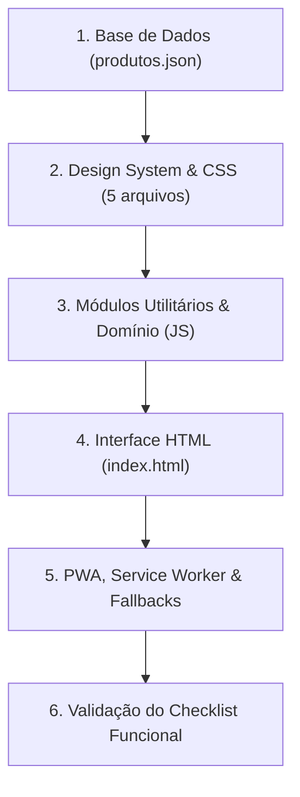

# Guia de Reconstrução do Sistema & Catálogo de Decisões

## 🎯 Objetivo
Este documento serve como manual mestre para permitir que qualquer engenheiro de software, arquiteto ou agente de IA reconstrua o sistema **PB&Cia** com 100% de fidelidade técnica, funcional e visual, mesmo que todos os arquivos de código-fonte originais deixem de existir.

---

## 🌐 Visão Geral

A reconstrução deve seguir a filosofia original: **Zero-Backend**, **Vanilla ES Modules**, **PWA Offline-First** e **Checkout Assistido via WhatsApp**.

---

## 📋 Roteiro Sequencial de Reconstrução

### Passo 1: Criação da Base de Dados
1. Crie o arquivo `data/produtos.json` com o formato especificado em [`data-model.md`](data-model.md).
2. Certifique-se de preencher `loja.nome`, `loja.vigenciaTabela`, `loja.whatsapp` e o array de `categorias`.

### Passo 2: Estruturação dos Estilos CSS
1. Crie `assets/css/variables.css` com os tokens de cores, elevações, espaçamentos e regras de `[data-theme="dark"]` conforme [`design-system-ui.md`](design-system-ui.md).
2. Crie `assets/css/style.css` com reset global, estilização de scrollbars e regras de `:focus-visible`.
3. Crie `assets/css/layout.css` com Header, Hero, Tools bar, Grid e Footer.
4. Crie `assets/css/components.css` com Cards, Skeletons, Modal, Cart, Toasts e Loading Screen.
5. Crie `assets/css/responsive.css` configurando os breakpoints (`1024px`, `768px`, `640px`, `480px`) e a gaveta lateral retrátil de categorias.

### Passo 3: Implementação dos Módulos JavaScript (ESM)
1. **`assets/js/utils.js`:** Implemente `el`, `$`, `$$`, `debounce`, `readStorage`, `writeStorage`, `formatCurrency`, `escapeHtml`, `normalizeText`, `shareProduct`, `refreshIcons`.
2. **`assets/js/catalog.js`:** Implemente a classe `Catalog` com `load()`, `_flatten()`, `renderCard()`, `renderMissingCard()`, `renderSkeletons()`, `isFavorite()`, `toggleFavorite()`.
3. **`assets/js/filters.js`:** Implemente `Filters` com `apply()`, suporte a categorias, ordenação, faixa de preço e busca textual.
4. **`assets/js/pagination.js`:** Implemente `Pagination` com o algoritmo de grade cheia `sizesFor(cols, total)` e `_pageWindow()`.
5. **`assets/js/search.js`:** Implemente `Search` com debounce de 250ms.
6. **`assets/js/modal.js`:** Implemente `ProductModal` com abertura, bloqueio de scroll, deep link `?p=CODIGO` e compartilhamento.
7. **`assets/js/cart.js`:** Implemente `Cart` com persistência em `catalog:cart`, métodos `add`, `updateQuantity`, `remove`, `clear` e gaveta lateral.
8. **`assets/js/whatsapp.js`:** Implemente `Whatsapp` com `orderMessage` e `productMessage`.
9. **`assets/js/app.js`:** Implemente `App` para orquestrar o bootstrap, sincronizar metatags e escutar eventos globais.

### Passo 4: Casca HTML & Ícones
1. Crie `index.html` importando as fontes Inter do Google Fonts, o bundle de ícones Lucide via CDN (`https://unpkg.com/lucide@latest`), os 5 arquivos CSS e o script principal `<script type="module" src="assets/js/app.js">`.

### Passo 5: PWA e Resiliência Offline
1. Crie `manifest.webmanifest` e configure ícones e cores conforme [`pwa-service-worker.md`](pwa-service-worker.md).
2. Crie `sw.js` com cache-first para estáticos e network-first para `data/produtos.json`.
3. Crie `offline.html` e `404.html`.

---

## ⚠️ Catálogo de Decisões Técnicas, Hacks e Armadilhas

| Comportamento Observado | Motivo Técnico / Causa Raiz | Como Reproduzir Fielmente |
| :--- | :--- | :--- |
| **Chave Composta `${codigo}-${slug}`** | Evita colisão entre produtos que possuem o mesmo código numérico mas categorias distintas. | Utilize `Catalog.key(product)` sempre que manipular o carrinho ou placeholders de imagens. |
| **Normalização NFD na Busca** | Permite que usuários encontrem "Pão" buscando por "pao" ou vice-versa. | Use `text.normalize('NFD').replace(/[\u0300-\u036f]/g, '').toLowerCase()`. |
| **Favoritos com tolerância a órfãos** | Se a loja excluir um produto do JSON, o cliente antigo que favoritou o item não pode ter o app travado. | Renderize o card com a classe `product-card--missing`, texto tachado e opção de desfavoritar. |
| **Late Binding no Carrinho** | Previne que alterações de preço no JSON gerem divergências no pedido do carrinho. | Armazene apenas `{ key, code, quantity }` no `localStorage` e faça o join dinâmico com o catálogo no momento da renderização. |
| **Paginação em múltiplos de $2 \times \text{cols}$** | Evita que uma linha termine com apenas 1 ou 2 cartões deslocados visualmente. | Utilize `Pagination.sizesFor(cols, total)` calculando as colunas computadas do CSS (`_measureColumns`). |
| **`refreshIcons()` pós-mutação** | Ícones Lucide declarados como `<i data-lucide="..."></i>` precisam ser convertidos em `<svg>` após alterações no DOM. | Chame `window.lucide.createIcons()` sempre que injetar novos elementos HTML. |

---

## ✅ Checklist de Verificação Funcional

- [ ] **Carregamento Inicial:** Exibe skeletons animados e logo pulsante até que `produtos.json` seja lido com sucesso.
- [ ] **Metadados:** Título da página, cabeçalho e badge do hero refletem os valores configurados no JSON.
- [ ] **Busca:** Funciona para termos sem acento, códigos numéricos e categorias.
- [ ] **Filtros & Preço:** O slider de preço máximo atualiza a contagem de produtos disponíveis em tempo real.
- [ ] **Ordenação:** Ordena corretamente por Menor Preço, Maior Preço, A-Z e Z-A.
- [ ] **Paginação:** Altera o número de páginas e opções do seletor conforme o redimensionamento da janela.
- [ ] **Favoritos:** Persiste em `catalog:favorites` e trata itens órfãos graciosamente.
- [ ] **Carrinho:** Calcula subtotais e quantidades com precisão, atualizando o badge do cabeçalho.
- [ ] **WhatsApp:** Monta mensagem em Markdown válida e abre `https://wa.me/...`.
- [ ] **Deep Link:** URL com `?p=CODIGO` abre automaticamente o modal de detalhes do produto.
- [ ] **Tema:** Alterna entre Light e Dark mode, respeitando `prefers-color-scheme` no primeiro acesso.
- [ ] **PWA & Offline:** Funciona sem conexão à internet após o primeiro acesso através do Service Worker.

---

## 📖 Mapa Geral da Documentação
- [Índice Geral (Home)](README.md)
- [Arquitetura Global](architecture.md)
- [Modelo de Dados](data-model.md)
- [Gerenciamento de Estado](state-management.md)
- [Catálogo & Modal](catalog-module.md)
- [Filtros, Busca & Paginação](filters-search-pagination.md)
- [Carrinho & WhatsApp](cart-whatsapp.md)
- [Design System & CSS](design-system-ui.md)
- [PWA & Offline](pwa-service-worker.md)
- [Ferramental de Imagens](tools-automation.md)
