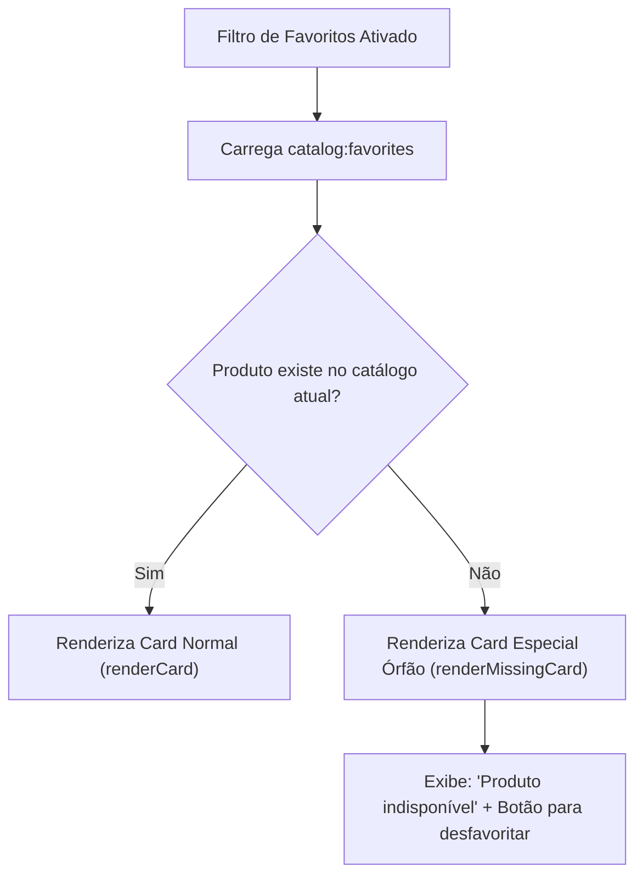

# Gerenciamento de Estado & LocalStorage

## 🎯 Objetivo
Este documento detalha o mecanismo de persistência de estado no cliente utilizado pelo sistema **PB&Cia**, descrevendo as chaves do `window.localStorage`, as estruturas de dados armazenadas, a estratégia de tratamento de favoritos órfãos (produtos descontinuados ou excluídos da tabela) e o controle de temas visual (*Dark Mode* / *Light Mode*).

---

## 🌐 Visão Geral

Como uma aplicação Jamstack / Zero-Backend, o estado do usuário não é gravado em banco de dados remoto ou sessões de servidor. O estado reside na memória do navegador e é sincronizado com o `localStorage` através das funções seguras `readStorage` e `writeStorage` presentes em [`assets/js/utils.js`](../assets/js/utils.js).

```mermaid
graph TD
    subgraph Browser Storage (localStorage)
        K1["catalog:cart"]
        K2["catalog:favorites"]
        K3["catalog:theme"]
    end

    subgraph Memory Domain Models
        C["Cart (assets/js/cart.js)"]
        Cat["Catalog (assets/js/catalog.js)"]
        App["App (assets/js/app.js)"]
    end

    C <-->|"read/write"| K1
    Cat <-->|"read/write"| K2
    App <-->|"read/write"| K3

    Cat -.->|"lookup produto por código"| C
```

---

## 🔑 Dicionário de Chaves de Armazenamento (`STORAGE_KEYS`)

As constantes de identificação de chaves são definidas em `utils.js`:

```javascript
export const STORAGE_KEYS = {
  CART: 'catalog:cart',
  FAVORITES: 'catalog:favorites',
  THEME: 'catalog:theme',
};
```

---

### 1. Carrinho de Compras (`catalog:cart`)

O carrinho persiste apenas o identificador composto do produto, seu código de referência e a quantidade de pacotes selecionada.

#### Schema JSON
```json
[
  {
    "key": "00006-pao-de-batata",
    "code": "00006",
    "quantity": 2
  },
  {
    "key": "00085-pao-de-batata",
    "code": "00085",
    "quantity": 1
  }
]
```

#### Princípio de Resolução Tardia (*Late Binding*)
O carrinho **não** armazena o preço, nome ou imagem do produto no `localStorage`.  
Ao renderizar a gaveta lateral, o método `Cart.resolveItems()` faz o cruzamento em memória com o catálogo vivo:
```javascript
resolveItems() {
  return this.items
    .map((i) => {
      const product = this.catalog.getProductByCode(i.code);
      return product ? { ...i, product } : null;
    })
    .filter(Boolean);
}
```
*Vantagem arquitetural:* Caso os preços ou nomes de produtos sejam alterados na tabela de preços (`produtos.json`), o carrinho do usuário reflete os valores novos instantaneamente, evitando divergências na hora do pedido no WhatsApp.

---

### 2. Produtos Favoritos (`catalog:favorites`) & Resiliência a Órfãos

A lista de favoritos armazena os produtos que o cliente marcou com o ícone de coração.

#### Compatibilidade com Formatos Legados
O sistema suporta duas estruturas históricas:
- **Formato v1 (Legado):** Array de strings contendo apenas os códigos: `["00006", "00085"]`.
- **Formato v2 (Atual):** Array de objetos com código e nome: `[{"codigo": "00006", "nome": "Pão de Batata Sem Recheio"}]`.

#### Algoritmo de Suporte a Favoritos Órfãos
Se uma nova versão da tabela de preços excluir determinado produto que um cliente já havia favoritado no passado, o sistema **não perde o dado nem quebra a interface**:



O método `Catalog.getOrphanFavorites()` identifica itens cujo código não consta mais em `this.products`:
```javascript
getOrphanFavorites() {
  return this.favorites.filter((f) => {
    const code = typeof f === 'object' ? f.codigo : f;
    return !this.products.some((p) => p.codigo === code);
  });
}
```
Os itens órfãos são renderizados com estilo atenuado (`filter: grayscale(0.6)`), texto tachado e indicador visual de "Produto não localizado", permitindo que o usuário clique no coração para removê-los do seu armazenamento local de forma limpa.

---

### 3. Tema Visual (`catalog:theme`)

Armazena a preferência de tema da interface: `"light"` ou `"dark"`.

#### Fluxo de Decisão no Carregamento
1. Lê `catalog:theme` do `localStorage`;
2. Se nulo (primeiro acesso), consulta a preferência do sistema operacional do usuário via Media Query:
   ```javascript
   const prefersDark = window.matchMedia('(prefers-color-scheme: dark)').matches;
   const theme = saved || (prefersDark ? 'dark' : 'light');
   ```
3. Aplica o atributo no elemento raiz do documento:
   ```javascript
   document.documentElement.setAttribute('data-theme', theme);
   ```

---

## 🛡️ Robustez e Tratamento de Exceções (`utils.js`)

Em navegadores em modo anônimo estrito, com cookies de terceiros bloqueados ou em iframes com restrições de sandbox, o acesso direto a `localStorage.getItem` ou `localStorage.setItem` pode disparar uma exceção do tipo `SecurityError`.

As funções utilitárias isolam esses riscos:

```javascript
export function readStorage(key, fallback) {
  try {
    const raw = localStorage.getItem(key);
    return raw ? JSON.parse(raw) : fallback;
  } catch {
    return fallback;
  }
}

export function writeStorage(key, value) {
  try {
    localStorage.setItem(key, JSON.stringify(value));
    return true;
  } catch {
    return false;
  }
}
```

---

## 📖 Referências Cruzadas
- [Arquitetura Global](architecture.md)
- [Módulo de Catálogo & Modal](catalog-module.md)
- [Carrinho & Integração WhatsApp](cart-whatsapp.md)
- [Design System & Estilização Dark Mode](design-system-ui.md)
