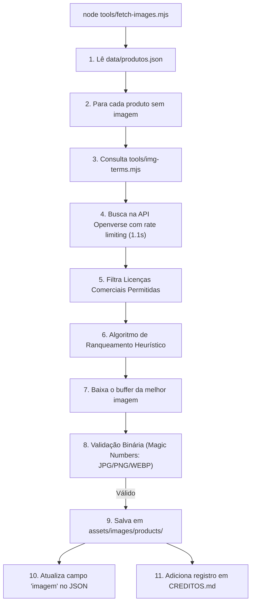

# Ferramentas & Automação de Ingestão de Imagens

## 🎯 Objetivo
Este documento descreve o ecossistema de scripts utilitários localizados no diretório [`tools/`](../tools/), responsáveis pela busca automatizada, filtragem de conformidade de licenças, validação binária e download de imagens de alta resolução sob Creative Commons a partir da API pública do **Openverse**.

---

## 🌐 Visão Geral

Para evitar a dependência de fotos manuais de catálogo e manter o projeto legalmente seguro com licenças abertas para uso comercial, o repositório conta com dois scripts em Node.js nativo (ES Modules `.mjs`):



---

## 📖 Mapeamento de Termos Semânticos (`tools/img-terms.mjs`)

APIs internacionais de repositórios de mídia aberta (como Openverse, Wikimedia e Flickr) apresentam melhores resultados de busca quando consultadas em inglês.

O arquivo mapeia cada produto pela chave `${categoriaSlug}|${codigo}` ou fornece um termo genérico de fallback `${categoriaSlug}|*`:

```javascript
const TERMS = {
  'pao-de-batata|*': 'potato bread',
  'pao-de-batata|00085': 'potato bread cheese',
  'pao-de-batata|00037': 'potato bread sausage',
  'salgados-fritos|00048': 'coxinha chicken',
  'pao-de-queijo|00393': 'brazilian cheese bread pao de queijo',
  // ...
};

export function termFor(categoriaSlug, codigo) {
  const specific = TERMS[`${categoriaSlug}|${codigo}`];
  if (specific) return specific;
  return TERMS[`${categoriaSlug}|*`] || null;
}
```

---

## ⚙️ Script de Ingestão (`tools/fetch-images.mjs`)

### 1. Conformidade de Licenças Comerciais
O script descarta categoricamente licenças com a cláusula **Non-Commercial (`-nc`)**, aceitando apenas licenças que autorizam o uso em catálogos comerciais:
- `CC0` (Domínio Público)
- `PDM` (Public Domain Mark)
- `BY` (Atribuição)
- `BY-SA` (Atribuição + Compartilhamento pela mesma licença)
- `BY-ND` (Atribuição + Sem Derivações)

---

### 2. Ranqueamento Heurístico de Qualidade (`rankImages`)
As imagens retornadas pela API recebem uma pontuação baseada em:
1. **Tipo de Licença:** $+40$ pontos para Domínio Público/CC0 (sem necessidade de atribuição obrigatória), $+20$ para CC-BY e $+10$ para BY-SA/BY-ND.
2. **Resolução Mínima (menor dimensão):**
   - $\ge 1600\text{px}$: $+30$ pontos
   - $\ge 1024\text{px}$: $+25$ pontos
   - $\ge 600\text{px}$: $+15$ pontos
   - $\ge 400\text{px}$: $+5$ pontos
   - $< 400\text{px}$: $-20$ pontos
3. **Proporção:** $+8$ pontos para imagens com largura $\ge$ altura (*aspect ratio landscape/quadrado* ideal para cartões).

---

### 3. Validação Binária por Magic Numbers
Em vez de confiar na extensão da URL retornada pela web (que frequentemente pode estar errada ou redirecionar para HTML), o script inspeciona os primeiros bytes do buffer:

```javascript
function detectType(buf) {
  // JPG: FF D8 FF
  if (buf[0] === 0xff && buf[1] === 0xd8 && buf[2] === 0xff) return 'jpg';
  // PNG: 89 50 4E 47
  if (buf.slice(0, 4).equals(Buffer.from([0x89, 0x50, 0x4e, 0x47]))) return 'png';
  // WEBP: RIFF....WEBP
  if (buf.slice(0, 4).equals(Buffer.from('RIFF'))) {
    if (buf.slice(8, 12).equals(Buffer.from('WEBP'))) return 'webp';
  }
  // GIF: GIF8
  if (buf.slice(0, 4).equals(Buffer.from('GIF8'))) return 'gif';
  return null;
}
```

---

### 4. Geração Automática de `CREDITOS.md`
Para cumprir a exigência legal das licenças CC-BY e CC-BY-SA, o script compila o arquivo `assets/images/products/CREDITOS.md` registrando a fonte e o autor de cada imagem baixada.

---

### 5. Controle de Reposição (`SKIP_EXISTING`)

O script aceita a variável de ambiente `SKIP_EXISTING` para decidir se produtos que **já possuem** o campo `imagem` preenchido devem ser processados:

- `SKIP_EXISTING=1` (padrão): pula produtos com `imagem` já definida, evitando re-downloads e preservando licenças já aprovadas.
- `SKIP_EXISTING=0`: ignora o estado atual e refaz a busca/download de **todos** os produtos.

> ⚠️ **Armadilha operacional:** atualmente todos os 62 produtos de `data/produtos.json` estão preenchidos com o placeholder provisório `"imagem": "assets/images/logo.png"` (ver [`data-model.md`](data-model.md) → Histórico de Alterações). Por isso, executar `node tools/fetch-images.mjs` sem variáveis de ambiente pulará **todos** os produtos. Para popular as fotos reais, rode:
> ```bash
> SKIP_EXISTING=0 node tools/fetch-images.mjs
> ```
> (No Windows PowerShell: `$env:SKIP_EXISTING='0'; node tools/fetch-images.mjs`)

O `CREDITOS.md` só é gerado/atualizado quando há atribuições novas (`attributions.length > 0`), ou seja, apenas em execuções que efetivamente baixaram alguma imagem.

---

## 📖 Referências Cruzadas
- [Modelo de Dados & produtos.json](data-model.md)
- [Módulo de Catálogo](catalog-module.md)
- [Guia de Reconstrução](reconstruction-guide.md)
