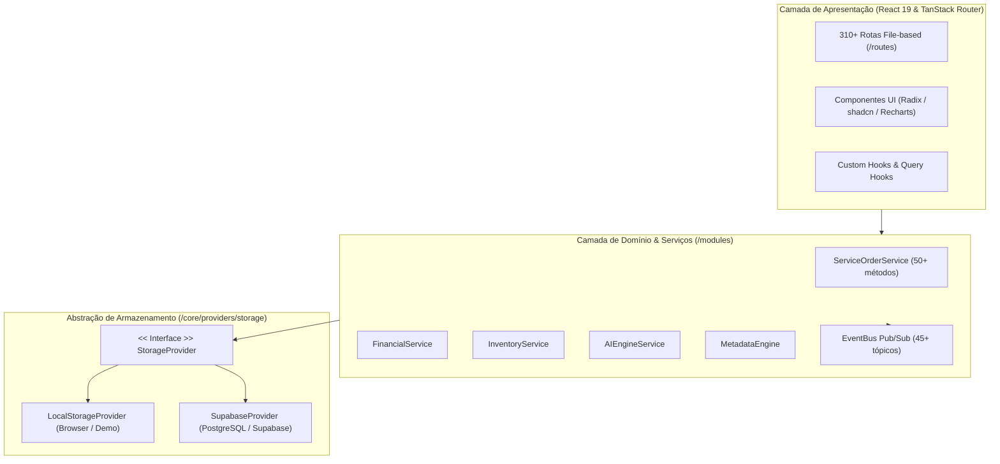
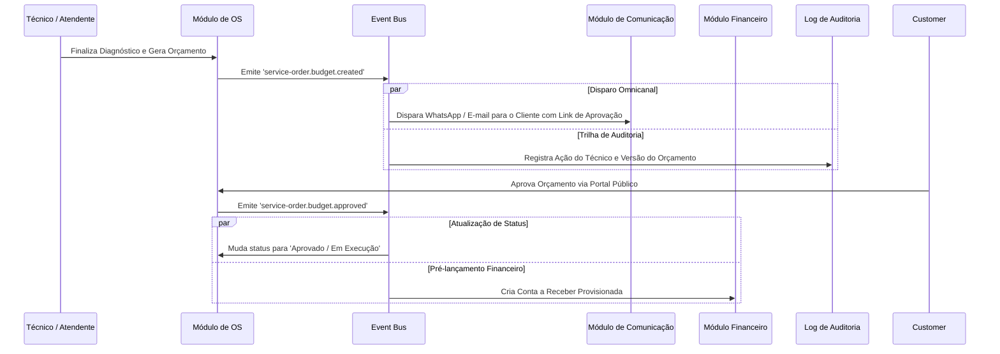

# ServiceForge Platform — Manual Técnico e Arquitetural (v1.0.0-RC1)

Bem-vindo à documentação oficial do **ServiceForge**, uma plataforma SaaS modular de alta performance projetada para gestão integrada de **assistência técnica, ordens de serviço, finanças, estoque, compras, CRM, ERP, RH, automações orientadas a eventos e inteligência artificial**.

---

## 📑 Sumário

1. [Visão Geral e Objetivos do Produto](#1-visão-geral-e-objetivos-do-produto)
2. [Stack Tecnológica e Dependências](#2-stack-tecnológica-e-dependências)
3. [Arquitetura do Sistema](#3-arquitetura-do-sistema)
4. [Camada de Persistência Híbrida (Storage Providers)](#4-camada-de-persistência-híbrida-storage-providers)
5. [Motor de Eventos e Automação (Event Bus & Workflows)](#5-motor-de-eventos-e-automação-event-bus--workflows)
6. [Catálogo dos Módulos do Sistema](#6-catálogo-dos-módulos-do-sistema)
7. [Plataforma de IA & OCR](#7-plataforma-de-ia--ocr)
8. [Segurança, Multi-Tenancy e RBAC](#8-segurança-multi-tenancy-e-rbac)
9. [Guia de Desenvolvimento e Setup](#9-guia-de-desenvolvimento-e-setup)
10. [Deploy, Build e Operações](#10-deploy-build-e-operações)
11. [Mapa de Documentos Complementares](#11-mapa-de-documentos-complementares)

---

## 1. Visão Geral e Objetivos do Produto

O **ServiceForge** resolve a complexidade operacional de oficinas e empresas de serviços técnicos através de:
- **Gestão de Ciclo de Vida Completo de OS**: Recepção, checklist de entrada, diagnóstico técnico multinível, orçamento versionado, aprovação digital omnicanal (WhatsApp/E-mail/Portal), execução com cronômetro de horas, controle de qualidade, testes técnicos e entrega com assinatura digital.
- **Backoffice Empresarial Integrado**: Financeiro (Contas a Pagar/Receber, Faturamento, DRE), Estoque (Almoxarifados, Lotes, Posições de Armazenamento), Compras e Fornecedores.
- **Suporte Híbrido Offline-First & Nuvem**: Execução com `LocalStorageProvider` para operação autônoma/desenvolvimento e `SupabaseProvider` (PostgreSQL) para escala multi-tenant em nuvem.
- **Extensibilidade via Metadados**: Customização de entidades, campos dinâmicos, visualizações e formulários sem necessidade de alterar o código-fonte.
- **Inteligência Artificial Integrada**: OCR para identificação de placas/números de série, visão computacional para inspeção de defeitos e recomendação de diagnósticos via base de conhecimento técnico.

---

## 2. Stack Tecnológica e Dependências

```
Frontend / SSR:
├── TanStack Start (SSR Framework com Vite 8 e Nitro)
├── React 19 (Hooks modernos, Transições e Server Components)
├── TanStack Router (Roteamento tipado file-based com 310+ rotas)
├── TanStack React Query v5 (Cacheamento inteligente e sincronização de dados)
└── Tailwind CSS v4 + Radix UI + shadcn/ui + Lucide Icons + Recharts

Core & Estado:
├── Zustand (Gerenciamento de estado reativo e UI)
├── React Hook Form + Zod (Validação estrita de esquemas e formulários)
└── Event Bus desacoplado (Pub/Sub nativo)

Persistência & Backend:
├── Supabase Client (@supabase/supabase-js) + PostgreSQL 15+
├── Row Level Security (RLS) + Triggers e Functions PL/pgSQL
└── LocalStorage Engine com serialização e migração de schema automática
```

---

## 3. Arquitetura do Sistema

A arquitetura do ServiceForge segue os princípios de **Clean Architecture** com desacoplamento por contratos e injeção de provedores.



---

## 4. Camada de Persistência Híbrida (Storage Providers)

O ServiceForge possui uma interface de persistência única definida em `src/core/providers/storage/types.ts`:

```typescript
export interface StorageProvider {
  get<T>(key: string): Promise<T | null>;
  set<T>(key: string, value: T): Promise<void>;
  remove(key: string): Promise<void>;
  list<T>(prefix: string): Promise<T[]>;
  clear(): Promise<void>;
}
```

### Provedores Implementados:
1. **`LocalStorageProvider`**: Armazena dados localmente no navegador em formato chave-valor estruturado. Ideal para demonstrações offline, testes e ambientes isolados.
2. **`SupabaseProvider`**: Conecta diretamente às tabelas do PostgreSQL no Supabase, garantindo integridade referencial, queries avançadas e RLS multi-empresa.

A comutação entre os provedores ocorre de forma transparente baseada na presença das variáveis `VITE_SUPABASE_URL` e `VITE_SUPABASE_ANON_KEY`.

---

## 5. Motor de Eventos e Automação (Event Bus & Workflows)

O sistema possui um barramento de eventos síncrono/assíncrono que desacopla os módulos de negócio:

### Fluxo de Notificação e Automação de Exemplo:


---

## 6. Catálogo dos Módulos do Sistema

O sistema conta com **37 módulos** organizados em 3 pilares estruturais:

### ⚙️ Pilar 1: Operações e Assistência Técnica
- **Ordens de Serviço (`service-orders`)**: Workspace com mais de 30 abas integradas (Diagnóstico, Checklists de Entrada/Saída, Orçamentos multinível, Atividades com Time Tracking, Galeria de Fotos categorizada, Testes de Bancada, Controle de Qualidade, Cálculo de Margem de Lucro e Custos, Entregas, Garantias, Devoluções e Assinatura Digital).
- **Clientes (`customers`)**: Gerenciamento completo de pessoas físicas e jurídicas, múltiplos endereços, contatos secundários, histórico de manutenções e documentos anexos.
- **Ativos & Equipamentos (`assets` / `devices`)**: Cadastro de números de série, marcas, modelos, categorias, histórico de intervenções e acessórios vinculados.
- **Base de Conhecimento Técnico (`knowledge`)**: Repositório de procedimentos e soluções técnicas com **algoritmo de recomendação automática** durante o atendimento da OS com base no modelo do equipamento e sintoma relatado.
- **Documentos & Designer (`documents`)**: Criação de layouts de ordens de serviço, certificados de garantia, recibos de entrega com validação por QR Code e assinatura eletrônica.

### 🏢 Pilar 2: Gestão Empresarial (ERP & Backoffice)
- **Financeiro (`financial`)**: Plano de contas multinível, Contas a Pagar e Receber, Fluxo de Caixa projetado/realizado, Centros de Custo, Conciliação e Faturamento de NFS-e.
- **Estoque & Almoxarifado (`inventory`)**: Cadastro de peças e produtos, controle multi-almoxarifado, endereçamento de estoque (*bins*), contagens de inventário, movimentações e alertas de estoque mínimo.
- **Compras (`purchasing`)**: Gestão de fornecedores, cotações, pedidos de compra e recebimento físico/fiscal de mercadorias.
- **CRM (`crm`)**: Funil de vendas, captação de leads, oportunidades de manutenção corporativa e contratos de nível de serviço (SLA).
- **Recursos Humanos (`hr`)**: Gestão de colaboradores técnicos, escalas de trabalho, registro de ponto, folha e cálculo de comissões por produtividade e serviços executados.
- **Relatórios & Analytics (`reporting`)**: Dashboards gerenciais, KPIs em tempo real, gerador de datasets e exportações personalizadas.

### 🛡️ Pilar 3: Plataforma, Segurança e Infraestrutura
- **Administração (`admin`)**: Gestão multi-empresa (*tenants*), controle de usuários, perfis de acesso RBAC, trilha de auditoria (*audit log*), backups e monitoramento de saúde do sistema.
- **Motor de Metadados (`metadata`)**: Construtor visual de entidades, campos personalizados e formulários dinâmicos.
- **Ambiente Demo & Testes (`demo-env`)**: Gerador de dados sintéticos para testes, restauração de cenários e verificação de integridade.
- **Integrações & Webhooks (`integrations`)**: Conectores externos, APIs REST e webhooks para integração com sistemas legados e ERPs externos.
- **Portal do Cliente (`portal`)**: Acesso público seguro para clientes acompanharem o status da OS, aprovarem orçamentos e baixarem laudos e notas fiscais.

---

## 7. Plataforma de IA & OCR

O ServiceForge possui uma camada de IA com arquitetura multi-provedor (OpenAI, Anthropic Claude, Google Gemini, Azure OpenAI):
- **Mecanismo OCR**: Extração automática de dados de fotos de etiquetas de equipamentos, números de série (IMEI, MAC Address, Part Numbers) e documentos de identificação.
- **Visão Computacional**: Classificação de avarias estéticas em fotos de entrada do equipamento para geração do checklist fotográfico.
- **Playground e Biblioteca de Prompts**: Ambiente interno para afinação de prompts e automações de atendimento.
- **Auditoria de IA**: Registro completo de custos em tokens, tempo de resposta e conformidade de privacidade.

---

## 8. Segurança, Multi-Tenancy e RBAC

1. **Multi-Tenancy por Empresa**: Todos os registros possuem referência obrigatória a `company_id`, garantindo isolamento total entre empresas no mesmo banco PostgreSQL via RLS (*Row Level Security*).
2. **Controle de Acesso Baseado em Papéis (RBAC)**: Matriz granular de permissões dividida por módulo e ação (`read`, `write`, `delete`, `export`, `admin`).
3. **Trilha de Auditoria Universal**: Todas as mutações de dados no sistema geram logs imutáveis na tabela `audit_log`, contendo o ID do usuário, endereço IP, timestamp UTC, ação executada e snapshot antes/depois em formato JSONB.

---

## 9. Guia de Desenvolvimento e Setup

### Pré-requisitos
- Node.js 20+ ou Bun 1.1+
- Git

### Instalação e Execução Local

```bash
# 1. Clonar repositório
git clone https://github.com/pycriador-org/serviceforge-chatgpt.git
cd serviceforge-chatgpt

# 2. Instalar dependências com Bun (ou npm)
bun install

# 3. Configurar variáveis de ambiente
cp .env.example .env

# 4. Iniciar servidor de desenvolvimento (Vite + TanStack Start)
bun run dev
```

### Variáveis de Ambiente Principais (`.env`)

```ini
# Configuração do Supabase (Opcional para modo LocalStorage)
VITE_SUPABASE_URL=https://sua-instancia.supabase.co
VITE_SUPABASE_ANON_KEY=sua-chave-anon-publica

# Provedores de IA (Opcional)
VITE_OPENAI_API_KEY=sua-chave-openai
VITE_ANTHROPIC_API_KEY=sua-chave-anthropic
```

---

## 10. Deploy, Build e Operações

### Build de Produção
```bash
bun run build
```
O build compila a aplicação com Vite gerando os bundles otimizados pelo Nitro engine, prontos para execução em plataformas como Cloudflare Pages/Workers, Vercel, Netlify ou contêineres Docker Node.js.

### Migrações de Banco de Dados
Os scripts SQL de inicialização e migrações estão localizados em `supabase/migrations/`:
- `00001_serviceforge_schema.sql`: Estrutura completa de tabelas dos 37 módulos, índices e triggers.
- `00002_sync_auth_users.sql` & `00003_consolidate_auth_triggers.sql`: Sincronização automática de contas de autenticação com a tabela `users`.

---

## 11. Mapa de Documentos Complementares

Para aprofundamento técnico em áreas específicas, consulte os manuais dedicados:

| Documento | Caminho | Descrição |
| :--- | :--- | :--- |
| **Dicionário de Banco de Dados** | [`docs/database/data-dictionary.md`](docs/database/data-dictionary.md) | Catálogo completo de tabelas, tipos e RLS |
| **Referência de Eventos** | [`docs/api/domain-events-reference.md`](docs/api/domain-events-reference.md) | Lista dos 45+ eventos de domínio e payloads |
| **Módulo: Ordens de Serviço** | [`docs/modules/service-orders.md`](docs/modules/service-orders.md) | Manual das 30+ abas, testes, QC e margens |
| **Módulo: Financeiro** | [`docs/modules/financial.md`](docs/modules/financial.md) | Contas a pagar/receber, DRE e faturamento |
| **Módulo: Estoque e Compras** | [`docs/modules/inventory-purchasing.md`](docs/modules/inventory-purchasing.md) | Almoxarifados, movimentações e cotações |
| **Módulo: Automação e Eventos** | [`docs/modules/automation-events.md`](docs/modules/automation-events.md) | Workflows, máquinas de estado e agendador |
| **Módulo: Plataforma de IA** | [`docs/modules/ai-platform.md`](docs/modules/ai-platform.md) | OCR, visão computacional e prompts |
| **Módulo: Admin e Plataforma** | [`docs/modules/admin-platform.md`](docs/modules/admin-platform.md) | Multi-tenant, RBAC e dados de demonstração |
| **Módulo: CRM, ERP e RH** | [`docs/modules/crm-erp-hr.md`](docs/modules/crm-erp-hr.md) | Leads, contratos, ponto e comissões |
| **Módulo: Documentos e Portal** | [`docs/modules/documents-portal.md`](docs/modules/documents-portal.md) | Assinaturas digitais, QR Code e portal público |
