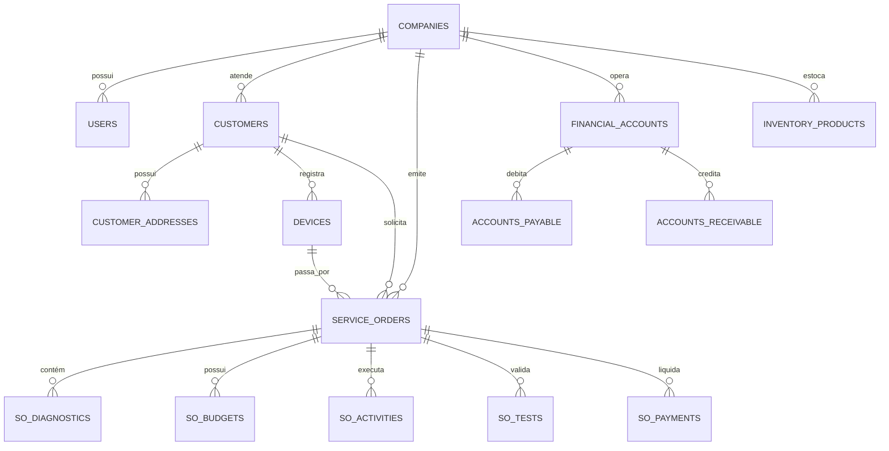

# Dicionário de Dados & Arquitetura PostgreSQL (Supabase)

O **ServiceForge** utiliza o PostgreSQL (via Supabase) com suporte a isolamento de multi-tenancy, Row Level Security (RLS), triggers de sincronização e campos estruturados `JSONB` para extensibilidade.

---

## 🗄️ Visão Geral das Entidades e Relacionamentos



---

## 📋 Tabelas Principais do Sistema

### 1. Plataforma & Multi-Tenant (`companies`, `users`, `roles`, `audit_log`)

#### `companies`
Armazena as empresas registradas na plataforma.
| Coluna | Tipo | Restrições | Descrição |
| :--- | :--- | :--- | :--- |
| `id` | `TEXT` | `PRIMARY KEY` | Identificador único (`gen_uid()`) |
| `name` | `TEXT` | `NOT NULL` | Razão Social ou Nome Fantasia |
| `document` | `TEXT` | | CNPJ ou CPF |
| `email` | `TEXT` | | E-mail de contato principal |
| `phone` | `TEXT` | | Telefone de contato |
| `logo` | `TEXT` | | URL da imagem do logotipo |
| `active` | `BOOLEAN` | `DEFAULT true` | Status de ativação da empresa |
| `settings` | `JSONB` | `DEFAULT '{}'` | Configurações personalizadas da empresa |
| `created_at` | `TIMESTAMPTZ`| `DEFAULT now_utc()` | Data de cadastro |
| `updated_at` | `TIMESTAMPTZ`| `DEFAULT now_utc()` | Data da última atualização |

#### `users`
Usuários do sistema vinculados às empresas.
| Coluna | Tipo | Restrições | Descrição |
| :--- | :--- | :--- | :--- |
| `id` | `TEXT` | `PRIMARY KEY` | Identificador único |
| `email` | `TEXT` | `UNIQUE, NOT NULL` | E-mail corporativo de acesso |
| `name` | `TEXT` | `NOT NULL` | Nome completo do operador |
| `role` | `TEXT` | `DEFAULT 'viewer'` | Papel no sistema (`admin`, `technician`, `attendant`, `financial`) |
| `company_id` | `TEXT` | `REFERENCES companies(id)` | Empresa de vínculo |
| `active` | `BOOLEAN` | `DEFAULT true` | Ativo / Inativo |
| `preferences`| `JSONB` | `DEFAULT '{}'` | Preferências de tema, idioma e notificações |

#### `audit_log`
Trilha de auditoria imutável de todas as ações no sistema.
| Coluna | Tipo | Descrição |
| :--- | :--- | :--- |
| `id` | `TEXT PRIMARY KEY` | Identificador único do log |
| `user_id` | `TEXT REFERENCES users(id)` | Usuário que executou a ação |
| `action` | `TEXT NOT NULL` | `create`, `update`, `delete`, `approve`, `close` |
| `entity` | `TEXT NOT NULL` | Nome da entidade (`service_order`, `payment`, `budget`) |
| `entity_id` | `TEXT` | Identificador da entidade afetada |
| `details` | `JSONB DEFAULT '{}'` | Snapshot antes/depois, IP e metadados adicionais |
| `created_at`| `TIMESTAMPTZ` | Timestamp em UTC da ocorrência |

---

### 2. Clientes & Ativos (`customers`, `customer_addresses`, `devices`)

#### `customers`
| Coluna | Tipo | Descrição |
| :--- | :--- | :--- |
| `id` | `TEXT PRIMARY KEY` | ID único do cliente |
| `name` | `TEXT NOT NULL` | Nome / Razão Social |
| `document` | `TEXT` | CPF ou CNPJ |
| `email` | `TEXT` | E-mail para envio de orçamentos |
| `phone` / `mobile` | `TEXT` | Contato telefônico e WhatsApp |
| `type` | `TEXT DEFAULT 'pf'` | `pf` (Pessoa Física) ou `pj` (Pessoa Jurídica) |
| `company_id` | `TEXT REFERENCES companies(id)` | Tenant |
| `tags` | `JSONB DEFAULT '[]'` | Etiquetas de segmentação (VIP, inadimplente, etc.) |

#### `devices` (Ativos / Equipamentos)
| Coluna | Tipo | Descrição |
| :--- | :--- | :--- |
| `id` | `TEXT PRIMARY KEY` | Identificador único do ativo |
| `customer_id` | `TEXT REFERENCES customers(id)` | Proprietário do equipamento |
| `type` | `TEXT NOT NULL` | Smartphone, Notebook, Desktop, Inversor, etc. |
| `brand` | `TEXT` | Marca (Apple, Samsung, Dell, Lenovo) |
| `model` | `TEXT` | Modelo técnico |
| `serial_number` | `TEXT` | Número de série / IMEI / Chassi |
| `accessories` | `TEXT` | Acessórios entregues juntos (carregador, capa) |
| `notes` | `TEXT` | Observações de histórico do ativo |

---

### 3. Ordens de Serviço & Execução (`service_orders`, `so_budgets`, `so_tests`)

#### `service_orders`
Tabela principal do ciclo de vida da OS.
| Coluna | Tipo | Descrição |
| :--- | :--- | :--- |
| `id` | `TEXT PRIMARY KEY` | UUID da OS |
| `number` | `TEXT NOT NULL` | Código human-readable sequencial (Ex: `SF-000104`) |
| `customer_id` | `TEXT REFERENCES customers(id)` | Cliente atendido |
| `device_id` | `TEXT REFERENCES devices(id)` | Equipamento em reparo |
| `technician_id`| `TEXT REFERENCES users(id)` | Técnico responsável atribuído |
| `priority` | `TEXT DEFAULT 'medium'` | `low`, `medium`, `high`, `urgent` |
| `status` | `TEXT NOT NULL` | `Aberto`, `Em Diagnóstico`, `Orçamento Gerado`, `Aprovado`, `Em Execução`, `Testes`, `Pronto`, `Entregue`, `Fechado` |
| `entry_date` | `TIMESTAMPTZ NOT NULL` | Data de entrada do equipamento |
| `deadline` | `TIMESTAMPTZ` | Prazo acordado com o cliente |
| `description` | `TEXT NOT NULL` | Relato do defeito pelo cliente |
| `diagnosis` | `TEXT` | Parecer técnico e causa raiz |
| `estimated_value`| `NUMERIC(12,2)` | Valor estimado inicial |
| `final_value` | `NUMERIC(12,2)` | Valor final consolidado |
| `pinned` | `BOOLEAN DEFAULT false` | Fixada para acesso rápido |
| `timeline` | `JSONB DEFAULT '[]'` | Histórico cronológico de eventos e transições |

---

### 4. Módulo Financeiro (`financial_accounts`, `accounts_payable`, `accounts_receivable`, `invoices`)

#### `financial_accounts`
Contas bancárias, caixas físicos e contas de investimento.
| Coluna | Tipo | Descrição |
| :--- | :--- | :--- |
| `id` | `TEXT PRIMARY KEY` | ID da conta bancária |
| `name` | `TEXT NOT NULL` | Nome da conta (Ex: Banco do Brasil Principal) |
| `type` | `TEXT NOT NULL` | `checking`, `savings`, `cash`, `credit` |
| `current_balance` | `NUMERIC(14,2)` | Saldo atual conciliado |
| `company_id` | `TEXT REFERENCES companies(id)` | Tenant |

#### `accounts_payable` & `accounts_receivable`
Títulos financeiros integrados com compras e ordens de serviço.
| Coluna | Tipo | Descrição |
| :--- | :--- | :--- |
| `id` | `TEXT PRIMARY KEY` | ID do título |
| `description` | `TEXT NOT NULL` | Histórico do lançamento |
| `original_value` | `NUMERIC(12,2)` | Valor bruto |
| `final_value` | `NUMERIC(12,2)` | Valor líquido após descontos/juros |
| `due_date` | `DATE NOT NULL` | Data de vencimento |
| `paid_at` / `received_at` | `TIMESTAMPTZ` | Data da liquidação |
| `status` | `TEXT NOT NULL` | `pending`, `paid` / `received`, `overdue`, `cancelled` |
| `service_order_id`| `TEXT` | Vínculo com a OS geradora |
| `cost_center_id` | `TEXT` | Centro de custos alocado |

---

### 5. Estoque & Almoxarifado (`inventory_products`, `inventory_movements`, `warehouses`)

#### `inventory_products`
| Coluna | Tipo | Descrição |
| :--- | :--- | :--- |
| `id` | `TEXT PRIMARY KEY` | ID do produto/peça |
| `code` / `sku` | `TEXT NOT NULL` | Código interno e código de barras |
| `name` | `TEXT NOT NULL` | Descrição da peça/componente |
| `cost_price` | `NUMERIC(12,2)` | Preço de custo médio |
| `sale_price` | `NUMERIC(12,2)` | Preço de venda praticado |
| `current_stock`| `NUMERIC(10,2)` | Quantidade atual em estoque |
| `min_stock` | `NUMERIC(10,2)` | Ponto de reposição com alerta automático |

---

## 🔒 Políticas de Segurança (Row Level Security - RLS)

Todas as tabelas possuem RLS ativado no PostgreSQL para garantir que uma empresa nunca acesse dados de outra:

```sql
-- Exemplo de Política RLS Multi-tenant
ALTER TABLE service_orders ENABLE ROW LEVEL SECURITY;

CREATE POLICY service_orders_tenant_isolation ON service_orders
  FOR ALL
  USING (company_id = (SELECT company_id FROM users WHERE id = auth.uid()));
```
