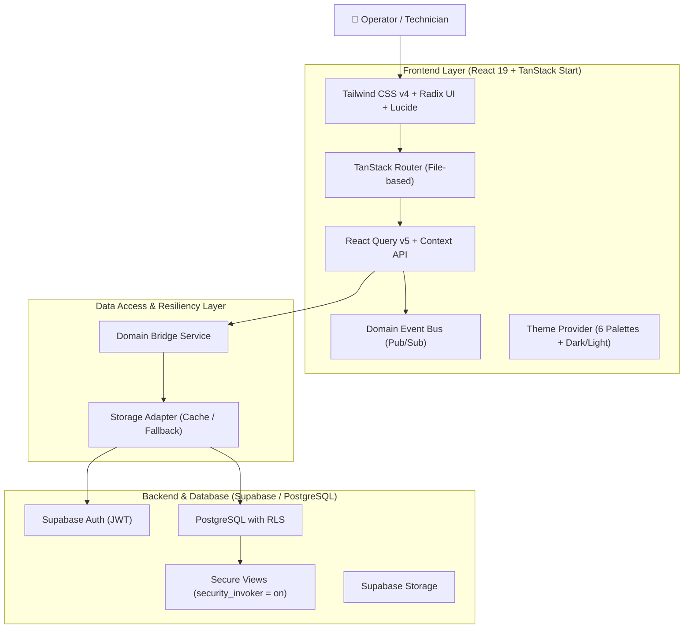

# System Architecture — ServiceForge Platform

> Language: English (EN) | [Português (pt-BR)](../../pt-BR/architecture/architecture.md)
>
> Status: ACCEPTED | Version: v1.0.0-RC1

ServiceForge utilizes an event-driven modular layered architecture that enables hybrid deployment across Server-Side Rendering (via TanStack Start / Cloudflare Nitro) and static SPA hosting (GitHub Pages).

---

## 🏛️ System Decomposition

---

## 🧩 Architectural Highlights

### 1. File-Based Routing (`src/routes`)
- Over 300 strongly-typed route definitions with automatic code splitting (`@tanstack/react-router`).
- Persistent navigation hierarchy under `_app` featuring collapsible sidebar on desktop and drawer navigation on mobile.

### 2. Universal Data Table Component (`src/components/data-table.tsx`)
- Automatic multi-type column sorting (strings with `localeCompare`, dates, numbers, booleans) on interactive headers.
- Built-in multi-field search and resilient null-safe filtering.
- Protected from lateral clipping via `overflow-x-auto min-w-0` and cell spacing `first:pl-4 last:pr-4`.

### 3. Dual Storage Adapter Strategy
- Primary persistence layer to PostgreSQL via Supabase with synchronized client-side cache fallback for offline/development resiliency.
