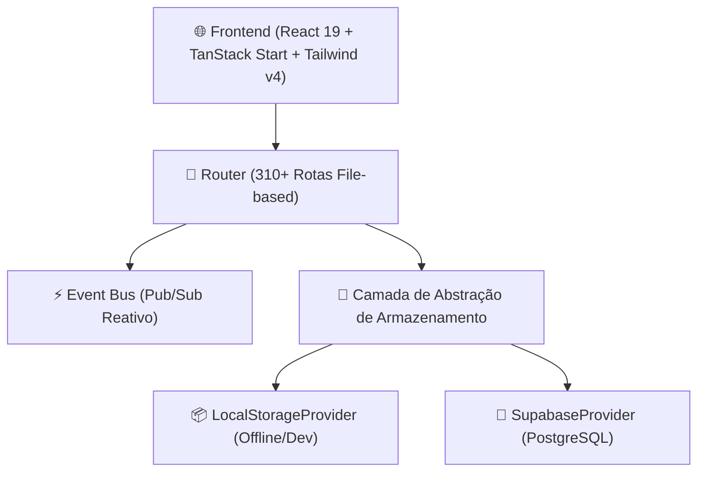

# ServiceForge Platform — Central de Documentação

Guia mestre de referência técnica, arquitetural e funcional da plataforma **ServiceForge (v1.0.0-RC1)**.

---

## 🧭 Guias e Manuais Estratégicos

| Seção | Descrição | Link |
| :--- | :--- | :--- |
| **Manual Geral do Sistema** | Visão panorâmica, stack técnica, princípios e setup rápido | [DOCUMENTATION.md](../DOCUMENTATION.md) |
| **Dicionário de Banco de Dados** | Estrutura completa de tabelas PostgreSQL/Supabase, chaves e RLS | [data-dictionary.md](database/data-dictionary.md) |
| **Catálogo de Eventos (Event Bus)** | Referência dos 45+ eventos de domínio, payloads e automações | [domain-events-reference.md](api/domain-events-reference.md) |
| **Configuração do Supabase** | Guia de deploy do banco, migrations e autenticação | [supabase-setup.md](supabase-setup.md) |

---

## 📦 Especificações Detalhadas por Módulo

### 1. Operações e Assistência Técnica
- 🔧 **[Gestão de Ordens de Serviço](modules/service-orders.md)**: Ciclo de vida da OS, workspace com 30+ abas, laudos, checklists, testes de bancada, controle de qualidade, custos e margem de lucro.
- 👥 **[Clientes e Endereços](admin/customers.md)**: Cadastro unificado PF/PJ, contatos secundários e histórico.
- 📱 **[Ativos & Equipamentos](admin/assets.md)**: Controle de números de série, marcas, modelos e histórico de manutenções.
- 🧠 **[Base de Conhecimento Técnico](admin/knowledge-platform.md)**: Repositório de soluções técnicas com recomendação inteligente na OS.
- 📄 **[Documentos, Assinaturas e Portal](modules/documents-portal.md)**: Designer visual de templates, assinatura eletrônica em tela e portal público do cliente.

### 2. Gestão Empresarial (ERP & Backoffice)
- 💰 **[Módulo Financeiro](modules/financial.md)**: Contas a pagar/receber, conciliação, plano de contas, centros de custo e DRE.
- 📦 **[Estoque e Compras](modules/inventory-purchasing.md)**: Multi-almoxarifados, endereçamento de estoque (*bins*), cotações e recebimento de notas fiscais.
- 🤝 **[CRM, ERP e Recursos Humanos](modules/crm-erp-hr.md)**: Funil de vendas, contratos corporativos, controle de ponto e cálculo de comissões técnicas.
- 📊 **[Relatórios e Dashboards](reporting/index.md)**: KPIs operacionais, gráficos gerenciais e exportação de datasets.

### 3. Plataforma, Automação e IA
- ⚙️ **[Automação, Regras e Workflows](modules/automation-events.md)**: Motor de regras (*triggers* e ações), máquinas de estado e agendador de tarefas.
- 🤖 **[Plataforma de IA & OCR](modules/ai-platform.md)**: Extração de dados de etiquetas por OCR, visão computacional para laudos e biblioteca de prompts.
- 🛡️ **[Administração e Plataforma](modules/admin-platform.md)**: Multi-tenancy, controle de usuários (RBAC), motor de metadados dinâmicos e gerador de dados demo.

---

## 🏛️ Visão Geral da Arquitetura

O ServiceForge é construído em camadas modulares com persistência desacoplada:



---

## 🚀 Como Iniciar o Desenvolvimento

```bash
# Instalar dependências
bun install

# Iniciar ambiente local
bun run dev

# Gerar build de produção
bun run build
```

Para detalhes adicionais sobre o histórico de desenvolvimento e sprints realizados, consulte os registros em [`docs/sdd/`](sdd/).
