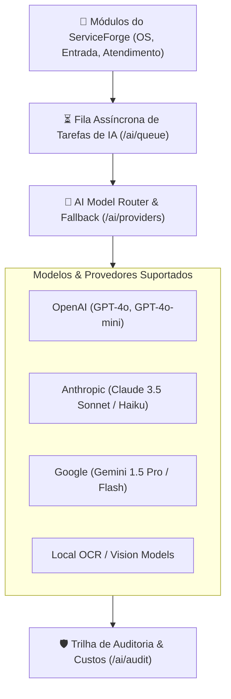

# Módulo: Plataforma de Inteligência Artificial (AI Platform)

A **Plataforma de IA** do **ServiceForge** provê recursos cognitivos de última geração integrados diretamente ao fluxo de assistência técnica, acelerando diagnósticos, eliminando digitação manual e automatizando análises visuais.

---

## 🤖 Arquitetura Multi-Provedor

O sistema suporta integração simultânea com os principais modelos de linguagem e visão computacional do mercado:

---

## 🛠️ Recursos e Casos de Uso

### 1. Reconhecimento Óptico de Caracteres (OCR) (`/ai/ocr`)
- **Leitura de Etiquetas de Equipamentos**: Extrai automaticamente marca, modelo, número de série, IMEI, MAC Address e voltagem a partir de uma foto da etiqueta traseira do equipamento.
- **Leitura de Documentos de Clientes**: Digitaliza CNH/RG e comprovantes de endereço, preenchendo automaticamente o cadastro do cliente no balcão em segundos.

### 2. Visão Computacional para Laudos Fotográficos (`/ai/vision`)
- **Detecção de Danos Estéticos**: Analisa fotos tiradas na entrada do equipamento e identifica riscos, trincas na carcaça, oxidação em placas ou telas quebradas.
- **Geração Automática do Checklist Visual**: Preenche as observações de avaria do termo de recebimento com base nas imagens, evitando contestações futuras de clientes.

### 3. Biblioteca Central de Prompts (`/ai/prompts`)
- Gerenciamento de templates de prompts com variáveis dinâmicas (ex: `{{customerName}}`, `{{equipmentModel}}`, `{{defectDescription}}`).
- Versionamento e controle de parâmetros de inferência (temperatura, top_p, limite de tokens).

### 4. Assistente de Diagnóstico & Resumo Técnico
- Transforma anotações técnicas informais do técnico em laudos formais claros e elegantes para o cliente no orçamento.
- Tradução de relatórios técnicos para múltiplos idiomas (Português, Inglês, Espanhol).

### 5. Auditoria de Uso & Custos (`/ai/audit`)
- Controle rigoroso de gasto mensal por empresa, latência das respostas, tokens consumidos e histórico detalhado das requisições para conformidade e segurança.
