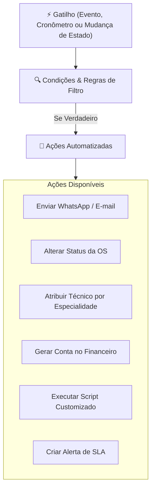

# Módulo: Automação, Regras & Workflows (Automation Engine)

O motor de **Automação** do **ServiceForge** permite programar ações reativas a eventos de negócio, eliminando tarefas manuais repetitivas e garantindo conformidade operacional através de regras configuráveis, máquinas de estado e agendadores.

---

## ⚙️ Componentes do Motor de Automação

---

## 📋 Funcionalidades Principais

### 1. Construtor Visual de Workflows (`/automation/workflows` & `/automation/designer`)
- Criação de fluxos compostos com etapas sequenciais e paralelas.
- Suporte a bifurcações condicionais baseadas em atributos do cliente (ex: cliente VIP), valor da OS ou tipo de equipamento.
- Tratamento de exceções e políticas de retentativa automática (*retry policy*).

### 2. Regras de Negócio Rápidas (`/automation/rules`)
- Configuração simples no formato **Se [Gatilho + Condição] Então [Ação]**.
- Exemplos práticos configuráveis:
  - *Se OS permanecer em "Aguardando Peça" por mais de 48h, notificar gerente de compras.*
  - *Se valor do orçamento ultrapassar R$ 5.000, exigir aprovação do supervisor técnico.*
  - *Se laudo for concluído com defeito "Tela Quebrada", sugerir automaticamente a peça correspondente.*

### 3. Máquinas de Estado (`/automation/statemachine`)
- Definição estrita das transições permitidas para ordens de serviço e orçamentos.
- Impede pulos de etapas obrigatórias (exemplo: impede colocar a OS como "Pronta para Entrega" sem antes concluir os testes de bancada e o controle de qualidade).

### 4. Agendador & Cron Jobs (`/automation/scheduler` & `/automation/timers`)
- Execução de tarefas programadas periódicas:
  - Verificação diária de prazos de garantia expirando.
  - Alerta matinal de ordens de serviço com SLA próximo do vencimento.
  - Envio de pesquisa de satisfação (NPS) 3 dias após a entrega do equipamento.

### 5. Execução de Scripts Personalizados (`/automation/scripts`)
- Ambiente sandbox seguro para execução de regras complexas em JavaScript/TypeScript com acesso controlado ao contexto do evento.
- Auditoria de tempo de execução e consumo de recursos.
