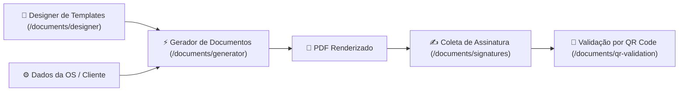
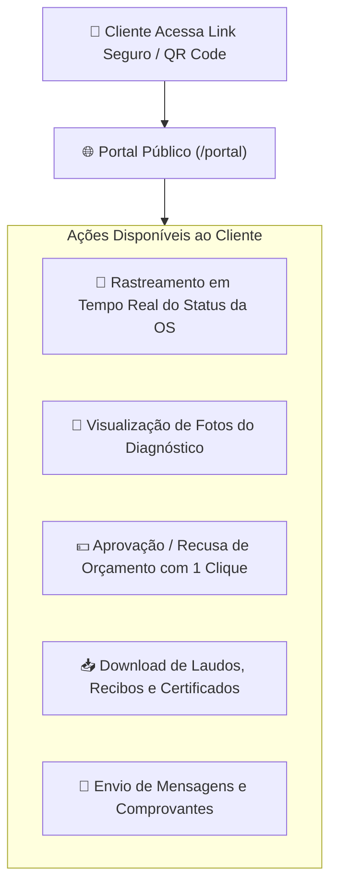

# Módulo: Documentos, Assinaturas & Portal Público

Este módulo cobre os canais de formalização jurídica, emissão de termos técnicos e a interface de autoatendimento para os clientes finais da assistência técnica.

---

## 📄 Gestão de Documentos & Assinaturas Digitais (`/documents`)

### Funcionalidades:
1. **Designer Visual de Templates (`/documents/designer`)**:
   - Criação e personalização visual de Ordens de Serviço, Termos de Entrada, Laudos de Diagnóstico, Recibos de Pagamento e Certificados de Garantia.
   - Suporte a tags dinâmicas como `{{empresa.logo}}`, `{{cliente.nome}}`, `{{equipamento.serial}}`, `{{servicos.tabela}}`, `{{valor.total}}`.
2. **Coleta de Assinatura Eletrônica (`/documents/signatures`)**:
   - Coleta de assinatura em tela sensível ao toque (smartphones, tablets no balcão) ou mouse.
   - Carimbo de data/hora (timestamp UTC), endereço IP e hash criptográfico SHA-256 para validade jurídica.
3. **Autenticação por QR Code (`/documents/qr-validation`)**:
   - Cada documento impresso ou gerado em PDF contém um QR Code único.
   - Qualquer pessoa (cliente, fiscalização ou seguradora) pode escanear o código para validar a autenticidade e a versão original do laudo técnico.

---

## 🌐 Portal do Cliente (`/portal`)

Uma área pública segura que permite ao cliente final acompanhar o andamento dos seus equipamentos sem sobrecarregar o atendimento telefônico:

### Recursos do Portal:
- **Acesso Sem Necessidade de Cadastro Complexo**: Autenticação via link único seguro (token temporário) enviado por WhatsApp/E-mail ou consulta rápida por Número da OS + CPF/CNPJ.
- **Customização de Marca (*Branding* / White-label) (`/portal/branding`)**: Apresentação com o logotipo, cores primárias, domínio próprio e dados de contato da sua assistência técnica.
- **Histórico de Garantias (`/portal/guarantees`)**: Consulta rápida de todos os serviços já executados no mesmo aparelho e prazo restante de cobertura.
