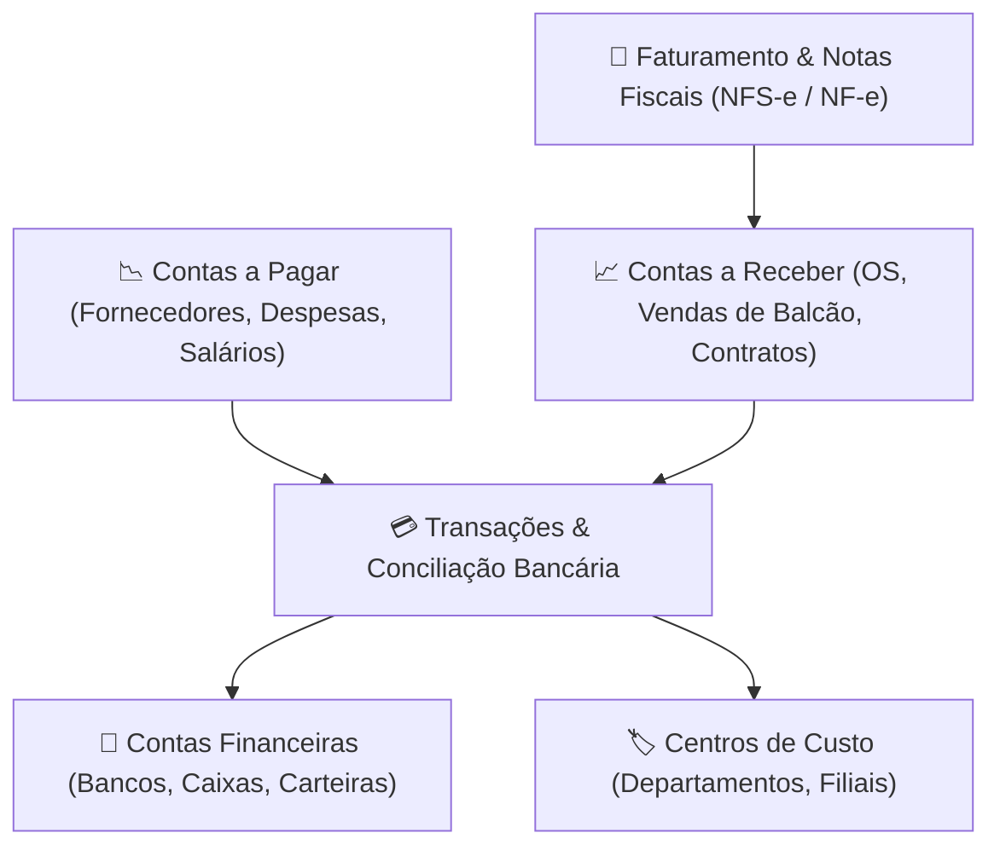

# Módulo: Gestão Financeira (Financial)

O módulo **Financeiro** do **ServiceForge** centraliza o controle econômico da empresa, garantindo rastreabilidade entre vendas, compras, ordens de serviço, colaboradores e contas bancárias.

---

## 🏛️ Estrutura e Funcionalidades

---

## 📑 Submódulos e Recursos

### 1. Contas Bancárias & Caixas (`/financial/accounts`)
- Cadastro de contas correntes, caixas físicos (gavetas de balcão), poupanças e cartões.
- Acompanhamento de saldo inicial, saldo conciliado e saldo projetado.
- Transferências internas entre contas com registro de comprovantes.

### 2. Contas a Pagar (`/financial/payable`)
- Gerenciamento de despesas operacionais, fornecedores de peças, tributos e salários.
- Controle de data de emissão, vencimento, acréscimos, multas, juros e descontos.
- Baixa individual ou em lote com débito automático na conta financeira correspondente.
- Vínculo direto com Pedidos de Compra gerados no módulo de Compras.

### 3. Contas a Receber (`/financial/receivable`)
- Geração automática a partir da aprovação e conclusão de Ordens de Serviço e Vendas.
- Suporte a múltiplos métodos de pagamento: Cartão de Crédito/Débito, PIX, Boleto, Dinheiro e Transferência.
- Controle de inadimplência com régua de cobrança automática e avisos de vencimento.

### 4. Centros de Custo (`/financial/cost-centers`)
- Classificação de receitas e despesas por departamento (Oficina Técnica, Vendas de Acessórios, Administrativo, TI).
- Avaliação de rentabilidade isolada por unidade ou setor.

### 5. Faturamento & Notas Fiscais (`/financial/invoices`)
- Emissão de notas fiscais de serviços (NFS-e) e notas fiscais de peças/mercadorias (NF-e).
- Armazenamento de arquivos XML e geração de espelho DANFE/PDF para envio ao cliente.

### 6. Relatórios & DRE Gerencial
- **Fluxo de Caixa**: Visão diária, semanal e mensal projetada vs. realizada.
- **Demonstrativo do Resultado do Exercício (DRE)**: Receita bruta, deduções, custos diretos de peças, despesas operacionais e lucro líquido.
