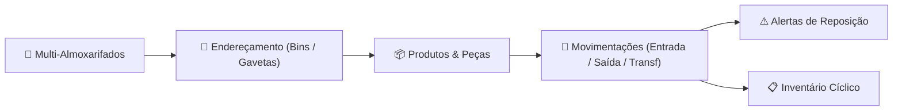
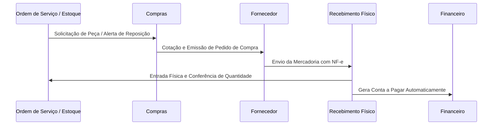

# Módulo: Estoque & Compras (Inventory & Purchasing)

A gestão integrada de **Estoque e Compras** assegura que a assistência técnica nunca sofra interrupções por falta de componentes críticos, mantendo controle rigoroso sobre custos e inventário físico.

---

## 📦 Gestão de Estoque (`/inventory`)

### Principais Recursos de Estoque:
1. **Multi-Almoxarifados (`/inventory/warehouses`)**: Controle de estoques em diferentes lojas, bancadas de técnicos, depósitos centrais ou veículos de atendimento externo.
2. **Endereçamento de Estoque / Bins (`/inventory/bins`)**: Identificação física exata de prateleiras, corredores e gaveteiros (Ex: `GAL-A-PRAT-03-GAV-12`).
3. **Movimentações & Baixa Automática (`/inventory/movements`)**:
   - Baixa imediata de componentes ao serem utilizados em Ordens de Serviço.
   - Devolução de peças não utilizadas ou retiradas de sucata.
   - Transferências entre filiais ou bancadas com protocolo de envio e recebimento.
4. **Inventário & Contagens Cíclicas (`/inventory/counts`)**: Ajustes de saldo por contagem física periódica com apuração de divergências.
5. **Alertas de Estoque Mínimo (`/inventory/alerts`)**: Notificação automática quando o saldo disponível atinge o ponto de reposição.

---

## 🛒 Gestão de Compras (`/purchasing`)

O módulo de Compras conecta as necessidades de reposição do estoque e demandas especiais de OS diretamente com fornecedores homologados.

### Funcionalidades de Compras:
- **Gestão de Fornecedores (`/purchasing/suppliers`)**: Cadastro completo, histórico de compras, prazos médios de entrega e avaliação de qualidade.
- **Pedidos de Compra (`/purchasing/orders`)**: Composição de itens com valores negociados, prazos de pagamento e previsão de entrega.
- **Recebimento de Mercadorias (`/purchasing/receiving`)**:
  - Conferência cega ou orientada por XML da NF-e.
  - Atualização instantânea do estoque e recálculo do custo médio da peça.
  - Criação automática dos lançamentos em Contas a Pagar no módulo Financeiro.
