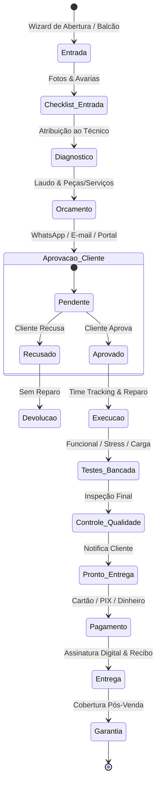

# Módulo: Gestão de Ordens de Serviço (Service Orders)

O módulo de **Ordens de Serviço (OS)** é o coração operacional do **ServiceForge**. Ele fornece um ecossistema completo para gerenciar desde o atendimento inicial no balcão até a entrega final com assinatura digital e acompanhamento pós-venda.

---

## 🔄 Fluxo de Vida Completo da Ordem de Serviço

---

## 🗂️ Arquitetura do Workspace da OS (30+ Abas)

Ao abrir uma Ordem de Serviço, o operador e o técnico têm acesso a um workspace de alta produtividade dividido em abas especializadas:

| Aba | Rota | Funcionalidade e Recursos |
| :--- | :--- | :--- |
| **Resumo** | `/$id` | Visão panorâmica, dados do cliente, equipamento, status atual e botões de ação rápida |
| **Diagnóstico** | `/$id/diagnostic` | Parecer técnico com controle de versões/revisões, causas apuradas e fotos do diagnóstico |
| **Execução** | `/$id/execution` | Lista de atividades técnicas, cronômetro (*time tracking* em tempo real) e diário de bordo |
| **Orçamento** | `/$id/budget` | Composição de serviços e peças, descontos, acréscimos, impostos e histórico de versões |
| **Aprovação** | `/$id/approval` | Painel de controle de autorização (WhatsApp, Portal, E-mail ou presencial) |
| **Pagamentos** | `/$id/payments` | Liquidação financeira, parcelamento, recibos fiscais e integração com contas a receber |
| **Testes** | `/$id/tests` | Bateria de testes técnicos (funcional, visual, estresse, conectividade, carga, áudio, câmeras) |
| **Qualidade (CQ)**| `/$id/quality` | Inspeção de controle de qualidade com aprovação formal antes da liberação ao cliente |
| **Custos & Margem**| `/$id/costs` | Cálculo analítico de custo de peças, hora técnica, serviços terceirizados, margem de lucro e markup |
| **Conhecimento** | `/$id/knowledge` | Sugestões automáticas de soluções com base no defeito e modelo + busca na base técnica |
| **Entrega** | `/$id/delivery` | Checklist de saída, devolução de acessórios trocados e conferência física |
| **Assinaturas** | `/$id/signatures` | Coleta de assinatura digital na tela (touchscreen/mouse) com hash de integridade |
| **Recibos** | `/$id/receipts` | Emissão de comprovantes em PDF (Recibo de Entrada, Saída, Pagamento e Garantia) |
| **Fotos** | `/$id/photos` | Galeria categorizada (Entrada, Diagnóstico, Execução, Saída, Devolução, Garantia) |
| **Timeline** | `/$id/timeline` | Linha do tempo auditável de cada alteração de status, técnico e valores |
| **Garantia** | `/$id/warranty` | Prazos de garantia diferenciados por serviço ou peça e geração de certificado |
| **Devoluções** | `/$id/returns` | Controle de devoluções, reaberturas e histórico de retornos no período de garantia |
| **Comentários** | `/$id/comments` | Chat interno entre técnicos e atendentes com marcação e anexos |
| **Portal Público** | `/$id/portal` | Gerenciamento do token de acesso público do cliente com controle de permissões |

---

## 🧠 Integração com a Base de Conhecimento Técnico

Durante o atendimento da OS, o sistema executa um algoritmo inteligente de recomendação:
1. Analisa a marca, modelo e tipo de equipamento da OS;
2. Compara os sintomas descritos com a base de artigos técnicos cadastrados;
3. Exibe na aba **Conhecimento Técnico** os tutoriais, diagramas esquemáticos e procedimentos recomendados ranqueados por relevância.
4. Ao clicar em um artigo, o sistema registra métricas de uso para aprimorar futuros diagnósticos.

---

## 💰 Análise de Custos e Margem de Lucro (`SOCosts`)

O sistema calcula em tempo real o resultado financeiro da OS:
$$\text{Custo Total} = \text{Custo de Peças} + (\text{Horas Gastas} \times \text{Custo Hora Técnico}) + \text{Serviços Terceirizados}$$
$$\text{Lucro Bruto} = \text{Valor Final da OS} - \text{Custo Total}$$
$$\text{Margem de Lucro (\%)} = \left( \frac{\text{Lucro Bruto}}{\text{Valor Final}} \right) \times 100$$

Isso assegura que nenhum serviço seja entregue com prejuízo ou margem fora da política da empresa.
