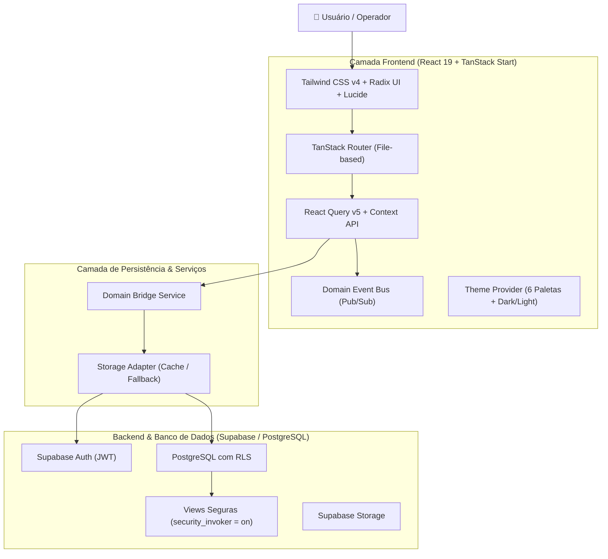

# Arquitetura do Sistema — ServiceForge Platform

> Language: pt-BR | [English (EN)](../../en/architecture/architecture.md)
>
> Status: ACCEPTED | Versão: v1.0.0-RC1

O ServiceForge adota uma arquitetura em camadas orientada a eventos e componentes modulares, permitindo execução híbrida SSR (via TanStack Start / Cloudflare Nitro) e SPA estática (GitHub Pages).

---

## 🏛️ Topologia Geral

---

## 🧩 Componentes Centrais

### 1. Roteador Baseado em Arquivos (`src/routes`)
- Mais de 300 rotas tipadas com code-splitting automático (`@tanstack/react-router`).
- Áreas estruturadas sob `_app` com layout persistente, barra lateral colapsável e navegação mobile responsiva via gaveta (*Sheet*).

### 2. Tabela de Dados Reutilizável (`src/components/data-table.tsx`)
- Ordenação de colunas automática em todas as colunas interativas (`asc` / `desc`).
- Busca e filtragem resiliente com comparador inteligente de textos, números e datas (`localeCompare("pt-BR")`).
- Layout responsivo protegido contra cortes laterais com overflow x horizontal e paddings `first:pl-4 last:pr-4`.

### 3. Adaptador de Armazenamento
- Estratégia resiliente que persiste em PostgreSQL via Supabase com cache sincronizado localmente.
- Fallback gracioso para garantir funcionamento contínuo mesmo com oscilações de rede.
