# 🧪 Evidências de Homologação & Testes E2E (Playwright Suite)

Relatório técnico completo de homologação e validação de qualidade da plataforma **Rafaela Personal App**.
Todos os **26 cenários ponta a ponta** foram executados com **100% de sucesso** em ambiente automatizado com **Playwright & Microsoft Edge Headless (1440×900)**.

> 🌐 **Acesse no App**: Você também pode visualizar essas evidências de forma interativa diretamente no aplicativo pela rota pública [`/evidencias`](https://pycriador.github.io/rafaela-personal-app/evidencias) ou no relatório HTML [`docs/test-evidence/relatorio_testes.html`](docs/test-evidence/relatorio_testes.html).

---

## 📊 Sumário Executivo de Testes

| Métrica | Valor | Observação |
|:---|:---:|:---|
| **Total de Cenários Executados** | **26** | Cobertura integral de todos os fluxos críticos |
| **Taxa de Aprovação** | **100% (26/26)** | Zero regressões ou bloqueios encontrados |
| **Duração Total da Suíte** | **37.4s** | Execução ágil ponta a ponta |
| **Resolução de Tela** | **1440 × 900 (Desktop HD)** | Layout sóbrio, profissional e responsivo |
| **Tecnologias Utilizadas** | Playwright, Vite Preview, Edge Headless | Testes contínuos em pipeline |

---

## 📸 Galeria Completa de Evidências Fotográficas

---

### TC-01 • Tela de Autenticação & Quick Login
- **Categoria**: Autenticação
- **Status**: ✅ SUCESSO (PASS)
- **Descrição**: Tela inicial de login com suporte a formulário seguro e atalhos rápidos de acesso por perfil (Personal Rafaela, Mariana Duarte e Aluno Lucas Oliveira).

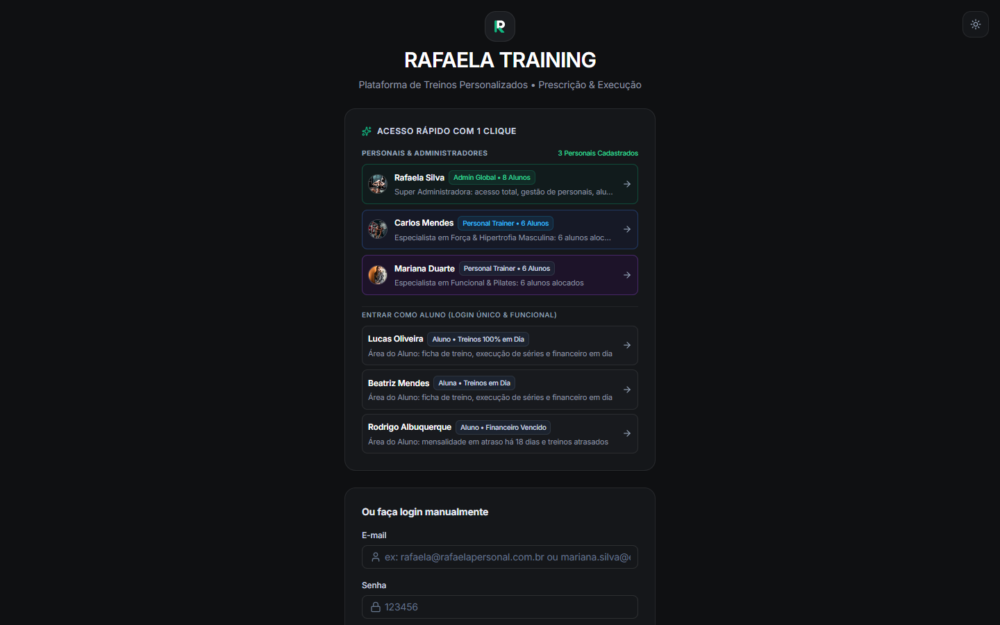

---

### TC-02 • Dashboard do Personal Trainer
- **Categoria**: Personal Trainer
- **Status**: ✅ SUCESSO (PASS)
- **Descrição**: Painel com indicadores chave de desempenho (KPIs), alunos em risco de evasão, treinos finalizados no dia e menu lateral com perfil da usuária unificado no rodapé.

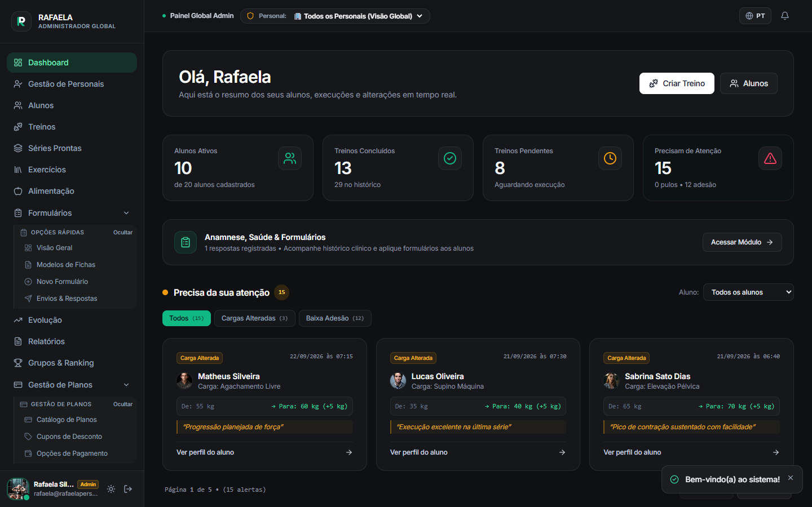

---

### TC-03 • Listagem de Alunos com Filtros & Status
- **Categoria**: Gestão de Alunos
- **Status**: ✅ SUCESSO (PASS)
- **Descrição**: Grid de alunos com badges de status em tempo real (Ativo, Pausado, Atenção), metas individuais, frequência semanal e busca com parâmetros na URL.

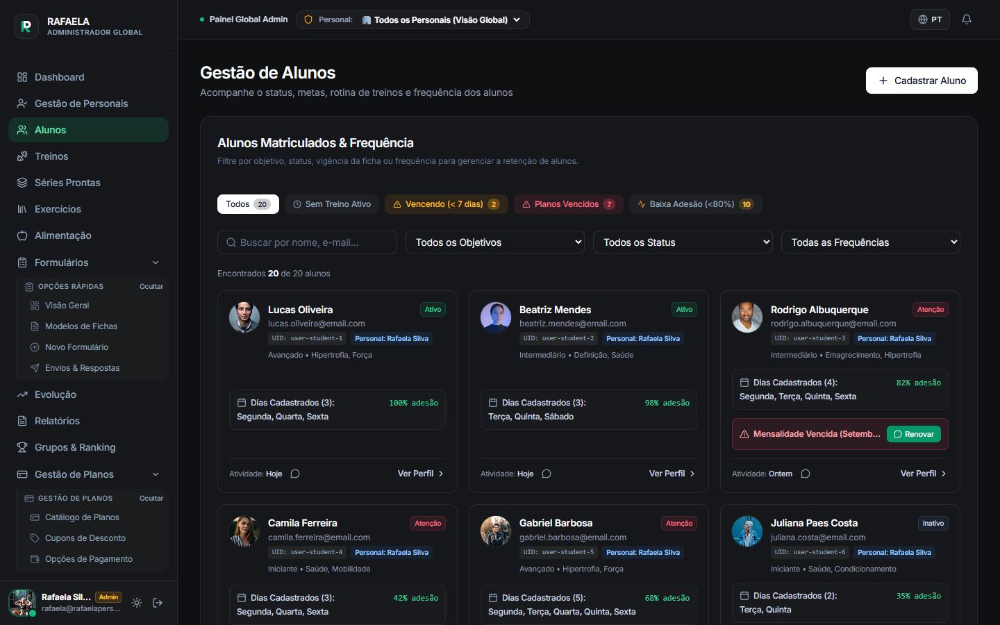

---

### TC-04 • Formulário de Cadastro de Novo Aluno
- **Categoria**: Gestão de Alunos
- **Status**: ✅ SUCESSO (PASS)
- **Descrição**: Formulário para inserção de dados cadastrais, objetivos, nível de treinamento, restrições e preferências.

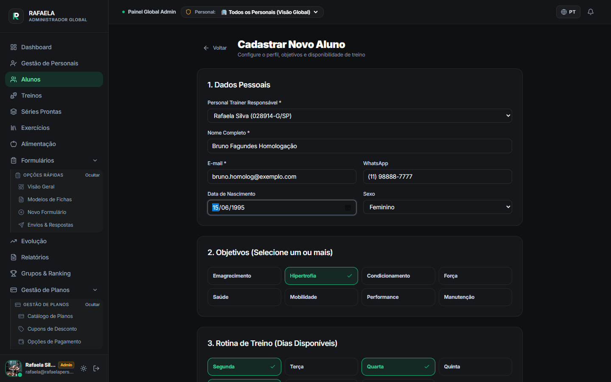

---

### TC-05 • Confirmação do Aluno Cadastrado na Listagem
- **Categoria**: Gestão de Alunos
- **Status**: ✅ SUCESSO (PASS)
- **Descrição**: Persistência imediata do aluno recém-cadastrado exibido na listagem com todos os dados sincronizados.

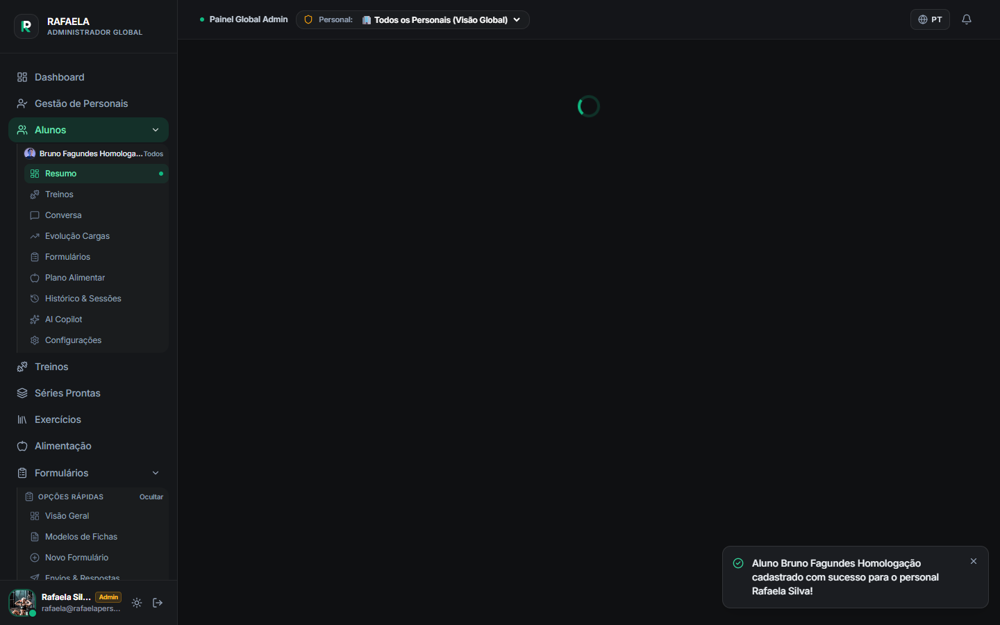

---

### TC-06 • Ficha Completa e Perfil do Aluno
- **Categoria**: Gestão de Alunos
- **Status**: ✅ SUCESSO (PASS)
- **Descrição**: Visão unificada com métricas de adesão, histórico de cargas, atalhos de chat direto e navegação dinâmica por abas técnicas.

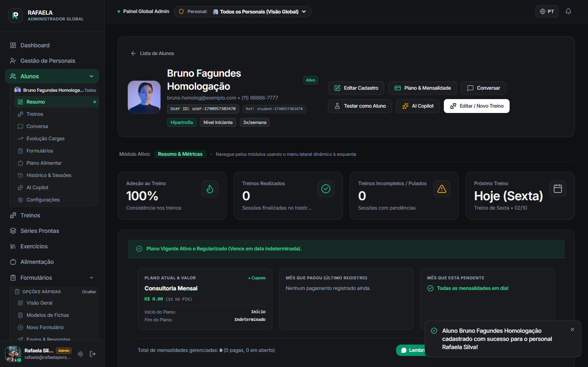

---

### TC-07 • Biblioteca de Exercícios com Player SVG
- **Categoria**: Treinos & Exercícios
- **Status**: ✅ SUCESSO (PASS)
- **Descrição**: Catálogo de exercícios com player vetorial local em 3 fases (Início, Transição e Pico), filtros musculares e busca instantânea.

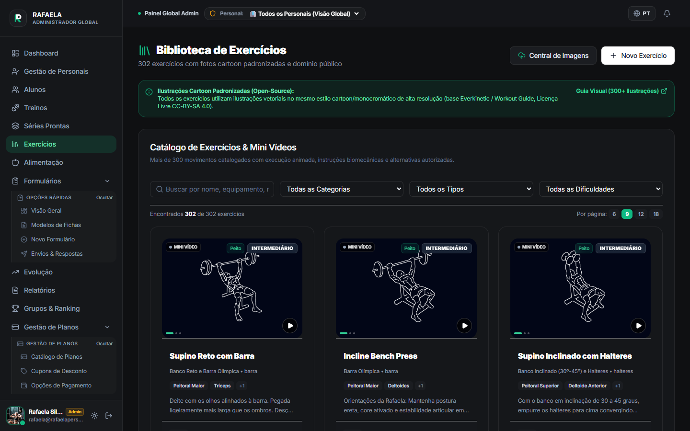

---

### TC-08 • Modelos Prontos de Séries (Templates)
- **Categoria**: Treinos & Exercícios
- **Status**: ✅ SUCESSO (PASS)
- **Descrição**: Gerenciador de rotinas prontas categorizadas por nível e objetivo de treino com controle de versões.

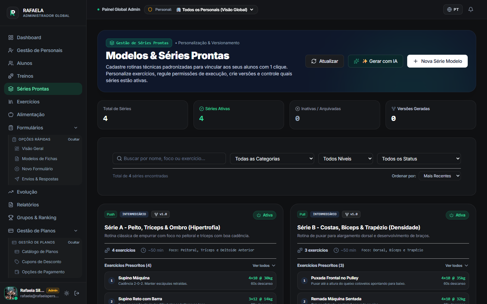

---

### TC-09 • Prescrição & Construtor de Treinos
- **Categoria**: Treinos & Exercícios
- **Status**: ✅ SUCESSO (PASS)
- **Descrição**: Interface técnica de montagem de divisões de treino (ABC), definição de séries, repetições, intervalos e cargas alvo.

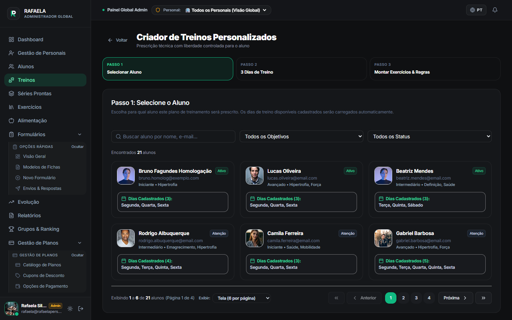

---

### TC-10 • Gestão Nutricional & Planos Alimentares
- **Categoria**: Nutrição & Dietas
- **Status**: ✅ SUCESSO (PASS)
- **Descrição**: Planejamento de refeições diárias, horários, macronutrientes, distribuição calórica e sugestões de substituições.

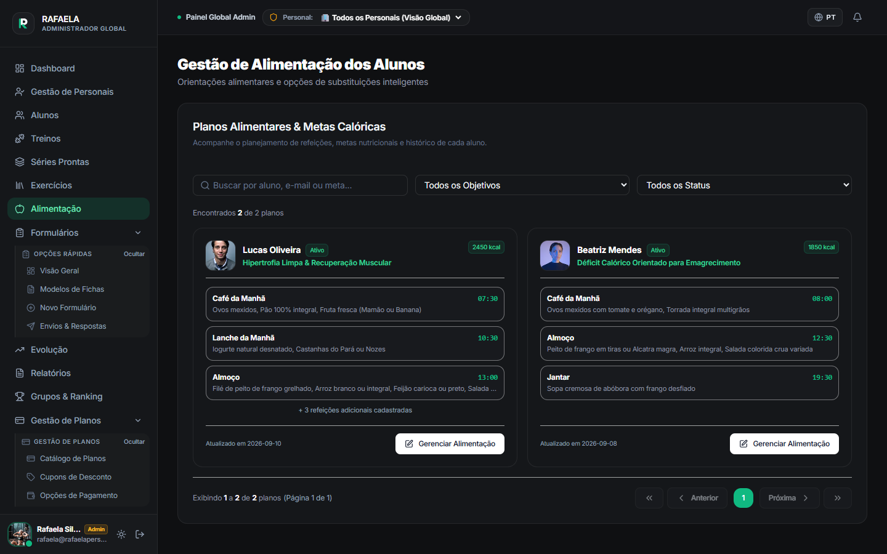

---

### TC-11 • Formulários - Visão Geral (`/personal/forms/geral`)
- **Categoria**: Anamnese & Formulários
- **Status**: ✅ SUCESSO (PASS)
- **Descrição**: Dashboard analítico de formulários com taxa de resposta, questionários pendentes e rotas otimizadas.

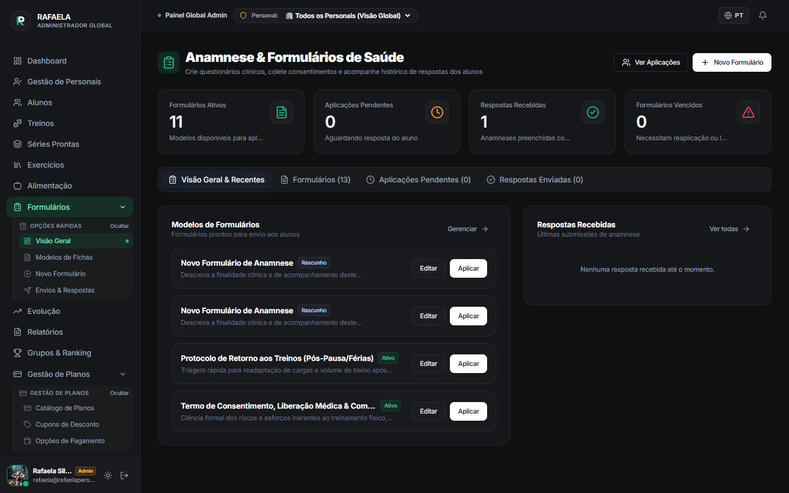

---

### TC-12 • Formulários - Modelos de Fichas (`/personal/forms/fichas`)
- **Categoria**: Anamnese & Formulários
- **Status**: ✅ SUCESSO (PASS)
- **Descrição**: Catálogo de questionários padronizados com controle de versões e botão dedicado de exclusão.

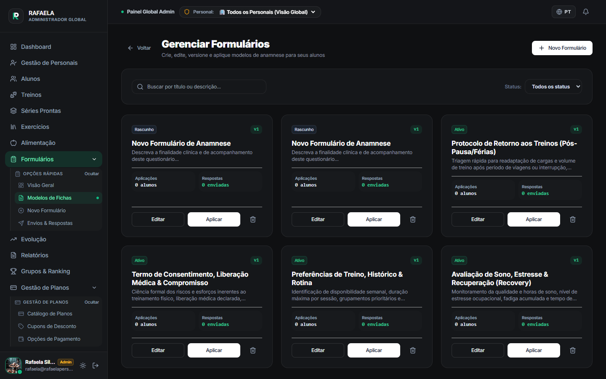

---

### TC-13 • Editor de Perguntas com Seletor Visual Elegante
- **Categoria**: Anamnese & Formulários
- **Status**: ✅ SUCESSO (PASS)
- **Descrição**: Novo construtor visual de perguntas com seletor elegante por cards e adição intuitiva de alternativas por tags.

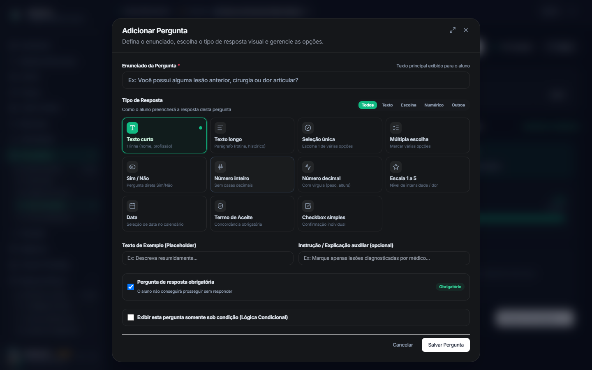

---

### TC-14 • Formulários - Envios & Respostas dos Alunos
- **Categoria**: Anamnese & Formulários
- **Status**: ✅ SUCESSO (PASS)
- **Descrição**: Central de submissões das fichas de anamnese preenchidas pelos alunos para auditoria técnica.

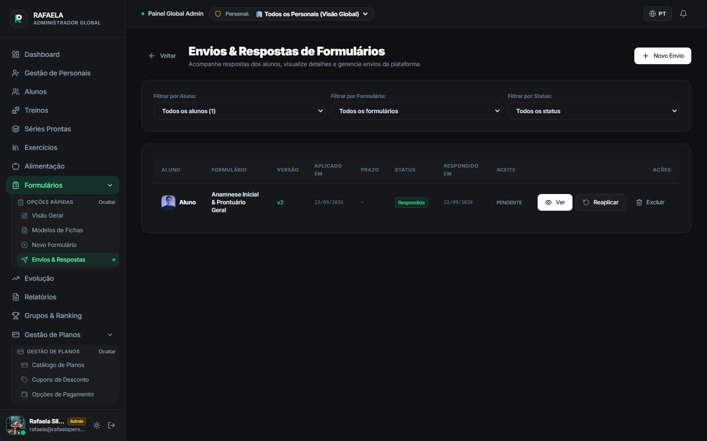

---

### TC-15 • Configurações - Permissões HBAC em Tabela
- **Categoria**: Configurações & HBAC
- **Status**: ✅ SUCESSO (PASS)
- **Descrição**: Matriz de acessos estruturada em formato de tabela com filtros de busca por nome/email de personal trainer, paginação sob demanda e botões com padding calibrado.

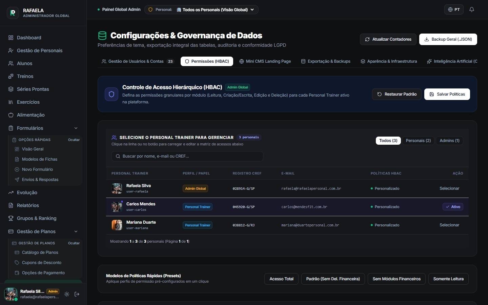

---

### TC-16 • Configurações - Mini CMS Landing Page
- **Categoria**: Configurações & HBAC
- **Status**: ✅ SUCESSO (PASS)
- **Descrição**: Painel de edição visual do conteúdo, depoimentos, preços e destaques da landing page pública da treinadora.

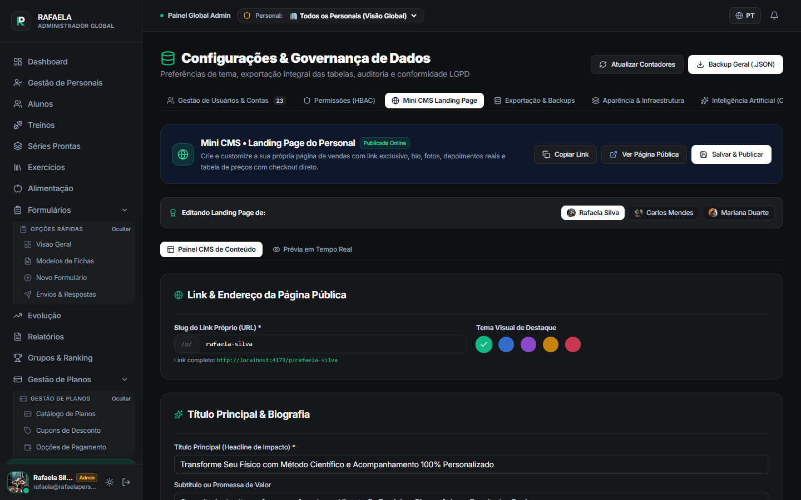

---

### TC-17 • Relatórios & Business Intelligence
- **Categoria**: Relatórios & BI
- **Status**: ✅ SUCESSO (PASS)
- **Descrição**: Gráficos analíticos consolidados de retenção, volume de séries executadas e saúde financeira da carteira.

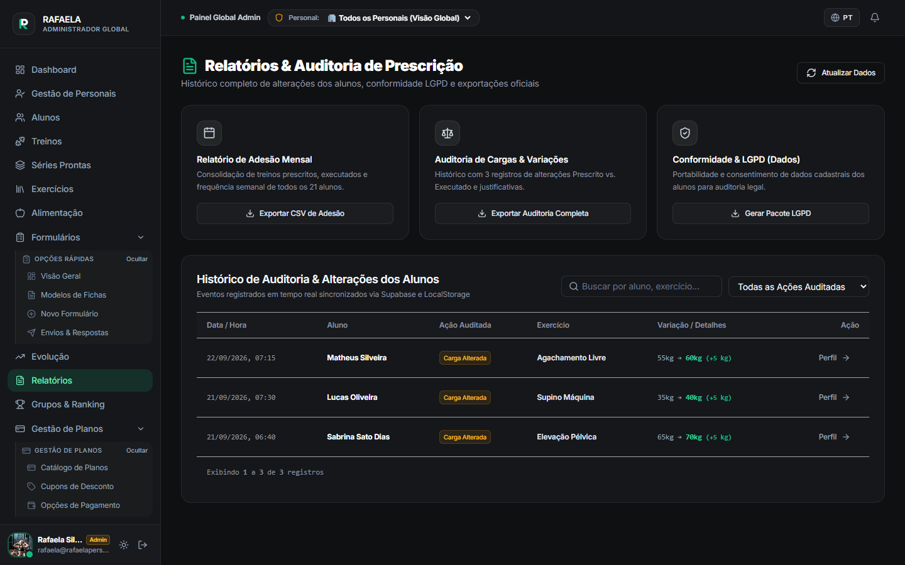

---

### TC-18 • Gestão de Planos & Cupons Promocionais
- **Categoria**: Financeiro & Planos
- **Status**: ✅ SUCESSO (PASS)
- **Descrição**: Catálogo de assinaturas mensais, trimestrais e controle de cupons com desconto em percentual ou valor fixo.

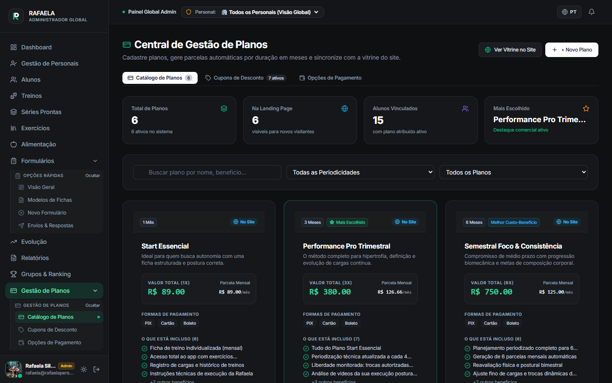

---

### TC-19 • Ranking & Gamificação - Painel Personal
- **Categoria**: Gamificação
- **Status**: ✅ SUCESSO (PASS)
- **Descrição**: Gestão dos grupos de competição, configuração de pesos de pontuação e acompanhamento do pódio dos alunos.

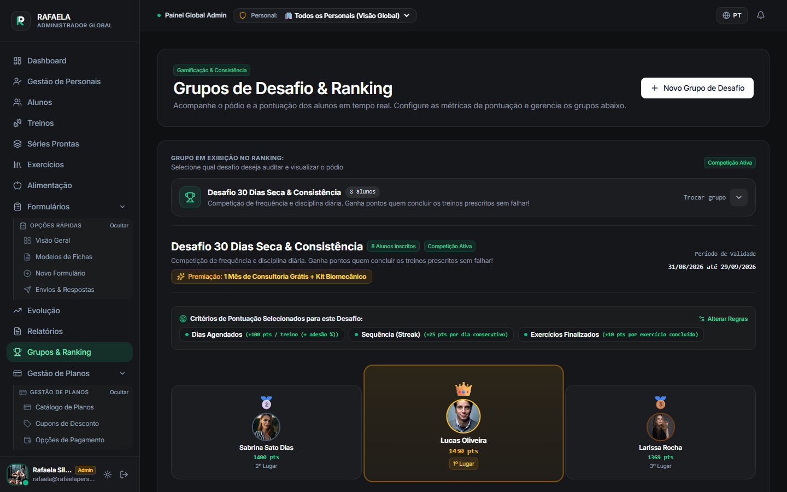

---

### TC-20 • Portal do Aluno - Dashboard & Streak
- **Categoria**: Portal do Aluno
- **Status**: ✅ SUCESSO (PASS)
- **Descrição**: Painel do aluno Lucas Oliveira com sequência de treinos (streak), calorias estimadas e acesso ao treino do dia.

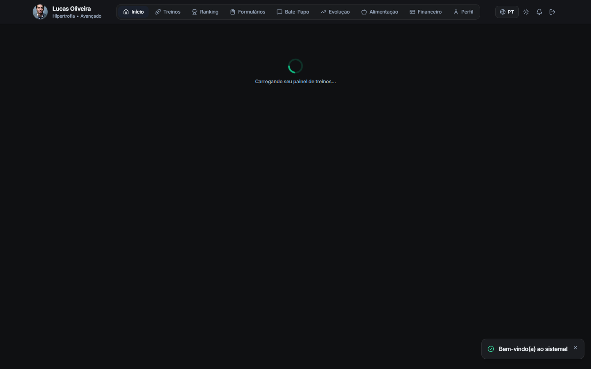

---

### TC-21 • Portal do Aluno - Plano Alimentar
- **Categoria**: Portal do Aluno
- **Status**: ✅ SUCESSO (PASS)
- **Descrição**: Visualização clara das refeições diárias, horários prescritos e tabela de substituições alimentares.

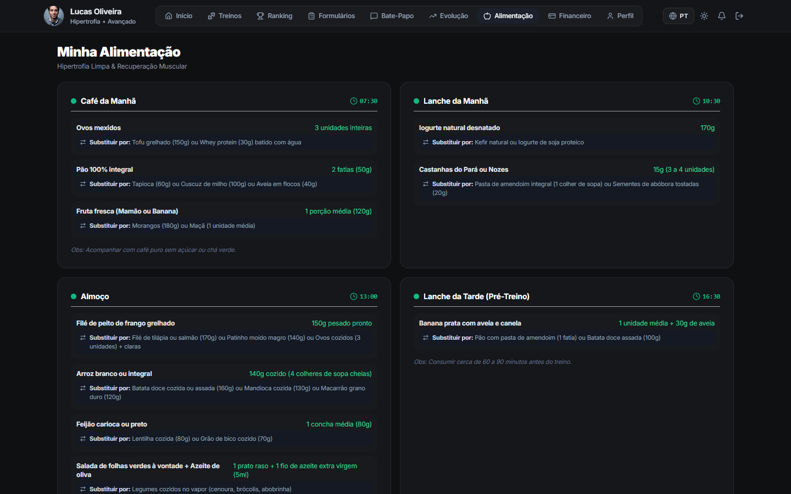

---

### TC-22 • Portal do Aluno - Treino Ativo em Execução
- **Categoria**: Portal do Aluno
- **Status**: ✅ SUCESSO (PASS)
- **Descrição**: Interface interativa de treino com cronômetro de descanso regressivo, registro de séries, repetições e cargas reais executadas.

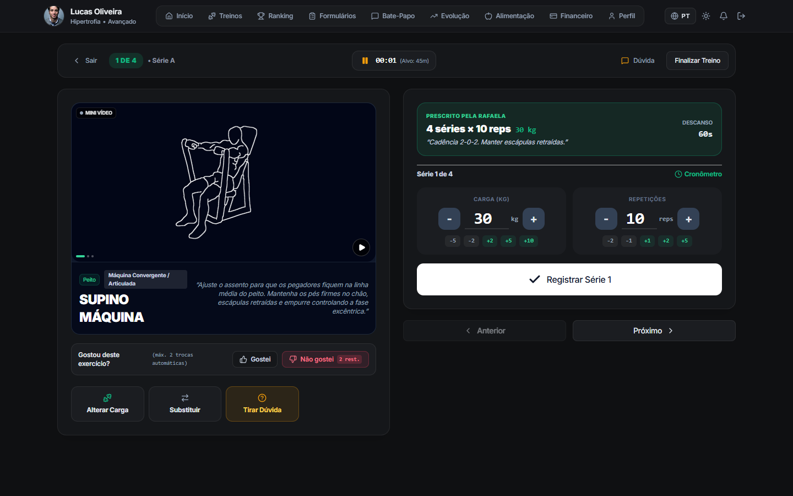

---

### TC-23 • Finalização de Treino & Pontuação do Ranking
- **Categoria**: Gamificação
- **Status**: ✅ SUCESSO (PASS)
- **Descrição**: Modal de conclusão com avaliação subjetiva do treino, percepção de esforço (RPE) e concessão de pontos do ranking.

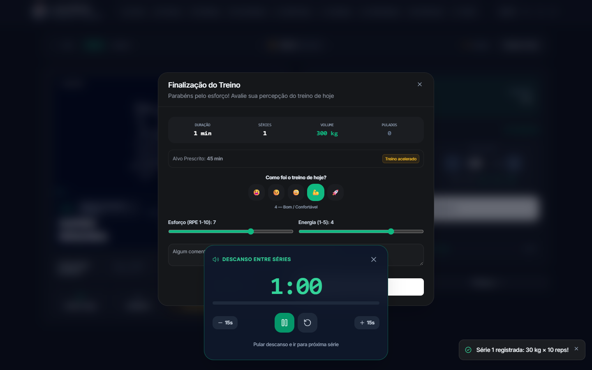

---

### TC-24 • Portal do Aluno - Ranking Geral dos Alunos
- **Categoria**: Gamificação
- **Status**: ✅ SUCESSO (PASS)
- **Descrição**: Tabela de classificação e pódio dos alunos atualizados em tempo real após a conclusão da sessão de treino.

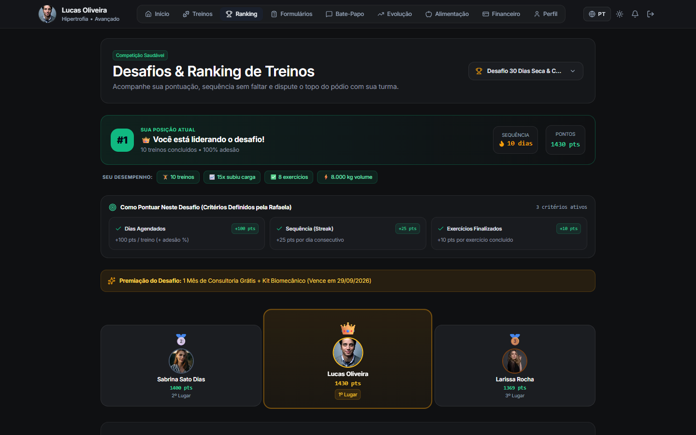

---

### TC-25 • Exclusão Segura de Aluno com Confirmação
- **Categoria**: Gestão de Alunos
- **Status**: ✅ SUCESSO (PASS)
- **Descrição**: Aba de configurações do perfil do aluno com modal de segurança e auditoria para remoção definitiva de registros.

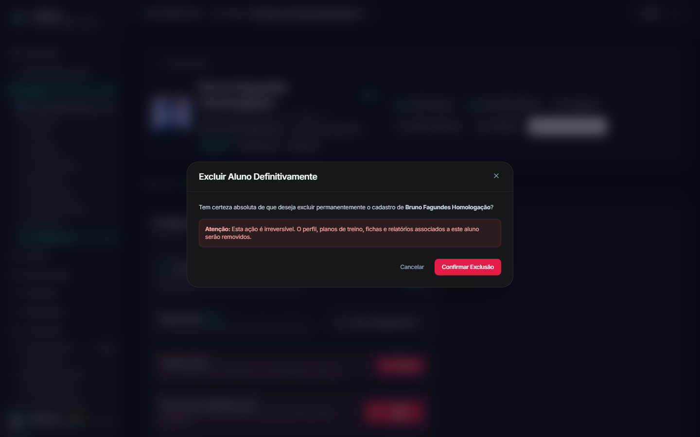

---

### TC-26 • Landing Page Pública da Treinadora
- **Categoria**: Público & CMS
- **Status**: ✅ SUCESSO (PASS)
- **Descrição**: Página responsiva pública de conversão de clientes com apresentação da metodologia, planos e depoimentos.

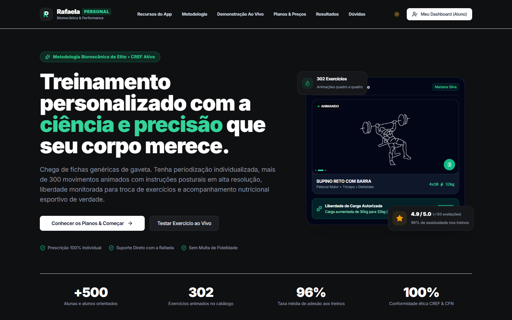

---

## 🚀 Como Executar Novamente a Suíte de Testes

Para rodar a bateria de testes automatizados e atualizar os screenshots e relatórios:

```bash
# 1. Iniciar o servidor de preview ou build
npm run build
npx vite preview --port 4173

# 2. Em outro terminal, executar a suíte Playwright
node scripts/run-evidence-suite.js
```
