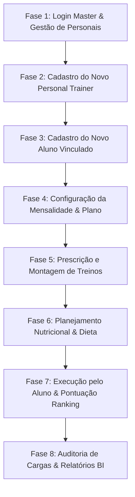

# 📋 Roteiro de Automação de Testes E2E • Plataforma Rafaela Personal

Este documento é a especificação formal e agnóstica de plataforma do **Roteiro de Testes Ponta a Ponta (E2E)** da plataforma. Ele foi desenhado para ser implementado em qualquer ferramenta de automação (Playwright, Cypress, Selenium WebDriver, Robot Framework ou Postman/Newman) ou executado por equipes de Quality Assurance (QA).

---

## 🎯 Objetivo dos Testes
Validar o ciclo de vida completo do ecossistema SaaS esportivo:
1. **Administração & Gestão de Personais**: Cadastrar novo Personal Trainer com CREF e especialidades.
2. **Onboarding de Alunos**: Cadastrar novo aluno com metas, rotina e vincular ao personal trainer.
3. **Prescrição Técnica de Treinamento**: Montar divisão de treinos, associar exercícios com player vetorial, cargas e repetições.
4. **Planejamento Nutricional**: Criar plano de dieta com refeições, horários e substituições inteligentes.
5. **Governança Financeira & Mensalidades**: Configurar plano de assinatura (mensal/trimestral), datas de vencimento e parcelamento.
6. **Portal do Aluno & Gamificação**: Acessar como aluno, visualizar treino/dieta, executar sessão ativa de treino com cronômetro, salvar esforço (RPE) e pontuar no ranking.
7. **Auditoria em Tempo Real & BI**: Verificar o feed de auditoria de alterações pelo personal e relatórios analíticos de retenção.

---

## 🏗️ Pré-requisitos & Ambiente de Teste

| Item | Especificação |
|:---|:---|
| **URL Base da Aplicação** | `http://localhost:4173` (ou URL de staging/produção) |
| **Resolução Recomendada** | `1440 x 900` (Desktop HD) |
| **Navegador Homologado** | Chromium / Microsoft Edge / Google Chrome |
| **Armazenamento** | Supabase PostgreSQL com Fallback para LocalStorage Híbrido |
| **Massa de Teste Isolada** | Nomes com sufixo `QA` para fácil rastreabilidade e limpeza |

---

## 📊 Matriz de Dados de Teste (Test Data)

### 1. Personal Trainer
- **Nome**: `Rodrigo Personal QA`
- **E-mail**: `rodrigo.qa@personal.com.br`
- **WhatsApp**: `(11) 97777-6666`
- **CREF**: `088765-G/SP`
- **Especialidades**: `Hipertrofia, Força, Reabilitação Postural`
- **Perfil / Role**: `personal`
- **Status**: `Ativo`

### 2. Aluno
- **Nome**: `Matheus Silva Aluno QA`
- **E-mail**: `matheus.qa@aluno.com.br`
- **WhatsApp**: `(11) 98888-5555`
- **Data de Nascimento**: `1998-05-20`
- **Gênero**: `Masculino`
- **Metas**: `Hipertrofia, Força`
- **Dias de Disponibilidade**: `Segunda, Quarta, Sexta`
- **Nível**: `Intermediário`
- **Personal Responsável**: `Rodrigo Personal QA` (ou `Rafaela Silva`)

### 3. Ficha de Treino
- **Nome do Plano**: `Ciclo Hipertrofia & Força QA`
- **Divisão**: `Treino A - Peitoral e Tríceps`
- **Exercícios**: `Supino Reto com Barra`, `Tríceps Polia Alta`
- **Séries / Carga**: `4 séries × 10 reps com 30 kg`, descanso `60s`

### 4. Plano Nutricional
- **Refeição**: `Café da Manhã Anabólico` (Horário: `07:30`)
- **Alimento**: `Ovos Mexidos (4 unidades)`
- **Substituição Autorizada**: `Whey Protein 30g + Aveia 40g`

### 5. Configuração Financeira & Mensalidade
- **Plano**: `Consultoria Trimestral Presencial`
- **Periodicidade**: `trimestral`
- **Valor Total**: `R$ 350,00`
- **Dia de Vencimento**: `10`
- **Quantidade de Parcelas**: `3 parcelas automáticas`

---

## 📝 Passo a Passo Detalhado (Step-by-Step)



---

### 🔹 CASO DE TESTE CT-AUT-01: Autenticação Master & Acesso Administrativo
- **Objetivo**: Acessar o sistema com perfil administrativo / personal trainer master.
- **URL**: `/login`
- **Passos**:
  1. Navegar para `{BASE_URL}/login`.
  2. Aguardar o seletor `text=Acesso Rápido` ficar visível.
  3. Clicar no botão `button:has-text("Rafaela Silva")` (ou preencher credenciais).
  4. Validar redirecionamento para `{BASE_URL}/personal/dashboard`.
- **Critério de Aceite**: Dashboard carregado com KPIs globais e menu lateral visível.
- **Seletor Chave**: `h1:has-text("Visão Geral")` ou `text=Alunos Ativos`.

---

### 🔹 CASO DE TESTE CT-AUT-02: Cadastro de Novo Personal Trainer
- **Objetivo**: Registrar um novo personal trainer no ecossistema multi-tenant.
- **URL**: `/personal/trainers`
- **Passos**:
  1. Navegar para `/personal/trainers`.
  2. Validar o carregamento da lista de personais cadastrados.
  3. Clicar no botão `button:has-text("Novo Personal")`.
  4. Preencher o formulário do modal:
     - Nome: `input[placeholder*="Carlos Mendes"]` -> `Rodrigo Personal QA`
     - E-mail: `input[placeholder*="carlos@email.com"]` -> `rodrigo.qa@personal.com.br`
     - WhatsApp: `input[placeholder*="98888-7777"]` -> `(11) 97777-6666`
     - CREF: `input[placeholder*="045920-G/SP"]` -> `088765-G/SP`
     - Especialidades: `input[placeholder*="Hipertrofia"]` -> `Hipertrofia, Força, Reabilitação Postural`
  5. Clicar em `button[type="submit"]:has-text("Cadastrar Personal"), button:has-text("Salvar")`.
  6. Validar fechamento do modal e exibição do card de `Rodrigo Personal QA`.
- **Critério de Aceite**: O novo personal trainer aparece na listagem com status `Ativo` e CREF visível.
- **Seletor Chave**: `text=Rodrigo Personal QA`.

---

### 🔹 CASO DE TESTE CT-AUT-03: Cadastro e Vínculo de Novo Aluno
- **Objetivo**: Cadastrar um novo aluno atribuído ao ecossistema do personal.
- **URL**: `/personal/students/new`
- **Passos**:
  1. Navegar para `/personal/students/new`.
  2. Aguardar o formulário `input[placeholder*="Mariana Silva"]`.
  3. Preencher dados pessoais:
     - Nome: `Matheus Silva Aluno QA`
     - E-mail: `matheus.qa@aluno.com.br`
     - WhatsApp: `(11) 98888-5555`
     - Data de Nascimento: `1998-05-20`
  4. Selecionar objetivos e dias de treino (Segunda, Quarta, Sexta).
  5. Clicar no botão `button:has-text("Salvar e Cadastrar Aluno")`.
  6. Aguardar redirecionamento para `/personal/students`.
- **Critério de Aceite**: Aluno `Matheus Silva Aluno QA` é listado na grade de alunos com status `Ativo`.
- **Seletor Chave**: `text=Matheus Silva Aluno QA`.

---

### 🔹 CASO DE TESTE CT-AUT-04: Configuração de Mensalidade & Plano Financeiro
- **Objetivo**: Parametrizar a assinatura financeira, valor e parcelamento do aluno.
- **URL**: `/personal/students/:id`
- **Passos**:
  1. Clicar no card do aluno `Matheus Silva Aluno QA` na listagem.
  2. Na página de detalhes do aluno, clicar no botão `button:has-text("Plano & Mensalidade")`.
  3. No modal financeiro:
     - Selecionar Periodicidade: `trimestral`.
     - Definir Valor (R$): `350`.
     - Dia de Vencimento: `10`.
     - Confirmar geração de parcelas.
  4. Clicar no botão `button:has-text("Salvar Plano & Mensalidades")`.
  5. Validar fechamento do modal e atualização do badge de plano financeiro no perfil.
- **Critério de Aceite**: O aluno exibe vigência do plano ativa e parcelas registradas.
- **Seletor Chave**: `text=Plano Ativo` ou `text=Consultoria`.

---

### 🔹 CASO DE TESTE CT-AUT-05: Prescrição e Montagem de Treinos
- **Objetivo**: Montar e publicar uma rotina técnica de treino personalizada.
- **URL**: `/personal/workouts/new?studentId={studentId}`
- **Passos**:
  1. No perfil do aluno, clicar no botão `button:has-text("Editar / Novo Treino")`.
  2. No Construtor de Treinos (`Criador de Treinos Personalizados`), o aluno já vem selecionado.
  3. Configurar os dias de treino (Segunda, Quarta, Sexta).
  4. Adicionar/ajustar exercícios (ex: Supino, Puxada) com séries, repetições e carga.
  5. Clicar em `button:has-text("Salvar Prescrição Completa"), button:has-text("Salvar Treino")`.
  6. Aguardar o salvamento e retorno à página de perfil do aluno.
- **Critério de Aceite**: A aba de treinos do aluno exibe a rotina técnica publicada e pronta para execução.
- **Seletor Chave**: `text=Treino Personalizado` ou `text=Exercícios`.

---

### 🔹 CASO DE TESTE CT-AUT-06: Configuração de Dieta & Plano Alimentar
- **Objetivo**: Prescrever orientações alimentares diárias e opções de substituição.
- **URL**: `/personal/students/:id?tab=alimentacao`
- **Passos**:
  1. No perfil do aluno, acessar a aba `Alimentação`.
  2. Clicar no botão `button:has-text("Nova Refeição")`.
  3. Preencher Nome da Refeição: `Café da Manhã Anabólico`, Horário: `07:30`.
  4. Clicar em `button:has-text("Salvar Refeição")`.
  5. Na refeição criada, clicar em `button:has-text("Adicionar Alimento")`.
  6. Preencher Nome do Alimento: `Ovos Mexidos (4 unidades)`, Quantidade: `4 unidades`, Substituições: `30g Whey Protein`.
  7. Clicar em `button:has-text("Salvar Alimento")`.
- **Critério de Aceite**: A refeição e os itens alimentares constam na grade nutricional do aluno.
- **Seletor Chave**: `text=Café da Manhã Anabólico`.

---

### 🔹 CASO DE TESTE CT-AUT-07: Execução de Treino Ativo pelo Aluno & Gamificação
- **Objetivo**: Aluno realiza o treino na academia, valida cargas e pontua no ranking.
- **URL**: `/student/dashboard` -> `/student/workout/today` -> `/student/ranking`
- **Passos**:
  1. Acessar o Portal do Aluno (via botão `Testar como Aluno` ou login com aluno `Lucas Oliveira`).
  2. No painel do aluno, validar o treino do dia e clicar no treino ativo (`/student/workout/today`).
  3. Na interface do treino ativo:
     - Validar contador de séries e animação vetorial do exercício.
     - Registrar a série atual clicando em `button:has-text("Registrar Série")`.
     - Validar disparo do cronômetro de descanso (`RestTimer`).
  4. Clicar em `button:has-text("Finalizar Treino")`.
  5. No modal de finalização, atribuir percepção de esforço (RPE) e notas.
  6. Clicar em `button:has-text("Confirmar"), button:has-text("Finalizar e Salvar")`.
  7. Validar animação de conquista/confetes e redirecionamento para o dashboard.
  8. Navegar para `/student/ranking` e verificar os pontos acumulados pelo treino.
- **Critério de Aceite**: Treino concluído gravado no histórico, streak atualizado e pontuação computada no ranking.
- **Seletor Chave**: `text=Desafios & Ranking de Treinos` e pontuação do aluno.

---

### 🔹 CASO DE TESTE CT-AUT-08: Auditoria de Cargas & Relatórios BI pelo Personal
- **Objetivo**: Personal audita o cumprimento do plano pelo aluno e confere métricas.
- **URL**: `/personal/dashboard` e `/personal/reports`
- **Passos**:
  1. Fazer login novamente como Personal Trainer Rafaela.
  2. No Dashboard, validar o feed de auditoria de treinos finalizados.
  3. Navegar para `/personal/reports`.
  4. Validar os gráficos analíticos de adesão semanal, frequência e volume treinado.
- **Critério de Aceite**: Relatórios atualizados refletindo as sessões e dados cadastrados.
- **Seletor Chave**: `text=Relatórios` e gráficos de performance.

---

## 🛠️ Como Integrar em Ferramentas Externas

### Snippet de Exemplo (Playwright / JavaScript)
```javascript
import { test, expect } from '@playwright/test';

test('Fluxo Completo Personal -> Aluno -> Treino -> Dieta', async ({ page }) => {
  // 1. Login
  await page.goto('http://localhost:4173/login');
  await page.click('button:has-text("Rafaela Silva")');
  await expect(page).toHaveURL(/.*personal\/dashboard/);

  // 2. Criar Personal
  await page.goto('http://localhost:4173/personal/trainers');
  await page.click('button:has-text("Novo Personal")');
  await page.fill('input[placeholder*="Carlos Mendes"]', 'Rodrigo Personal QA');
  await page.fill('input[placeholder*="carlos@email.com"]', 'rodrigo.qa@personal.com.br');
  await page.click('button:has-text("Cadastrar Personal"), button:has-text("Salvar")');
  await expect(page.locator('text=Rodrigo Personal QA')).toBeVisible();

  // 3. Criar Aluno
  await page.goto('http://localhost:4173/personal/students/new');
  await page.fill('input[placeholder*="Mariana Silva"]', 'Matheus Silva Aluno QA');
  await page.fill('input[placeholder*="aluno@email.com"]', 'matheus.qa@aluno.com.br');
  await page.click('button:has-text("Salvar e Cadastrar Aluno")');
  await expect(page.locator('text=Matheus Silva Aluno QA')).toBeVisible();
});
```
