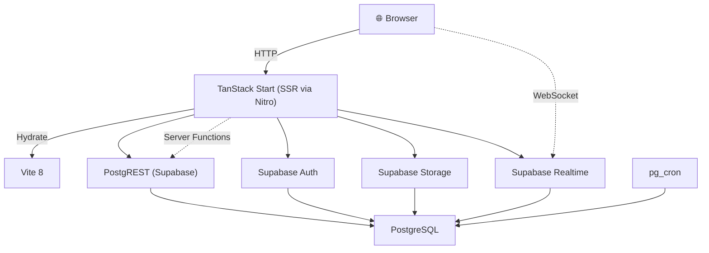

# Architecture

> 🇧🇷 Language: English

## Pattern

Server-first React application using **TanStack Start** with SSR powered by **Nitro**. File-based routing via TanStack Router with React Server Functions for secure, server-only logic.

## High-Level Diagram



## Data Layer

**Supabase** serves as the unified backend providing:

| Service | Purpose |
|---|---|
| **PostgreSQL** | Primary data store with RLS policies on all tables |
| **PostgREST** | Auto-generated REST API from schema |
| **Auth** | Authentication (Google OAuth + Email/Password) |
| **Storage** | File uploads (campaign images, media) |
| **Realtime** | Live broadcasts for number grid updates |
| **pg_cron** | Automatic reservation expiry and maintenance tasks |

### Client Modes

Two Supabase client instances are used throughout the codebase:

| Client | Scope | RLS | Usage |
|---|---|---|---|
| `supabase` | Client-side / authenticated user | Scoped | UI data fetching, user operations |
| `supabaseAdmin` | Server-side only (`*.server.ts`) | Bypassed | Admin CRUD, gateway config, audit |

## Server Functions

Created via `createServerFn()` from TanStack Start. These are the primary mechanism for secure server-side logic.

### Authentication Middleware

```ts
requireSupabaseAuth()  // Ensures valid session exists
requirePermission("campaigns.manage")  // Checks role-based permission
requireGlobalAdmin()  // Ensures GLOBAL_ADMIN role
```

### Module Conventions

- Server-only modules use the `*.server.ts` suffix
- Server functions are never exported to client bundles
- Service-role client is only instantiated in server modules

## State Management

| Layer | Technology | Notes |
|---|---|---|
| **Server State** | React Query (TanStack Query) | All data fetching, caching, mutations |
| **Auth Context** | React Context | Current user, session, permissions |
| **Theme Context** | React Context | Light/dark mode toggle |
| **Client State** | None (no Redux/Zustand) | Form state managed by React Hook Form |

## Realtime

Supabase Realtime subscriptions on the `campaign_numbers` table provide live grid updates. When a number is reserved or released, the broadcast reaches all connected clients viewing the same campaign.

**Flow**:
1. Client requests reservation via RPC
2. RPC `reserve_campaign_numbers` acquires advisory lock, validates, updates row
3. Supabase Realtime broadcasts the change
4. All connected clients receive the update and re-render the grid

## Database Security

### Row Level Security (RLS)

RLS is enabled on **all tables**. Policies are role-aware:

| Role | Access Pattern |
|---|---|
| **GLOBAL_ADMIN** | Full bypass via service-role client |
| **ADMIN** | Broad access via `user_has_admin_role()` helper |
| **PUBLISHER** | Scoped to own campaigns (`campaigns.created_by = auth.uid()`) |

### Advisory Locks

Used for concurrent number reservation to prevent double-sell. The `reserve_campaign_numbers` RPC acquires a session-level advisory lock before modifying `campaign_numbers` rows.

### Rate Limiting

`get_reservation_count_by_device()` RPC tracks reservation attempts per device token within a configurable window.

## Reservation Flow

```
Client → reserve_campaign_numbers RPC
  → Acquire advisory lock
  → Validate: campaign active, number available, rate limit OK
  → UPDATE campaign_numbers SET status='RESERVED', reserved_by, reserved_until
  → Release advisory lock
  → Supabase Realtime broadcasts change
  → All clients receive update → re-render grid
```

## Payment Flow

```
Order Created → Payment Record Created → Gateway PIX Request
  → QR Code Generated → Displayed to Customer
  → 15-minute countdown starts
  → Webhook received from gateway
    → Idempotency check (payment_events table)
    → RPC confirm_payment
      → Updates order status → Releases/allocates numbers
    → Supabase Realtime broadcasts grid update
```

## Deployment

- **Platform**: Lovable (https://lovable.dev)
- **Build**: Vite 8 → Nitro → Cloudflare Workers (SSR)
- **Branch**: main (auto-deploy on push)
- **Route Tree**: Auto-generated via `vite build`
