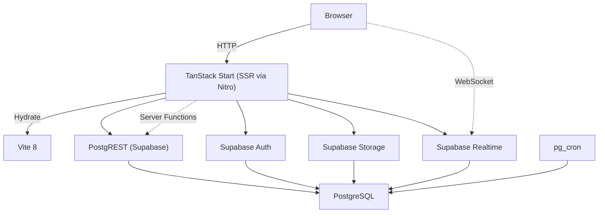

# Arquitetura

> 🇧🇷 Language: Portugues do Brasil

## Padrao

Aplicacao server-first React utilizando **TanStack Start** com SSR via **Nitro**. Roteamento file-based via TanStack Router com React Server Functions para logica segura exclusivamente no servidor.

## Diagrama de Alto Nivel



## Camada de Dados

**Supabase** serve como backend unificado fornecendo:

| Servico | Finalidade |
|---|---|
| **PostgreSQL** | Armazenamento principal de dados com politicas RLS em todas as tabelas |
| **PostgREST** | API REST auto-gerada a partir do schema |
| **Auth** | Autenticacao (Google OAuth + Email/Senha) |
| **Storage** | Upload de arquivos (imagens de campanha, midia) |
| **Realtime** | Transmissoes ao vivo para atualizacoes da grade de numeros |
| **pg_cron** | Expiracao automatica de reservas e tarefas de manutencao |

### Modos de Cliente

Dois clientes Supabase sao utilizados em todo o codigo-fonte:

| Cliente | Escopo | RLS | Uso |
|---|---|---|---|
| `supabase` | Lado do cliente / usuario autenticado | Escopado | Busca de dados na UI, operacoes do usuario |
| `supabaseAdmin` | Apenas no servidor (`*.server.ts`) | Ignorado | CRUD admin, config de gateways, auditoria |

## Server Functions

Criadas via `createServerFn()` do TanStack Start. Sao o mecanismo principal para logica segura do lado do servidor.

### Middleware de Autenticacao

```ts
requireSupabaseAuth()  // Garante que uma sessao valida exista
requirePermission("campaigns.manage")  // Verifica permissao baseada em papel
requireGlobalAdmin()  // Garante o papel GLOBAL_ADMIN
```

### Convencoes de Modulos

- Modulos exclusivamente do servidor utilizam o sufixo `*.server.ts`
- Server functions nunca sao exportadas para bundles do cliente
- Cliente service-role e instanciado apenas em modulos do servidor

## Gerenciamento de Estado

| Camada | Tecnologia | Observacoes |
|---|---|---|
| **Estado do Servidor** | React Query (TanStack Query) | Todas as buscas de dados, cache, mutations |
| **Contexto de Auth** | React Context | Usuario atual, sessao, permissoes |
| **Contexto de Tema** | React Context | Alternancia modo claro/escuro |
| **Estado do Cliente** | Nenhum (sem Redux/Zustand) | Estado de formulario gerenciado pelo React Hook Form |

## Realtime

Inscricoes Supabase Realtime na tabela `campaign_numbers` fornecem atualizacoes ao vivo da grade. Quando um numero e reservado ou liberado, a transmissao alcança todos os clients conectados visualizando a mesma campanha.

**Fluxo**:
1. Cliente solicita reserva via RPC
2. RPC `reserve_campaign_numbers` adquire advisory lock, valida, atualiza a linha
3. Supabase Realtime transmite a mudanca
4. Todos os clients conectados recebem a atualizacao e re-renderizam a grade

## Seguranca do Banco

### Row Level Security (RLS)

RLS habilitado em **todas as tabelas**. Politicas conscientes de papel:

| Papel | Padrao de Acesso |
|---|---|
| **GLOBAL_ADMIN** | Bypass total via cliente service-role |
| **ADMIN** | Acesso amplo via helper `user_has_admin_role()` |
| **PUBLISHER** | Restrito as proprias campanhas (`campaigns.created_by = auth.uid()`) |

### Travas de Aconselhamento (Advisory Locks)

Utilizadas para reserva concorrente de numeros, evitando dupla-venda. A RPC `reserve_campaign_numbers` adquire uma advisory lock a nivel de sessao antes de modificar linhas de `campaign_numbers`.

### Rate Limiting

A RPC `get_reservation_count_by_device()` rastreia tentativas de reserva por token de dispositivo dentro de uma janela configuravel.

## Fluxo de Reserva

```
Cliente → RPC reserve_campaign_numbers
  → Adquire advisory lock
  → Valida: campanha ativa, numero disponivel, rate limit OK
  → UPDATE campaign_numbers SET status='RESERVED', reserved_by, reserved_until
  → Libera advisory lock
  → Supabase Realtime transmite mudanca
  → Todos os clients recebem atualizacao → re-renderizam grade
```

## Fluxo de Pagamento

```
Pedido Criado → Registro de Pagamento Criado → Solicitacao PIX ao Gateway
  → QR Code Gerado → Exibido ao Cliente
  → Contagem regressiva de 15 minutos inicia
  → Webhook recebido do gateway
    → Verificacao de idempotencia (tabela payment_events)
    → RPC confirm_payment
      → Atualiza status do pedido → Libera/aloca numeros
    → Supabase Realtime transmite atualizacao da grade
```

## Deploy

- **Plataforma**: Lovable (https://lovable.dev)
- **Build**: Vite 8 → Nitro → Cloudflare Workers (SSR)
- **Branch**: main (deploy automatico ao push)
- **Arvore de Rotas**: Auto-gerada via `vite build`
