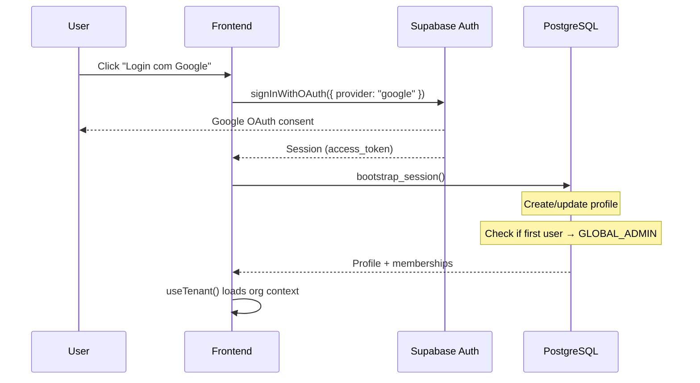
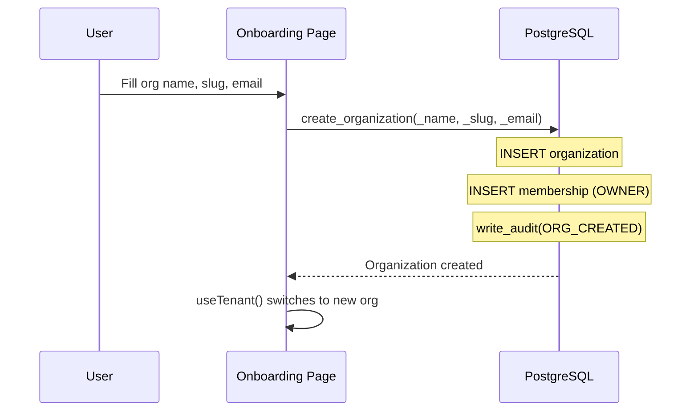

# Authentication & Multi-tenancy

> Language: EN | [Português (pt-BR)](../../pt-BR/application/auth.md)
>
> Status: ACCEPTED
>
> Documentation Standard v1.0

## Purpose

RaffleHub uses Google OAuth via Supabase Auth (Lovable Cloud Auth) for authentication. Multi-tenancy is achieved through organization-scoped data isolation with RLS and SECURITY DEFINER functions.

## Scope

| In scope | Notes |
| --- | --- |
| Authentication | Google OAuth via Supabase Auth |
| Session management | `bootstrap_session()` on first login |
| Organization creation | Onboarding flow for first org |
| Membership management | Invite, accept, role change, remove |
| Multi-tenancy | RLS-based isolation per organization |
| Platform admin | GLOBAL_ADMIN role for super-admin access |

## Authentication Flow

## Session Bootstrap

The `bootstrap_session()` function runs on every login:

1. Upserts `profiles` row (name, email, avatar from OAuth)
2. Updates `last_seen_at`
3. Checks `platform_roles` — if first user, grants GLOBAL_ADMIN
4. Returns profile data

## Organization Creation

## Multi-Tenancy Model

| Mechanism | Implementation |
| --- | --- |
| Data isolation | RLS policies on every table; `organization_id` FK |
| Access control | SECURITY DEFINER functions check `org_is_active()` + `has_permission()` |
| Client-side | `useTenant()` provides current org context |
| Tenant switching | `switchOrganization()` updates Zustand store + localStorage |

## Route Guards

| Guard | Behavior |
| --- | --- |
| Unauthenticated | Redirect to `/auth` |
| No organization | Redirect to `/onboarding` |
| Not GLOBAL_ADMIN (for `/platform`) | Show access denied card |
| Permission-based UI | `PermissionGate` component hides elements |

## RPC Functions

| Function | Access | Purpose |
| --- | --- | --- |
| `bootstrap_session()` | authenticated | Create/update profile, auto-promote GLOBAL_ADMIN |
| `create_organization()` | authenticated | Create org + OWNER membership |
| `invite_member()` | users.invite | Send invitation |
| `accept_invitation()` | authenticated | Accept invitation by token |
| `list_organization_members()` | users.view | Paginated member list |
| `change_member_role()` | roles.update | Change member role |
| `remove_member()` | users.remove | Remove member from org |
| `transfer_ownership()` | ownership.transfer | Transfer OWNER role |
| `suspend_own_organization()` | organization.suspend | Self-suspend org |

## Related Documentation

| Document | Path |
| --- | --- |
| Permissions | [permissions.md](permissions.md) |
| Security | [../security/overview.md](../security/overview.md) |
| RPC functions | [../contracts/rpc-functions.md](../contracts/rpc-functions.md) |
