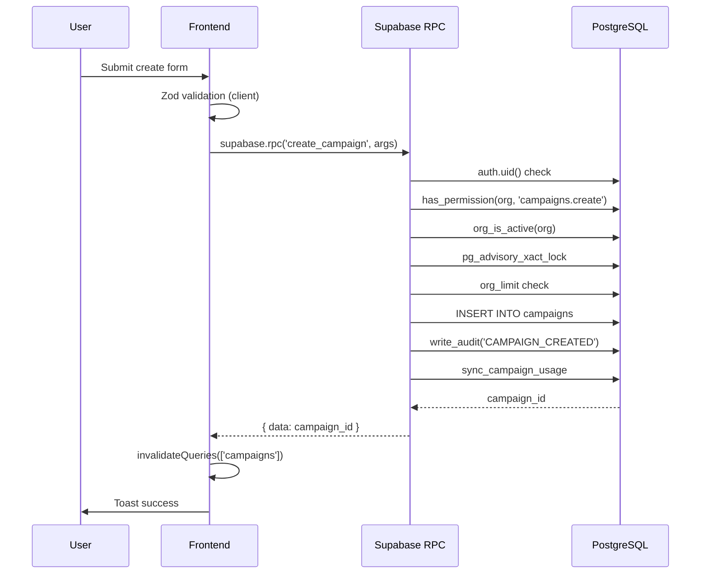

# Backend RPCs

> Language: EN | [Português (pt-BR)](../pt-BR/application/backend-rpcs.md)
>
> Status: ACCEPTED
>
> Documentation Standard v1.0

## Purpose

Documents all PostgreSQL RPC functions that serve as the backend business logic layer. Every mutation in RaffleHub flows through these SECURITY DEFINER functions.

## Architecture Pattern

```
Frontend → supabase.rpc('function_name', { args }) → PostgreSQL function → RLS bypass → Business logic → Audit
```

All RPCs follow a consistent pattern:
1. **Auth check**: `IF auth.uid() IS NULL THEN RAISE EXCEPTION 'NOT_AUTHENTICATED';`
2. **Permission check**: `IF NOT has_permission(_org, 'permission.key') THEN RAISE EXCEPTION 'FORBIDDEN';`
3. **Org active check**: `IF NOT org_is_active(_org) THEN RAISE EXCEPTION 'ORGANIZATION_NOT_ACTIVE';`
4. **Advisory lock** (for mutations): `PERFORM pg_advisory_xact_lock(hashtext('key:' || _org::text));`
5. **Plan limit check**: `PERFORM org_limit(_org, 'key')`
6. **Business logic**: INSERT/UPDATE/DELETE
7. **Audit**: `PERFORM write_audit(_org, 'ACTION', 'entity', id, context)`
8. **Usage sync**: `PERFORM sync_campaign_usage(_org)` (when applicable)

## Error Convention

All RPCs raise exceptions with string error codes (e.g., `'NOT_FOUND'`, `'FORBIDDEN'`). The frontend `describeError()` function maps these to user-facing Portuguese messages.

Common error codes:
| Code | Meaning |
| --- | --- |
| `NOT_AUTHENTICATED` | No JWT provided |
| `FORBIDDEN` | Insufficient permissions |
| `NOT_FOUND` | Entity not found |
| `ORGANIZATION_NOT_ACTIVE` | Organization suspended |
| `INVALID_STATUS_TRANSITION` | Campaign status machine violation |
| `PLAN_LIMIT_REACHED_*` | Plan limit exceeded |
| `CAMPAIGN_ARCHIVED_READONLY` | Cannot edit archived campaign |
| `SLUG_LOCKED_AFTER_PUBLISH` | Slug immutable after first publish |
| `CRITICAL_FIELD_LOCKED` | Field locked for current status |

## Service Layer (Frontend)

| Service | File | Methods |
| --- | --- | --- |
| `CampaignService` | `services/campaigns.ts` | list, metrics, get, create, update, setStatus, publish, pause, finish, archive, restore |
| `CampaignImageService` | `services/campaigns.ts` | list, validate, assertDecodable, upload, setCover, remove, reorder, signedUrl |
| `PublicCampaignService` | `services/campaigns.ts` | bySlug |
| `MembershipService` | `services/memberships.ts` | listMembers, listInvitations, invite, resendInvitation, revokeInvitation, previewInvitation, acceptInvitation, changeRole, setStatus, remove, transferOwnership, inviteLink |
| `OrganizationService` | `services/organizations.ts` | create, get, update, setStatus, suspendSelf, listAll, uploadLogo, removeLogo, signedLogoUrl |
| `AuditService` | `services/organizations.ts` | list, listForOrganization, listGlobal |
| `PlatformService` | `services/organizations.ts` | metrics, listOrganizations, listUsers, organizationDetail |
| `PermissionService` | `services/permissions.ts` | listMine, matrix, has, hasAny |
| `PlanLimitService` | `services/plans.ts` | listPlans, listPlanFeatures, listPlanLimits, getContext, canUseFeature, remaining, canInviteUser, canCreateCampaign, canAddNumbers |
| `TenantService` | `services/tenant.ts` | bootstrapSession, isGlobalAdmin, listMyMemberships, resolveActive |

## Data Flow: Campaign Creation



## Security Properties

| Property | Implementation |
| --- | --- |
| Authentication | `auth.uid() IS NOT NULL` check at start of every RPC |
| Authorization | `has_permission(org, 'key')` check after auth |
| Tenant isolation | `organization_id` FK + RLS policies (defense in depth) |
| Concurrency | `pg_advisory_xact_lock(hashtext('scope:' || org))` |
| Audit trail | `write_audit()` called on every mutation |
| Plan limits | `org_limit()` checked before resource creation |

## Related Documentation

| Document | Path |
| --- | --- |
| Architecture Overview | [../architecture/overview.md](../architecture/overview.md) |
| Data Model | [../architecture/data-model.md](../architecture/data-model.md) |
| REST API Contracts | [../contracts/rest-api.md](../contracts/rest-api.md) |
| Permissions | [permissions.md](permissions.md) |
