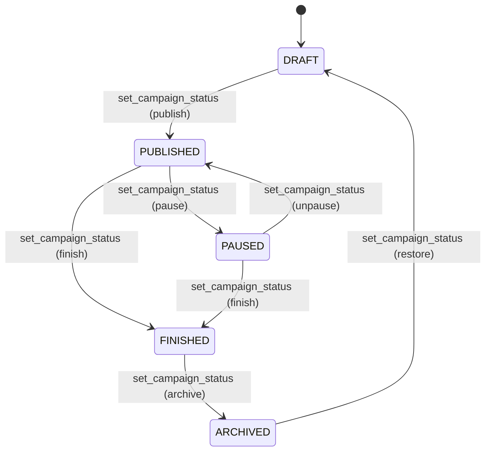

# Campaigns

> Language: EN | [Português (pt-BR)](../../pt-BR/application/campaigns.md)
>
> Status: ACCEPTED
>
> Documentation Standard v1.0

## Purpose

Campaigns are the core domain entity in RaffleHub. Each campaign represents a raffle with a product, a set of numbered tickets, a per-number price, and a lifecycle from draft to finished.

## Scope

| In scope | Notes |
| --- | --- |
| Campaign CRUD | Create, update, status transitions |
| Campaign images | Cover + gallery (up to 10) with reorder |
| Status lifecycle | DRAFT → PUBLISHED → PAUSED/FINISHED → ARCHIVED |
| Metrics | Counts by status, revenue calculations |
| Public view | Published campaigns accessible via slug |

## Campaign Lifecycle

### Valid Transitions

| From | To | Allowed |
| --- | --- | --- |
| DRAFT | PUBLISHED | Yes |
| PUBLISHED | PAUSED | Yes |
| PUBLISHED | FINISHED | Yes |
| PAUSED | PUBLISHED | Yes |
| PAUSED | FINISHED | Yes |
| FINISHED | ARCHIVED | Yes |
| ARCHIVED | DRAFT | Yes (restore) |
| DRAFT | PAUSED | No |
| DRAFT | FINISHED | No |
| PUBLISHED | ARCHIVED | No |
| PAUSED | ARCHIVED | No |

## Data Model

| Field | Type | Description |
| --- | --- | --- |
| `id` | UUID | Primary key |
| `organization_id` | UUID | FK to organizations |
| `name` | TEXT | Campaign name |
| `slug` | TEXT | URL-safe unique slug |
| `description` | TEXT | Optional description |
| `product_name` | TEXT | Product being raffled |
| `product_description` | TEXT | Optional product details |
| `total_numbers` | INTEGER | Total available numbers |
| `number_price` | NUMERIC | Price per number |
| `currency` | TEXT | BRL, USD, or EUR |
| `status` | campaign_status | Current lifecycle status |
| `start_date` | TIMESTAMPTZ | Optional start date |
| `end_date` | TIMESTAMPTZ | Optional end date |
| `created_at` | TIMESTAMPTZ | Creation timestamp |

## RPC Functions

| Function | Access | Purpose |
| --- | --- | --- |
| `create_campaign()` | campaigns.create | Create new campaign (auto-generates slug) |
| `update_campaign()` | campaigns.update | Update campaign fields |
| `set_campaign_status()` | campaigns.publish/pause/finish/archive/restore | Transition status with validation |
| `list_campaigns()` | campaigns.view | Paginated list with filters and sorting |
| `campaign_metrics()` | campaigns.view | Counts by status |
| `public_campaign()` | anon | Safe public view by slug |
| `add_campaign_image()` | campaigns.manage_images | Add cover or gallery image |
| `delete_campaign_image()` | campaigns.manage_images | Remove image |
| `set_campaign_cover()` | campaigns.manage_images | Set primary cover image |
| `reorder_campaign_images()` | campaigns.manage_images | Reorder gallery images |

## UI Routes

| Route | Purpose |
| --- | --- |
| `/campaigns` | Campaign list with filters, metrics cards |
| `/campaigns/create` | Create form (Zod-validated) |
| `/campaigns/$campaignId` | Detail page (status, metrics, actions) |
| `/campaigns/$campaignId/edit` | Edit form (locked fields based on status) |
| `/c/$slug` | Public campaign page (number grid, reservation) |

## Related Documentation

| Document | Path |
| --- | --- |
| Architecture overview | [../architecture/overview.md](../architecture/overview.md) |
| Data model | [../architecture/data-model.md](../architecture/data-model.md) |
| Numbers | [numbers.md](numbers.md) |
| RPC functions | [../contracts/rpc-functions.md](../contracts/rpc-functions.md) |
