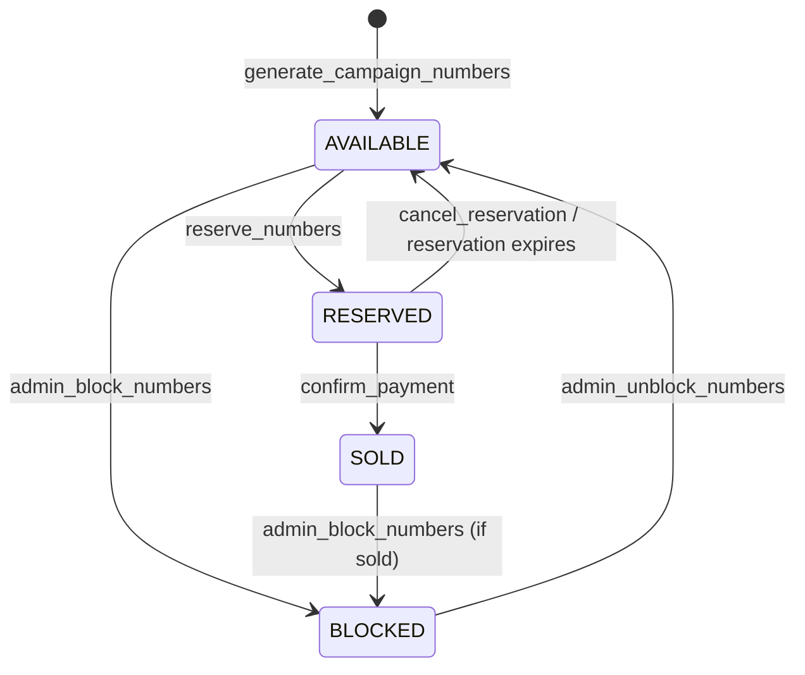
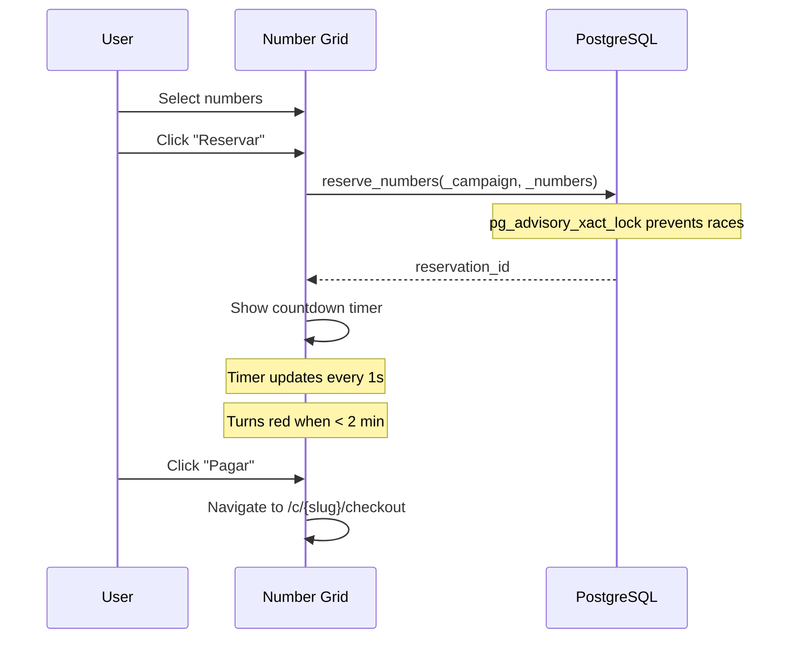

# Number Engine

> Language: EN | [Português (pt-BR)](../../pt-BR/application/numbers.md)
>
> Status: ACCEPTED
>
> Documentation Standard v1.0

## Purpose

The number engine manages individual numbered tickets within a campaign. Numbers can be generated in bulk, reserved temporarily, sold, or blocked. Real-time updates keep all clients in sync.

## Scope

| In scope | Notes |
| --- | --- |
| Auto-generation | Bulk insert on campaign publish (idempotent) |
| Status management | AVAILABLE → RESERVED → SOLD / BLOCKED |
| Reservation flow | Time-limited holds with expiry countdown |
| Block/unblock | Admin can block numbers from sale |
| Real-time | Supabase Realtime for instant UI updates |
| Public grid | Read-only grid for participants |
| Progress bar | Visual AVAILABLE/RESERVED/SOLD/BLOCKED proportions |
| Pagination | 50/page with search and status filter |

## Number Status Lifecycle

## Data Model

### campaign_numbers

| Field | Type | Description |
| --- | --- | --- |
| `id` | UUID | Primary key |
| `campaign_id` | UUID | FK to campaigns |
| `number` | INTEGER | The ticket number (1 to total_numbers) |
| `status` | number_status | AVAILABLE, RESERVED, SOLD, BLOCKED |
| `reserved_by` | UUID | User ID who reserved (nullable) |
| `created_at` | TIMESTAMPTZ | Creation timestamp |

### number_reservations

| Field | Type | Description |
| --- | --- | --- |
| `id` | UUID | Primary key |
| `campaign_id` | UUID | FK to campaigns |
| `user_id` | UUID | FK to auth.users |
| `status` | reservation_status | ACTIVE, EXPIRED, CANCELLED, COMPLETED |
| `expires_at` | TIMESTAMPTZ | Reservation expiry (configurable via `payment_ttl_minutes`) |
| `created_at` | TIMESTAMPTZ | Creation timestamp |

### Constraints

| Constraint | Type | Details |
| --- | --- | --- |
| `campaign_numbers_campaign_id_number_key` | UNIQUE | One number per campaign |
| `number_reservations_campaign_id_user_id_active` | UNIQUE | One active reservation per user per campaign |
| `reservation_expiry_check` | CHECK | `expires_at > created_at` |

## RPC Functions

| Function | Access | Purpose |
| --- | --- | --- |
| `generate_campaign_numbers()` | numbers.manage | Bulk insert AVAILABLE numbers (idempotent) |
| `admin_block_numbers()` | numbers.manage | Set numbers to BLOCKED |
| `admin_unblock_numbers()` | numbers.manage | Set BLOCKED numbers back to AVAILABLE |
| `list_campaign_numbers_admin()` | numbers.view | Paginated list with search/status filter |
| `campaign_number_metrics()` | numbers.view | Counts by status |
| `reserve_numbers()` | reservations.manage | Create time-limited hold (advisory lock) |
| `cancel_reservation()` | reservations.manage | Release held numbers |
| `get_active_reservation()` | reservations.view | Get current active reservation for user |
| `admin_cancel_reservation()` | reservations.manage | Admin cancel any reservation |
| `public_campaign_numbers()` | anon | Safe public view by slug |
| `list_campaign_numbers_with_participant()` | numbers.view | Numbers joined with participant data |

## Real-time Updates

- `useRealtimeNumbers` subscribes to `campaign_numbers` table changes
- Invalidates `campaign-numbers`, `campaign-number-metrics`, `active-reservation`, `public-campaign-numbers` query caches
- All connected clients see status changes instantly

## Reservation Flow

## UI Components

| Component | Purpose |
| --- | --- |
| `NumberGrid` | Interactive grid with status colors, selection, hover tooltip |
| `NumberStatusLegend` | Lightweight legend for cards/dashboards |
| Progress bar (admin) | AVAILABLE/RESERVED/SOLD/BLOCKED proportions with percentages |
| Progress bar (public) | AVAILABLE/RESERVED/SOLD proportions |
| Countdown timer | Live MM:SS countdown, red when < 2 min, disables Pay when expired |

## Related Documentation

| Document | Path |
| --- | --- |
| Campaigns | [campaigns.md](campaigns.md) |
| Payments | [payments.md](payments.md) |
| Participants | [participants.md](participants.md) |
| RPC functions | [../contracts/rpc-functions.md](../contracts/rpc-functions.md) |
