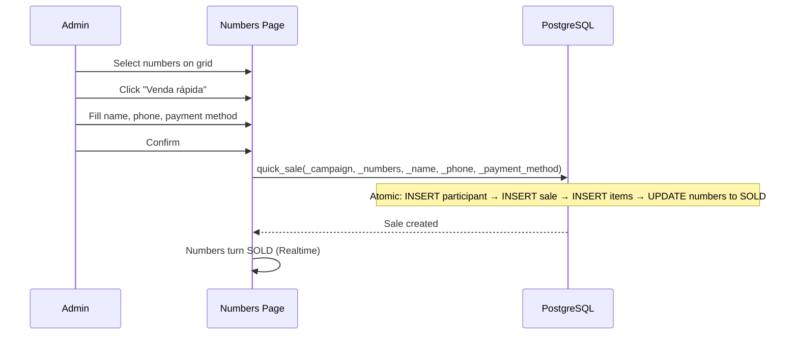

# Participants & Sales

> Language: EN | [Português (pt-BR)](../../pt-BR/application/participants.md)
>
> Status: ACCEPTED
>
> Documentation Standard v1.0

## Purpose

Participants are buyer/contact records associated with campaigns. Sales track which numbers were purchased, either through the online payment flow or admin-initiated manual sales (quick sale, offline).

## Scope

| In scope | Notes |
| --- | --- |
| Participant CRUD | Create, update, list per campaign |
| Participant history | View all numbers and sales for a participant |
| Manual sales | Admin-initiated offline sales |
| Quick sale | Atomically create participant + sale + mark numbers SOLD |
| Number transfer | Move numbers between participants |
| CSV export | Export participants and sales data |

## Data Model

### participants

| Field | Type | Description |
| --- | --- | --- |
| `id` | UUID | Primary key |
| `organization_id` | UUID | FK to organizations |
| `campaign_id` | UUID | FK to campaigns |
| `name` | TEXT | Buyer name |
| `phone` | TEXT | Optional phone |
| `email` | TEXT | Optional email |
| `document` | TEXT | Optional document (CPF/CNPJ) |
| `notes` | TEXT | Optional admin notes |
| `created_at` | TIMESTAMPTZ | Creation timestamp |

### manual_sales

| Field | Type | Description |
| --- | --- | --- |
| `id` | UUID | Primary key |
| `organization_id` | UUID | FK to organizations |
| `campaign_id` | UUID | FK to campaigns |
| `participant_id` | UUID | FK to participants |
| `payment_method` | payment_method | PIX, CASH, CARD, TRANSFER, OTHER |
| `sale_amount` | NUMERIC | Total sale amount |
| `status` | TEXT | active / cancelled |
| `notes` | TEXT | Optional notes |
| `created_at` | TIMESTAMPTZ | Creation timestamp |

### manual_sale_items

| Field | Type | Description |
| --- | --- | --- |
| `id` | UUID | Primary key |
| `sale_id` | UUID | FK to manual_sales |
| `number_id` | UUID | FK to campaign_numbers |

## RPC Functions

| Function | Access | Purpose |
| --- | --- | --- |
| `create_participant()` | participants.manage | Create new participant |
| `update_participant()` | participants.manage | Update participant data |
| `list_participants()` | participants.view | Paginated list with search |
| `get_participant_history()` | participants.view | All numbers and sales for participant |
| `export_participants_csv()` | participants.view | CSV export |
| `quick_sale()` | sales.manage | Atomically: create participant + sale + mark numbers SOLD |
| `create_manual_sale()` | sales.manage | Create manual sale |
| `update_manual_sale()` | sales.manage | Update sale details |
| `cancel_manual_sale()` | sales.manage | Cancel sale (revert numbers to AVAILABLE) |
| `transfer_numbers()` | sales.manage | Move numbers between participants |
| `list_manual_sales()` | sales.view | Paginated list |
| `campaign_sales_metrics()` | sales.view | Revenue and count metrics |
| `export_sales_csv()` | sales.view | CSV export |

## Quick Sale Flow

## UI Routes

| Route | Purpose |
| --- | --- |
| `/participants` | Cross-campaign participant list with CSV export |
| `/campaigns/$campaignId` | Campaign detail with Participants tab |

## Related Documentation

| Document | Path |
| --- | --- |
| Numbers | [numbers.md](numbers.md) |
| Payments | [payments.md](payments.md) |
| Campaigns | [campaigns.md](campaigns.md) |
| RPC functions | [../contracts/rpc-functions.md](../contracts/rpc-functions.md) |
