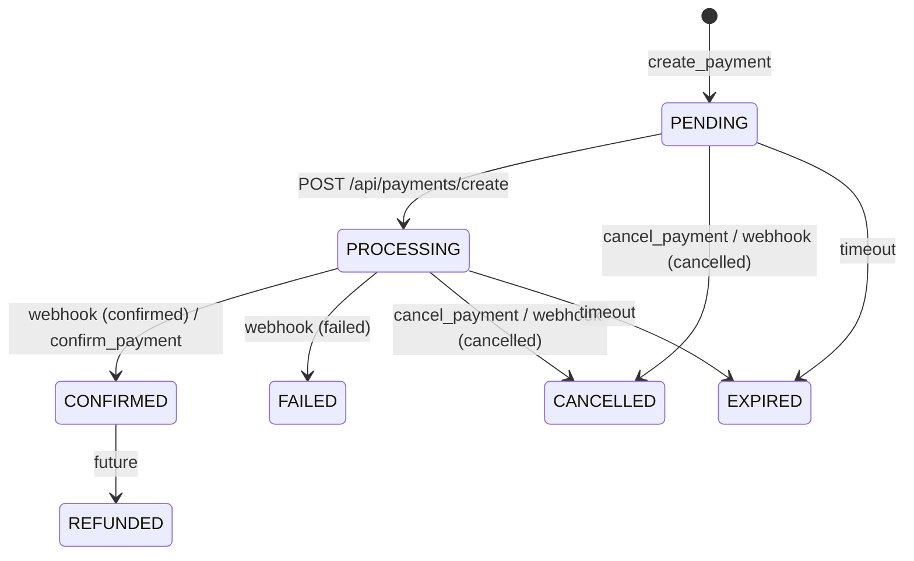
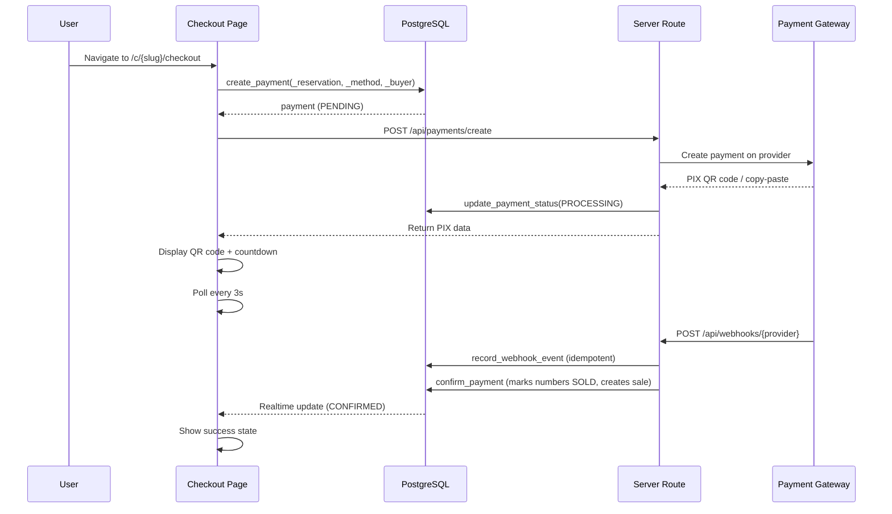

# Payment Engine

> Language: EN | [Português (pt-BR)](../../pt-BR/application/payments.md)
>
> Status: ACCEPTED
>
> Documentation Standard v1.0

## Purpose

The payment engine handles online payment processing for reservations. It supports multiple gateway providers (InfinityPay, Mercado Pago, PagBank), PIX/credit card/boleto methods, webhook-based confirmation, and credential encryption.

## Scope

| In scope | Notes |
| --- | --- |
| Payment creation | Create pending payment linked to reservation |
| Status lifecycle | PENDING → PROCESSING → CONFIRMED/FAILED/CANCELLED/EXPIRED |
| Gateway configuration | Per-org gateway setup with encrypted credentials |
| Webhook handling | Idempotent webhook receiver with status mapping |
| PIX display | QR code + copy-paste code with countdown |
| Public payment view | Checkout page accessible without auth |
| Auto-polling | Client polls for PENDING/PROCESSING payments (3s interval) |
| Real-time | Supabase Realtime for instant payment status updates |

## Payment Status Lifecycle



## Data Model

### payments

| Field | Type | Description |
| --- | --- | --- |
| `id` | UUID | Primary key |
| `organization_id` | UUID | FK to organizations |
| `campaign_id` | UUID | FK to campaigns |
| `reservation_id` | UUID | FK to number_reservations |
| `gateway_id` | UUID | FK to payment_gateways |
| `provider` | payment_gateway_provider | INFINITY_PAY, MERCADO_PAGO, PAGBANK |
| `method` | payment_method_online | PIX, CREDIT_CARD, BOLETO |
| `status` | payment_status | PENDING, PROCESSING, CONFIRMED, FAILED, CANCELLED, EXPIRED, REFUNDED |
| `amount` | NUMERIC | Payment amount |
| `currency` | TEXT | BRL, USD, EUR |
| `buyer_name` | TEXT | Buyer name |
| `buyer_phone` | TEXT | Optional buyer phone |
| `buyer_email` | TEXT | Optional buyer email |
| `buyer_document` | TEXT | Optional buyer document |
| `provider_payment_id` | TEXT | External payment ID from gateway |
| `pix_qr_code` | TEXT | Base64 QR code image |
| `pix_copy_paste` | TEXT | PIX copy-paste code |
| `expires_at` | TIMESTAMPTZ | Payment expiry |
| `paid_at` | TIMESTAMPTZ | Payment confirmation timestamp |
| `created_at` | TIMESTAMPTZ | Creation timestamp |

### payment_gateways

| Field | Type | Description |
| --- | --- | --- |
| `id` | UUID | Primary key |
| `organization_id` | UUID | FK to organizations |
| `provider` | payment_gateway_provider | INFINITY_PAY, MERCADO_PAGO, PAGBANK |
| `name` | TEXT | Display name |
| `credentials_encrypted` | TEXT | PGP-encrypted API credentials |
| `settings` | JSONB | Provider-specific settings |
| `is_active` | BOOLEAN | Whether gateway is enabled |
| `created_at` | TIMESTAMPTZ | Creation timestamp |

### webhook_events

| Field | Type | Description |
| --- | --- | --- |
| `id` | UUID | Primary key |
| `provider` | TEXT | Gateway provider name |
| `provider_event_id` | TEXT | External event ID |
| `payload` | JSONB | Raw webhook payload |
| `processed_at` | TIMESTAMPTZ | Processing timestamp |

## Checkout Flow



## RPC Functions

| Function | Access | Purpose |
| --- | --- | --- |
| `create_payment()` | payments.manage | Create pending payment |
| `update_payment_status()` | payments.manage | Update payment status |
| `confirm_payment()` | payments.manage | Confirm payment, mark numbers SOLD, create sale |
| `cancel_payment()` | payments.manage | Cancel payment |
| `get_payment()` | payments.view | Get payment by ID |
| `public_get_payment()` | anon | Safe public payment view |
| `list_payments()` | payments.view | Paginated list with filters |
| `campaign_payment_metrics()` | payments.view | Revenue and count metrics |
| `create_payment_gateway()` | payments.manage | Create gateway config |
| `update_payment_gateway()` | payments.manage | Update gateway config |
| `delete_payment_gateway()` | payments.manage | Delete gateway config |
| `list_payment_gateways()` | payments.view | List gateway configs |

## Server Routes

| Route | Method | Purpose |
| --- | --- | --- |
| `/api/payments/create` | POST | Create payment via provider (currently stubbed) |
| `/api/webhooks/:provider` | POST | Webhook receiver with idempotency |

## Credential Encryption

Gateway credentials are encrypted at rest using PostgreSQL's `pgp_sym_encrypt`:

```sql
INSERT INTO payment_gateways (..., credentials_encrypted)
VALUES (..., pgp_sym_encrypt($credentials, (SELECT value FROM app_settings WHERE key = 'payment_encryption_key')));
```

The encryption key is stored in `app_settings` table under the key `payment_encryption_key`.

## Auto-Polling

The `usePublicPayment` hook polls every 3 seconds when status is PENDING or PROCESSING:

```typescript
refetchInterval: (query) => {
  const status = query.state.data?.status;
  return status === "PENDING" || status === "PROCESSING" ? 3000 : false;
};
```

## UI Components

| Component | Purpose |
| --- | --- |
| `CheckoutPage` | 5-step flow: INFO → PROCESSING → PAYMENT → CONFIRMED → EXPIRED |
| `BuyerInfoForm` | Name, phone, email, document fields |
| `PixDisplay` | QR code + copy-paste + expiry countdown |
| `PaymentStatusBadge` | Colored badge for payment status |
| `PaymentHistoryTable` | Paginated table of payments |
| `PaymentMetricsCards` | Revenue, confirmed/pending/failed/cancelled counts |
| `GatewayConfigForm` | CRUD form for gateway configuration |

## Related Documentation

| Document | Path |
| --- | --- |
| Numbers | [numbers.md](numbers.md) |
| Campaigns | [campaigns.md](campaigns.md) |
| Security | [../security/overview.md](../security/overview.md) |
| API routes | [../contracts/api-routes.md](../contracts/api-routes.md) |
| RPC functions | [../contracts/rpc-functions.md](../contracts/rpc-functions.md) |
