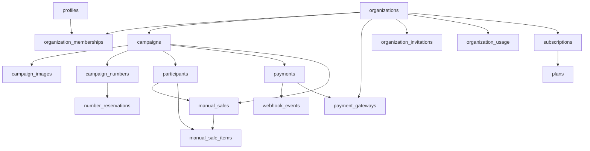

# Data Model

> Language: EN | [Português (pt-BR)](../../pt-BR/architecture/data-model.md)
>
> Status: ACCEPTED
>
> Documentation Standard v1.0

## Purpose

Complete database schema reference for RaffleHub. All business logic lives in PostgreSQL via SECURITY DEFINER functions. The client never writes directly to tables.

## Schemas / Namespaces

| Schema / Store | Purpose | Owner | Classification |
| --- | --- | --- | --- |
| `public` | All application tables, functions, RLS policies | rafflehub | Confirmed |
| `auth` | Supabase Auth (managed externally) | supabase | Confirmed |
| Storage: `org-assets` | Campaign images, org logos | rafflehub | Confirmed |

## Enums

| Enum | Values | Used By |
| --- | --- | --- |
| `org_role` | OWNER, ADMIN, MEMBER, VIEWER | organization_memberships |
| `org_status` | ACTIVE, SUSPENDED, INACTIVE | organizations |
| `membership_status` | ACTIVE, INVITED, SUSPENDED, REMOVED | organization_memberships |
| `invitation_status` | INVITED, ACCEPTED, EXPIRED, REVOKED | organization_invitations |
| `campaign_status` | DRAFT, PUBLISHED, PAUSED, FINISHED, ARCHIVED | campaigns |
| `campaign_image_type` | COVER, GALLERY | campaign_images |
| `number_status` | AVAILABLE, RESERVED, SOLD, BLOCKED | campaign_numbers |
| `reservation_status` | ACTIVE, EXPIRED, CANCELLED, COMPLETED | number_reservations |
| `payment_method` | PIX, CASH, CARD, TRANSFER, OTHER | manual_sales |
| `payment_method_online` | PIX, CREDIT_CARD, BOLETO | payments |
| `payment_status` | PENDING, PROCESSING, CONFIRMED, FAILED, CANCELLED, EXPIRED, REFUNDED | payments |
| `payment_gateway_provider` | INFINITY_PAY, MERCADO_PAGO, PAGBANK | payment_gateways |
| `subscription_status` | TRIALING, ACTIVE, PAST_DUE, CANCELLED, EXPIRED, SUSPENDED | subscriptions |

## Core Entities

| Entity | Store | Responsibility | Classification |
| --- | --- | --- | --- |
| `profiles` | profiles | User profile (name, email, avatar, last_seen) | Confirmed |
| `organizations` | organizations | Tenant root (name, slug, status, branding, locale) | Confirmed |
| `organization_memberships` | organization_memberships | User-to-org binding with role | Confirmed |
| `organization_invitations` | organization_invitations | Pending invitations with token hash | Confirmed |
| `plans` | plans | Subscription plans (prices, trial days) | Confirmed |
| `subscriptions` | subscriptions | Org subscription state | Confirmed |
| `campaigns` | campaigns | Raffle campaigns (product, numbers, price, status) | Confirmed |
| `campaign_images` | campaigns | Gallery/cover images per campaign | Confirmed |
| `campaign_numbers` | campaign_numbers | Individual numbered tickets with status | Confirmed |
| `number_reservations` | number_reservations | Time-limited holds on numbers | Confirmed |
| `participants` | participants | Buyer/contact records per campaign | Confirmed |
| `manual_sales` | manual_sales | Admin-initiated offline sales | Confirmed |
| `manual_sale_items` | manual_sale_items | Numbers belonging to a manual sale | Confirmed |
| `payments` | payments | Online payment records | Confirmed |
| `payment_gateways` | payment_gateways | Per-org gateway configuration | Confirmed |
| `webhook_events` | webhook_events | Idempotent webhook event log | Confirmed |
| `audit_logs` | audit_logs | Security and management event trail | Confirmed |
| `app_settings` | app_settings | Global key-value settings | Confirmed |
| `organization_usage` | organization_usage | Current consumption counters | Confirmed |

## Relationships (High Level)

## Cross-Cutting Data Concerns

| Concern | Approach | Classification |
| --- | --- | --- |
| Multi-tenancy / isolation | RLS policies on every table; `organization_id` FK on all tenant-scoped tables; SECURITY DEFINER functions check `org_id` membership | Confirmed |
| Soft delete / archive | Campaign status ARCHIVED (not deleted); organizations use status field (ACTIVE/SUSPENDED/INACTIVE) | Confirmed |
| PII / retention | Participant data (name, phone, email, document) stored per campaign; no automated retention/deletion | Confirmed |
| Encryption at rest (app-level) | Payment gateway credentials encrypted via `pgp_sym_encrypt` with key from `app_settings('payment_encryption_key')` | Confirmed |
| Audit trail | `audit_logs` table written by `write_audit()` helper; tracks actor, action, entity, metadata | Confirmed |
| Idempotency | Webhook events use `UNIQUE(provider, provider_event_id)` constraint; reservations use `pg_advisory_xact_lock` | Confirmed |
| Optimistic locking | Campaign status transitions validated in `set_campaign_status()` with `CAMPAIGN_TRANSITIONS` map | Confirmed |

## Related Documentation

| Document | Path |
| --- | --- |
| Architecture overview | [overview.md](overview.md) |
| Components | [components.md](components.md) |
| RPC functions | [../contracts/rpc-functions.md](../contracts/rpc-functions.md) |
| Security | [../security/overview.md](../security/overview.md) |
| Migrations | [../operations/migrations.md](../operations/migrations.md) |
