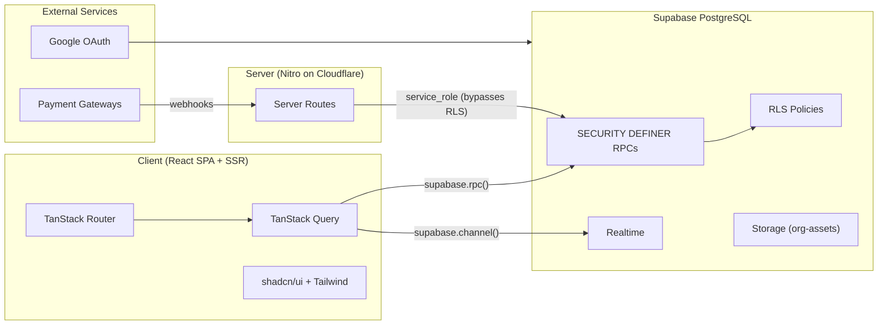
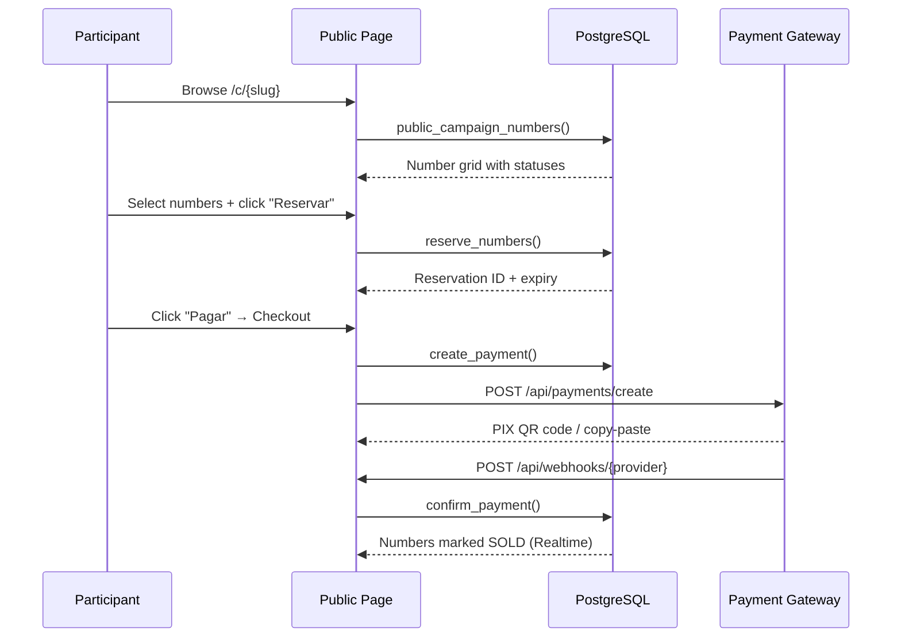

# Architecture Overview

> Language: EN | [Português (pt-BR)](../../pt-BR/architecture/overview.md)
>
> Status: ACCEPTED
>
> Documentation Standard v1.0

## Purpose

RaffleHub is a multi-tenant SaaS platform for managing raffles (rifas) in the Brazilian market. Organizations create campaigns, define products with numbered tickets, and participants browse, select, reserve, and pay for numbers online.

## Context

| Field | Value |
| --- | --- |
| Target market | Brazil (pt-BR locale, BRL currency, PIX payments) |
| Users | Organization admins (managing raffles), end participants (buying numbers) |
| Hosting | Cloudflare Workers (via Nitro with SSR) |
| Database | Supabase (PostgreSQL with RLS) |
| Auth | Lovable Cloud Auth (Google OAuth via Supabase Auth) |

## Goals

| Goal | Notes |
| --- | --- |
| Multi-tenant isolation | Each organization's data is isolated via RLS and SECURITY DEFINER functions |
| Real-time updates | Number grid and payment status update in real-time via Supabase Realtime |
| Public-facing campaigns | Published campaigns are accessible without authentication |
| Role-based access control | 4 organization roles + platform-level GLOBAL_ADMIN |
| Payment processing | PIX, credit card, boleto via multiple gateway providers |

## Non-Goals

| Non-goal | Rationale |
| --- | --- |
| Native mobile apps | Web-only via responsive design |
| Custom domain per org | Single domain with slug-based routing |
| Real-time chat | Not in scope for raffle management |

## System Boundary

| Inside the system | Outside the system |
| --- | --- |
| Campaign management | Supabase Auth (Google OAuth) |
| Number generation & reservation | Payment gateways (InfinityPay, Mercado Pago, PagBank) |
| Participant & sales tracking | Supabase Storage (campaign images) |
| Payment processing (orchestration) | Cloudflare CDN/Workers |
| Audit logging | Email/SMS (future) |

## Architecture Overview

## Main Components

| Component | Responsibility | Documentation |
| --- | --- | --- |
| Frontend (React) | UI rendering, routing, state management, real-time subscriptions | [components.md](components.md) |
| Server Routes (Nitro) | Webhook receivers, payment creation, image proxy | [contracts/api-routes.md](../contracts/api-routes.md) |
| PostgreSQL Functions | All business logic via SECURITY DEFINER functions | [contracts/rpc-functions.md](../contracts/rpc-functions.md) |
| Supabase Realtime | Push updates for number status and payment changes | — |
| Supabase Storage | Campaign image storage (cover + gallery) | — |

## Component Relationships

| From | To | Relationship | Contract |
| --- | --- | --- | --- |
| Frontend | PostgreSQL Functions | calls via `supabase.rpc()` | RPC (parameterized queries) |
| Frontend | Supabase Realtime | subscribes to table changes | Realtime channel |
| Server Routes | PostgreSQL Functions | calls via service_role client | RPC (bypasses RLS) |
| Payment Gateways | Server Routes | POST webhook payloads | HTTP POST |
| PostgreSQL Functions | audit_logs | writes audit trail | Direct INSERT |

## Data Flow

### Public Purchase Flow

## Dependencies

| Dependency | Purpose | Failure impact | Classification |
| --- | --- | --- | --- |
| Supabase | Database, Auth, Storage, Realtime | Total outage | Confirmed |
| Cloudflare Workers | Hosting, CDN | Site unavailable | Confirmed |
| Google OAuth | User authentication | Login disabled | Confirmed |
| Payment gateways | PIX/Card/Boleto processing | Payments blocked | Confirmed |

## Interfaces

| Interface | Provider | Consumers | Contract |
| --- | --- | --- | --- |
| RPC Functions | PostgreSQL | Frontend, Server Routes | SECURITY DEFINER functions |
| Webhook Endpoints | Payment Gateways | Server Routes | HTTP POST (JSON) |
| Realtime Channels | Supabase | Frontend | WebSocket (postgres_changes) |
| Storage API | Supabase | Server Routes (proxy) | HTTP GET |

## Security Boundaries

| Boundary | What is protected | Controls summary |
| --- | --- | --- |
| Organization isolation | All org-scoped data | RLS policies + SECURITY DEFINER functions |
| Role-based access | Admin operations | `has_permission()` checks in every RPC |
| Public access | Campaign browsing | Only `public_campaign()` and `public_campaign_numbers()` exposed |
| Payment credentials | Gateway API keys | PGP encryption at rest (`pgp_sym_encrypt`) |
| User data | PII (name, phone, email, document) | RLS + no client-side exposure of other users' data |

## Failure Domains

| Domain | Includes | Failure effect |
| --- | --- | --- |
| Database | PostgreSQL, RLS, RPCs | All operations blocked |
| Auth | Supabase Auth, Google OAuth | Login/signup disabled |
| Realtime | Supabase Realtime | No live updates (stale UI) |
| Payments | Gateway APIs, webhooks | Payment processing blocked |
| Storage | Supabase Storage | Image upload/view broken |

## Architectural Constraints

| ID | Description | Source | Impact | Current Status |
| --- | --- | --- | --- | --- |
| CON-001 | All writes must go through SECURITY DEFINER functions | Security requirement | No direct table writes from client | Active |
| CON-002 | `exactOptionalPropertyTypes: true` in TypeScript | tsconfig | Strict optional handling in all service calls | Active |
| CON-003 | Bun with 24h minimum release age | Supply-chain security | Delays dependency updates | Active |
| CON-004 | Single Cloudflare Workers deployment | Hosting choice | No separate staging environment | Active |

## Trade-offs

| Decision / approach | Benefit | Cost |
| --- | --- | --- |
| SECURITY DEFINER for all mutations | Centralized business logic, enforces RLS | Complex function management, harder to debug |
| Supabase RPC over REST | Type-safe, RLS-integrated, real-time capable | Vendor coupling |
| TanStack Query for data fetching | Automatic caching, refetching, optimistic updates | Client-side complexity |
| Zustand for tenant only | Minimal client state, avoids state management overhead | Limited to single concern |

## Known Limitations

| Limitation | Impact | Classification |
| --- | --- | --- |
| Payment gateway stubs (not fully implemented) | Cannot process real payments | Confirmed |
| No email/SMS notifications | Users rely on polling for status updates | Confirmed |
| No separate staging environment | All testing on production | Confirmed |
| No automated test suite | Manual verification only | Confirmed |

## Related Documentation

| Document | Path |
| --- | --- |
| Data model | [data-model.md](data-model.md) |
| Components | [components.md](components.md) |
| RPC functions | [../contracts/rpc-functions.md](../contracts/rpc-functions.md) |
| API routes | [../contracts/api-routes.md](../contracts/api-routes.md) |
| Security | [../security/overview.md](../security/overview.md) |
| Deployment | [../operations/deployment.md](../operations/deployment.md) |
