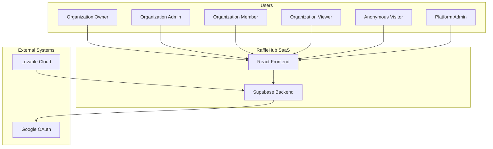

# System Context

> Language: EN | [Português (pt-BR)](../pt-BR/architecture/system-context.md)
>
> Status: ACCEPTED
>
> Documentation Standard v1.0

## Purpose

Defines RaffleHub's position in its ecosystem: users, external systems, trust boundaries, and interaction patterns.

## System Context Diagram

## Users

| User | Authentication | Access Level | Primary Use Case |
| --- | --- | --- | --- |
| Organization Owner | Google OAuth | Full control | Settings, billing, members, campaigns, numbers, sales |
| Organization Admin | Google OAuth | Campaign + member management | Create/manage campaigns, manage members, numbers, sales |
| Organization Member | Google OAuth | Operational access | Campaign operations, numbers, sales, participant lookup |
| Organization Viewer | Google OAuth | Read-only | View campaigns, numbers, participants, sales |
| Anonymous Visitor | None | Public campaigns only | Browse published campaigns, view numbers |
| Platform Admin | Google OAuth + GLOBAL_ADMIN role | Cross-tenant | Manage all organizations, users, platform metrics |

## External Systems

| System | Direction | Protocol | Purpose | Classification |
| --- | --- | --- | --- | --- |
| Google OAuth | Outbound | HTTPS (OAuth 2.0) | User authentication | Confirmed |
| Supabase Platform | Bidirectional | HTTPS + WebSocket | Backend-as-a-Service | Confirmed |
| Lovable Cloud | Inbound (deploy) | Git (SSH/HTTPS) | Hosting and CI/CD | Confirmed |

## Trust Boundaries

| Boundary | Description | Controls |
| --- | --- | --- |
| Browser ↔ Server | All RPCs authenticated | JWT Bearer token, CSRF middleware |
| Server ↔ Supabase | Service role key | Environment variable, not exposed to client |
| Tenant ↔ Tenant | Data isolation | RLS policies + RPC permission checks |
| Anonymous ↔ Authenticated | Public vs protected resources | RPC auth checks, RLS policies |

## Data Classification

| Data Type | Classification | Storage | Access |
| --- | --- | --- | --- |
| User credentials (OAuth tokens) | Confidential | Supabase Auth | Supabase Auth only |
| JWT tokens | Confidential | Browser localStorage | Auto-refresh |
| Organization data | Internal | PostgreSQL (organizations) | Org members + Platform Admin |
| Campaign data | Internal | PostgreSQL (campaigns) | Org members + Anonymous (public) |
| Number/sale data | Internal | PostgreSQL (campaign_numbers, manual_sales) | Org members |
| Audit logs | Internal | PostgreSQL (audit_logs) | Org members with audit.view |
| Images | Internal | Supabase Storage (org-assets) | Org members via signed URLs |

## Related Documentation

| Document | Path |
| --- | --- |
| Architecture Overview | [overview.md](overview.md) |
| Data Model | [data-model.md](data-model.md) |
| Security | [../security/overview.md](../security/overview.md) |
| Authentication | [../application/authentication.md](../application/authentication.md) |
