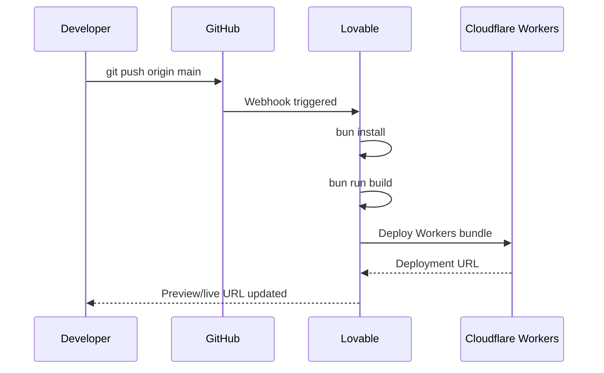

# Deployment

> Language: EN | [Português (pt-BR)](../../pt-BR/operations/deployment.md)
>
> Status: ACCEPTED
>
> Documentation Standard v1.0

## Purpose

RaffleHub is deployed as a Cloudflare Workers application using Nitro as the build system. The Lovable platform manages deployment via Git push to the connected branch.

## Deployment Target

| Field | Value |
| --- | --- |
| Platform | Cloudflare Workers |
| Build system | Nitro (via Vite + TanStack Start) |
| Runtime | Workers (V8 isolates) |
| Config | `.wrangler/deploy/config.json` |
| Preset | `cloudflare-module` |

## Build Process

```bash
# Development
bun run dev

# Production build
bun run build

# Preview production build
bun run preview
```

### Build Steps

1. **Client build** — Vite compiles React SPA with TanStack Router
2. **SSR build** — Nitro compiles server-side rendering
3. **Nitro build** — Generates Cloudflare Workers bundle
4. **Output** — `.output/` directory with `public/` (static) and `server/` (Workers)

### Build Output

| Output | Purpose |
| --- | --- |
| `.output/public/` | Static assets (JS, CSS, images) |
| `.output/server/index.mjs` | Cloudflare Workers entry point |
| `.output/server/wrangler.json` | Generated Wrangler configuration |
| `.wrangler/deploy/config.json` | Lovable deploy config |

## Package Manager

Bun with supply-chain protection:

```toml
# bunfig.toml
[install]
minimumReleaseAge = "24h"
```

All packages must be at least 24 hours old before installation (except Lovable-specific packages).

## Environment Variables

| Variable | Scope | Purpose |
| --- | --- | --- |
| `VITE_SUPABASE_URL` | Client | Supabase project URL |
| `VITE_SUPABASE_ANON_KEY` | Client | Supabase anonymous/public key |
| `SUPABASE_SERVICE_ROLE_KEY` | Server | Supabase service role key (bypasses RLS) |

See [environment.md](environment.md) for full configuration reference.

## Deployment Flow



## Rollback

| Action | How |
| --- | --- |
| Undo code change | Revert commit and push |
| Rollback deployment | Lovable dashboard → redeploy previous commit |
| Emergency | Disable route in Cloudflare dashboard |

Rollback stance: **Safe** — Git-based rollback, no database migration conflicts.

## Related Documentation

| Document | Path |
| --- | --- |
| Environment | [environment.md](environment.md) |
| Architecture | [../architecture/overview.md](../architecture/overview.md) |
| API routes | [../contracts/api-routes.md](../contracts/api-routes.md) |
