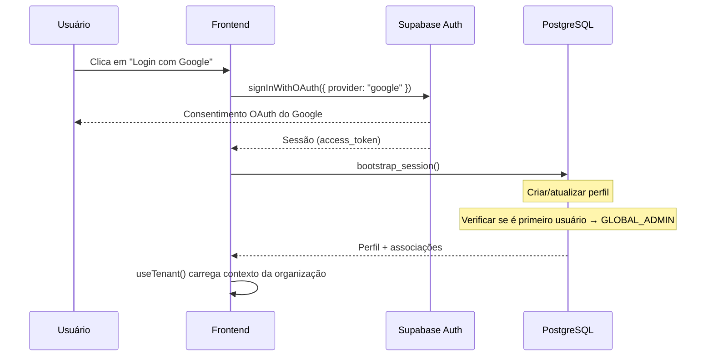
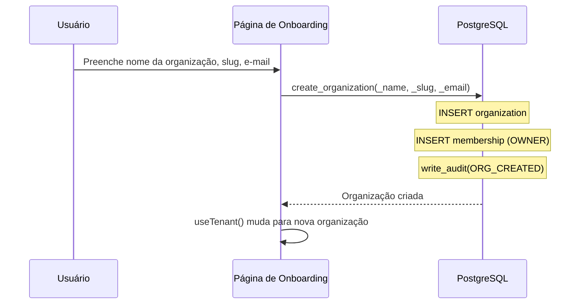

# Autenticação e Multi-tenancy

> Language: pt-BR | [English](../../en/application/auth.md)
>
> Status: ACCEPTED
>
> Documentation Standard v1.0

## Finalidade

O RaffleHub usa Google OAuth via Supabase Auth (Lovable Cloud Auth) para autenticação. O multi-tenancy é alcançado através de isolamento de dados por organização com RLS e funções SECURITY DEFINER.

## Escopo

| Escopo | Notas |
| --- | --- |
| Autenticação | Google OAuth via Supabase Auth |
| Gerenciamento de sessão | `bootstrap_session()` no primeiro login |
| Criação de organização | Fluxo de onboarding para a primeira organização |
| Gerenciamento de associação | Convite, aceitação, mudança de papel, remoção |
| Multi-tenancy | Isolamento baseado em RLS por organização |
| Admin da plataforma | Papel GLOBAL_ADMIN para acesso de super-administrador |

## Fluxo de Autenticação

## Bootstrap da Sessão

A função `bootstrap_session()` é executada em cada login:

1. Insere/atualiza linha em `profiles` (nome, e-mail, avatar do OAuth)
2. Atualiza `last_seen_at`
3. Verifica `platform_roles` — se for o primeiro usuário, concede GLOBAL_ADMIN
4. Retorna dados do perfil

## Criação de Organização

## Modelo de Multi-tenancy

| Mecanismo | Implementação |
| --- | --- |
| Isolamento de dados | Políticas RLS em todas as tabelas; FK `organization_id` |
| Controle de acesso | Funções SECURITY DEFINER verificam `org_is_active()` + `has_permission()` |
| Lado do cliente | `useTenant()` fornece o contexto da organização atual |
| Troca de tenant | `switchOrganization()` atualiza store Zustand + localStorage |

## Proteções de Rota

| Proteção | Comportamento |
| --- | --- |
| Não autenticado | Redireciona para `/auth` |
| Sem organização | Redireciona para `/onboarding` |
| Não é GLOBAL_ADMIN (para `/platform`) | Exibe card de acesso negado |
| UI baseada em permissões | Componente `PermissionGate` oculta elementos |

## Funções RPC

| Função | Acesso | Finalidade |
| --- | --- | --- |
| `bootstrap_session()` | authenticated | Criar/atualizar perfil, promover automaticamente GLOBAL_ADMIN |
| `create_organization()` | authenticated | Criar organização + associação OWNER |
| `invite_member()` | users.invite | Enviar convite |
| `accept_invitation()` | authenticated | Aceitar convite por token |
| `list_organization_members()` | users.view | Lista paginada de membros |
| `change_member_role()` | roles.update | Alterar papel do membro |
| `remove_member()` | users.remove | Remover membro da organização |
| `transfer_ownership()` | ownership.transfer | Transferir papel OWNER |
| `suspend_own_organization()` | organization.suspend | Auto-suspender organização |

## Documentação Relacionada

| Documento | Caminho |
| --- | --- |
| Permissões | [permissions.md](permissions.md) |
| Segurança | [../security/overview.md](../security/overview.md) |
| Funções RPC | [../contracts/rpc-functions.md](../contracts/rpc-functions.md) |
