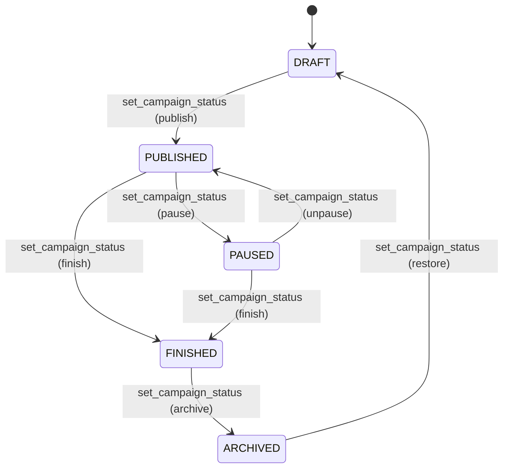

# Campanhas

> Language: pt-BR | [English](../../en/application/campaigns.md)
>
> Status: ACCEPTED
>
> Documentation Standard v1.0

## Finalidade

Campanhas são a entidade de domínio principal do RaffleHub. Cada campanha representa um sorteio com um produto, um conjunto de números numerados, um preço por número e um ciclo de vida que vai do rascunho ao finalizado.

## Escopo

| Escopo | Notas |
| --- | --- |
| CRUD de Campanhas | Criar, atualizar, transições de status |
| Imagens da Campanha | Capa + galeria (até 10) com reordenação |
| Ciclo de vida do status | DRAFT → PUBLISHED → PAUSED/FINISHED → ARCHIVED |
| Métricas | Contagens por status, cálculos de receita |
| Visão pública | Campanhas publicadas acessíveis via slug |

## Ciclo de Vida da Campanha

### Transições Válidas

| De | Para | Permitido |
| --- | --- | --- |
| DRAFT | PUBLISHED | Sim |
| PUBLISHED | PAUSED | Sim |
| PUBLISHED | FINISHED | Sim |
| PAUSED | PUBLISHED | Sim |
| PAUSED | FINISHED | Sim |
| FINISHED | ARCHIVED | Sim |
| ARCHIVED | DRAFT | Sim (restaurar) |
| DRAFT | PAUSED | Não |
| DRAFT | FINISHED | Não |
| PUBLISHED | ARCHIVED | Não |
| PAUSED | ARCHIVED | Não |

## Modelo de Dados

| Campo | Tipo | Descrição |
| --- | --- | --- |
| `id` | UUID | Chave primária |
| `organization_id` | UUID | FK para organizations |
| `name` | TEXT | Nome da campanha |
| `slug` | TEXT | Slug único compatível com URL |
| `description` | TEXT | Descrição opcional |
| `product_name` | TEXT | Produto sendo sorteado |
| `product_description` | TEXT | Detalhes opcionais do produto |
| `total_numbers` | INTEGER | Total de números disponíveis |
| `number_price` | NUMERIC | Preço por número |
| `currency` | TEXT | BRL, USD ou EUR |
| `status` | campaign_status | Status atual do ciclo de vida |
| `start_date` | TIMESTAMPTZ | Data de início opcional |
| `end_date` | TIMESTAMPTZ | Data de término opcional |
| `created_at` | TIMESTAMPTZ | Timestamp de criação |

## Funções RPC

| Função | Acesso | Finalidade |
| --- | --- | --- |
| `create_campaign()` | campaigns.create | Criar nova campanha (gera slug automaticamente) |
| `update_campaign()` | campaigns.update | Atualizar campos da campanha |
| `set_campaign_status()` | campaigns.publish/pause/finish/archive/restore | Transição de status com validação |
| `list_campaigns()` | campaigns.view | Lista paginada com filtros e ordenação |
| `campaign_metrics()` | campaigns.view | Contagens por status |
| `public_campaign()` | anon | Visão pública segura por slug |
| `add_campaign_image()` | campaigns.manage_images | Adicionar imagem de capa ou galeria |
| `delete_campaign_image()` | campaigns.manage_images | Remover imagem |
| `set_campaign_cover()` | campaigns.manage_images | Definir imagem de capa principal |
| `reorder_campaign_images()` | campaigns.manage_images | Reordenar imagens da galeria |

## Rotas UI

| Rota | Finalidade |
| --- | --- |
| `/campaigns` | Lista de campanhas com filtros e cards de métricas |
| `/campaigns/create` | Formulário de criação (validado com Zod) |
| `/campaigns/$campaignId` | Página de detalhes (status, métricas, ações) |
| `/campaigns/$campaignId/edit` | Formulário de edição (campos bloqueados com base no status) |
| `/c/$slug` | Página pública da campanha (grid de números, reserva) |

## Documentação Relacionada

| Documento | Caminho |
| --- | --- |
| Visão geral da arquitetura | [../architecture/overview.md](../architecture/overview.md) |
| Modelo de dados | [../architecture/data-model.md](../architecture/data-model.md) |
| Números | [numbers.md](numbers.md) |
| Funções RPC | [../contracts/rpc-functions.md](../contracts/rpc-functions.md) |
