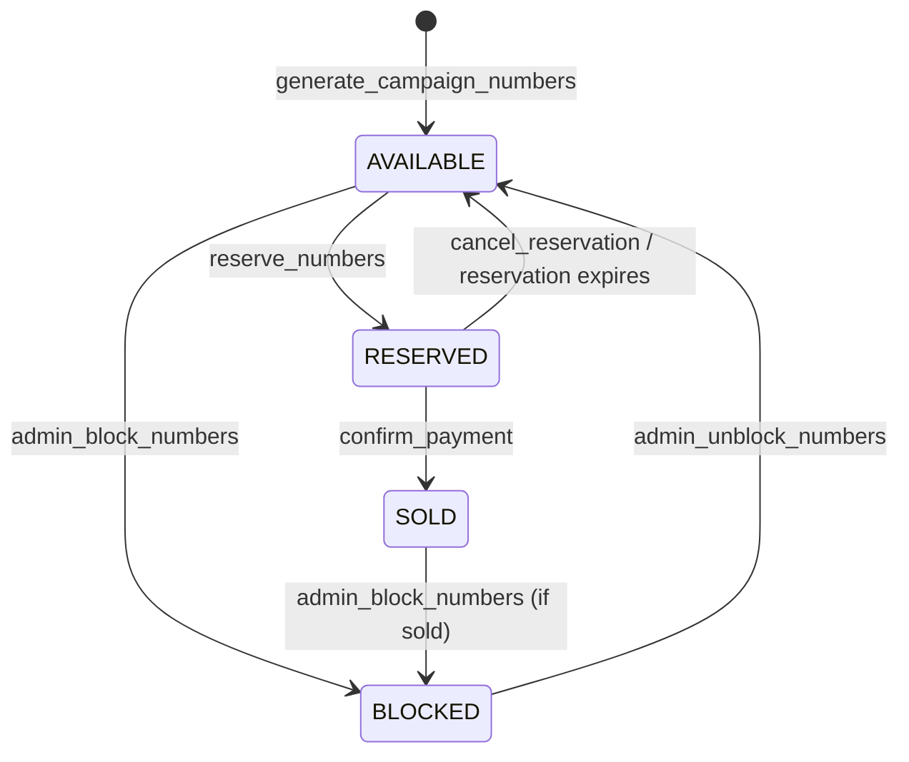
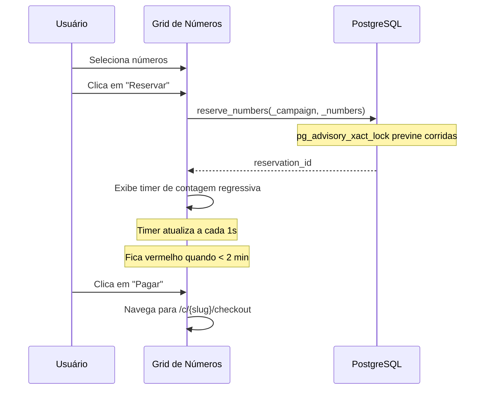

# Motor de Números

> Language: pt-BR | [English](../../en/application/numbers.md)
>
> Status: ACCEPTED
>
> Documentation Standard v1.0

## Finalidade

O motor de números gerencia ingressos numerados individuais dentro de uma campanha. Os números podem ser gerados em lote, reservados temporariamente, vendidos ou bloqueados. Atualizações em tempo real mantêm todos os clientes sincronizados.

## Escopo

| Escopo | Notas |
| --- | --- |
| Auto-geração | Inserção em lote ao publicar campanha (idempotente) |
| Gerenciamento de status | AVAILABLE → RESERVED → SOLD / BLOCKED |
| Fluxo de reserva | Holds com tempo limitado e contagem regressiva |
| Bloqueio/desbloqueio | Administrador pode bloquear números da venda |
| Tempo real | Supabase Realtime para atualizações instantâneas na UI |
| Grid público | Grid somente leitura para participantes |
| Barra de progresso | Proporções visuais AVAILABLE/RESERVED/SOLD/BLOCKED |
| Paginação | 50/página com busca e filtro de status |

## Ciclo de Vida do Status dos Números

## Modelo de Dados

### campaign_numbers

| Campo | Tipo | Descrição |
| --- | --- | --- |
| `id` | UUID | Chave primária |
| `campaign_id` | UUID | FK para campaigns |
| `number` | INTEGER | O número do ingresso (1 a total_numbers) |
| `status` | number_status | AVAILABLE, RESERVED, SOLD, BLOCKED |
| `reserved_by` | UUID | ID do usuário que reservou (nullable) |
| `created_at` | TIMESTAMPTZ | Timestamp de criação |

### number_reservations

| Campo | Tipo | Descrição |
| --- | --- | --- |
| `id` | UUID | Chave primária |
| `campaign_id` | UUID | FK para campaigns |
| `user_id` | UUID | FK para auth.users |
| `status` | reservation_status | ACTIVE, EXPIRED, CANCELLED, COMPLETED |
| `expires_at` | TIMESTAMPTZ | Expiração da reserva (configurável via `payment_ttl_minutes`) |
| `created_at` | TIMESTAMPTZ | Timestamp de criação |

### Restrições

| Restrição | Tipo | Detalhes |
| --- | --- | --- |
| `campaign_numbers_campaign_id_number_key` | UNIQUE | Um número por campanha |
| `number_reservations_campaign_id_user_id_active` | UNIQUE | Uma reserva ativa por usuário por campanha |
| `reservation_expiry_check` | CHECK | `expires_at > created_at` |

## Funções RPC

| Função | Acesso | Finalidade |
| --- | --- | --- |
| `generate_campaign_numbers()` | numbers.manage | Inserção em lote de números AVAILABLE (idempotente) |
| `admin_block_numbers()` | numbers.manage | Definir números como BLOCKED |
| `admin_unblock_numbers()` | numbers.manage | Definir números BLOCKED de volta para AVAILABLE |
| `list_campaign_numbers_admin()` | numbers.view | Lista paginada com filtro de busca/status |
| `campaign_number_metrics()` | numbers.view | Contagens por status |
| `reserve_numbers()` | reservations.manage | Criar hold com tempo limitado (advisory lock) |
| `cancel_reservation()` | reservations.manage | Liberar números reservados |
| `get_active_reservation()` | reservations.view | Obter reserva ativa atual do usuário |
| `admin_cancel_reservation()` | reservations.manage | Cancelar qualquer reserva como administrador |
| `public_campaign_numbers()` | anon | Visão pública segura por slug |
| `list_campaign_numbers_with_participant()` | numbers.view | Números associados com dados de participante |

## Atualizações em Tempo Real

- `useRealtimeNumbers` se inscreve nas mudanças da tabela `campaign_numbers`
- Invalida os caches de query `campaign-numbers`, `campaign-number-metrics`, `active-reservation`, `public-campaign-numbers`
- Todos os clientes conectados veem as mudanças de status instantaneamente

## Fluxo de Reserva

## Componentes UI

| Componente | Finalidade |
| --- | --- |
| `NumberGrid` | Grid interativo com cores de status, seleção, tooltip ao passar o mouse |
| `NumberStatusLegend` | Legenda leve para cards/dashboards |
| Barra de progresso (admin) | Proporções AVAILABLE/RESERVED/SOLD/BLOCKED com porcentagens |
| Barra de progresso (público) | Proporções AVAILABLE/RESERVED/SOLD |
| Timer de contagem regressiva | Contagem MM:SS ao vivo, vermelho quando < 2 min, desabilita Pagar quando expirado |

## Documentação Relacionada

| Documento | Caminho |
| --- | --- |
| Campanhas | [campaigns.md](campaigns.md) |
| Pagamentos | [payments.md](payments.md) |
| Participantes | [participants.md](participants.md) |
| Funções RPC | [../contracts/rpc-functions.md](../contracts/rpc-functions.md) |
