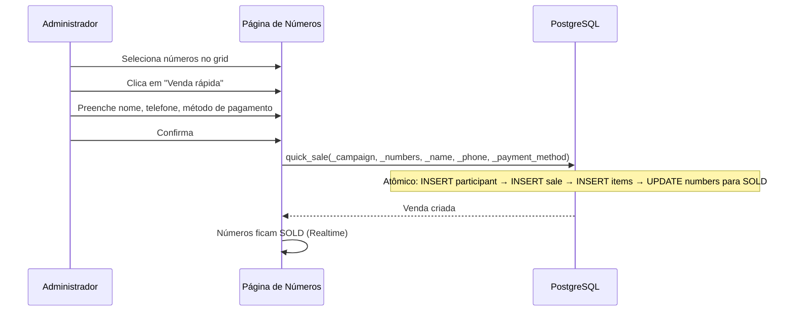

# Participantes e Vendas

> Language: pt-BR | [English](../../en/application/participants.md)
>
> Status: ACCEPTED
>
> Documentation Standard v1.0

## Finalidade

Participantes são registros de comprador/contato associados a campanhas. Vendas rastreiam quais números foram adquiridos, seja pelo fluxo de pagamento online ou vendas manuais iniciadas pelo administrador (venda rápida, offline).

## Escopo

| Escopo | Notas |
| --- | --- |
| CRUD de Participantes | Criar, atualizar, listar por campanha |
| Histórico do Participante | Visualizar todos os números e vendas de um participante |
| Vendas manuais | Vendas offline iniciadas pelo administrador |
| Venda rápida | Criar atomicamente participante + venda + marcar números como SOLD |
| Transferência de números | Mover números entre participantes |
| Exportação CSV | Exportar dados de participantes e vendas |

## Modelo de Dados

### participants

| Campo | Tipo | Descrição |
| --- | --- | --- |
| `id` | UUID | Chave primária |
| `organization_id` | UUID | FK para organizations |
| `campaign_id` | UUID | FK para campaigns |
| `name` | TEXT | Nome do comprador |
| `phone` | TEXT | Telefone opcional |
| `email` | TEXT | E-mail opcional |
| `document` | TEXT | Documento opcional (CPF/CNPJ) |
| `notes` | TEXT | Notas do administrador opcionais |
| `created_at` | TIMESTAMPTZ | Timestamp de criação |

### manual_sales

| Campo | Tipo | Descrição |
| --- | --- | --- |
| `id` | UUID | Chave primária |
| `organization_id` | UUID | FK para organizations |
| `campaign_id` | UUID | FK para campaigns |
| `participant_id` | UUID | FK para participants |
| `payment_method` | payment_method | PIX, CASH, CARD, TRANSFER, OTHER |
| `sale_amount` | NUMERIC | Valor total da venda |
| `status` | TEXT | active / cancelled |
| `notes` | TEXT | Notas opcionais |
| `created_at` | TIMESTAMPTZ | Timestamp de criação |

### manual_sale_items

| Campo | Tipo | Descrição |
| --- | --- | --- |
| `id` | UUID | Chave primária |
| `sale_id` | UUID | FK para manual_sales |
| `number_id` | UUID | FK para campaign_numbers |

## Funções RPC

| Função | Acesso | Finalidade |
| --- | --- | --- |
| `create_participant()` | participants.manage | Criar novo participante |
| `update_participant()` | participants.manage | Atualizar dados do participante |
| `list_participants()` | participants.view | Lista paginada com busca |
| `get_participant_history()` | participants.view | Todos os números e vendas do participante |
| `export_participants_csv()` | participants.view | Exportação CSV |
| `quick_sale()` | sales.manage | Atomically: criar participante + venda + marcar números como SOLD |
| `create_manual_sale()` | sales.manage | Criar venda manual |
| `update_manual_sale()` | sales.manage | Atualizar detalhes da venda |
| `cancel_manual_sale()` | sales.manage | Cancelar venda (reverter números para AVAILABLE) |
| `transfer_numbers()` | sales.manage | Mover números entre participantes |
| `list_manual_sales()` | sales.view | Lista paginada |
| `campaign_sales_metrics()` | sales.view | Métricas de receita e contagem |
| `export_sales_csv()` | sales.view | Exportação CSV |

## Fluxo de Venda Rápida

## Rotas UI

| Rota | Finalidade |
| --- | --- |
| `/participants` | Lista de participantes entre campanhas com exportação CSV |
| `/campaigns/$campaignId` | Detalhes da campanha com aba de Participantes |

## Documentação Relacionada

| Documento | Caminho |
| --- | --- |
| Números | [numbers.md](numbers.md) |
| Pagamentos | [payments.md](payments.md) |
| Campanhas | [campaigns.md](campaigns.md) |
| Funções RPC | [../contracts/rpc-functions.md](../contracts/rpc-functions.md) |
