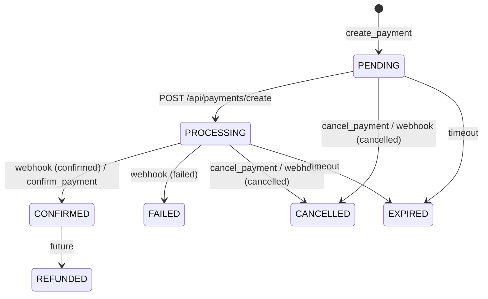
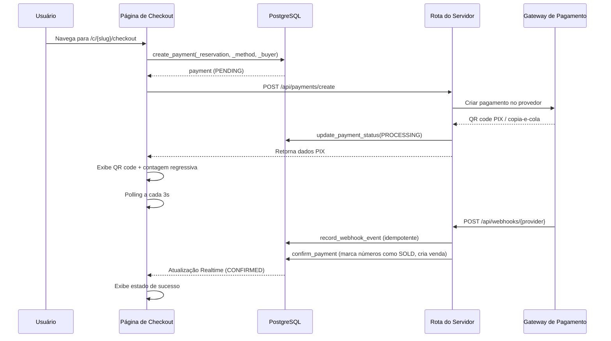

# Motor de Pagamentos

> Language: pt-BR | [English](../../en/application/payments.md)
>
> Status: ACCEPTED
>
> Documentation Standard v1.0

## Finalidade

O motor de pagamentos trata o processamento de pagamentos online para reservas. Ele suporta múltiplos provedores de gateway (InfinityPay, Mercado Pago, PagBank), métodos PIX/cartão de crédito/boleto, confirmação baseada em webhook e criptografia de credenciais.

## Escopo

| Escopo | Notas |
| --- | --- |
| Criação de pagamento | Criar pagamento pendente vinculado à reserva |
| Ciclo de vida do status | PENDING → PROCESSING → CONFIRMED/FAILED/CANCELLED/EXPIRED |
| Configuração do gateway | Configuração de gateway por organização com credenciais criptografadas |
| Tratamento de webhook | Receptor de webhook idempotente com mapeamento de status |
| Exibição PIX | QR code + código copia-e-cola com contagem regressiva |
| Visão pública do pagamento | Página de checkout acessível sem autenticação |
| Polling automático | Polling do cliente para pagamentos PENDING/PROCESSING (intervalo de 3s) |
| Tempo real | Supabase Realtime para atualizações instantâneas de status de pagamento |

## Ciclo de Vida do Status de Pagamento



## Modelo de Dados

### payments

| Campo | Tipo | Descrição |
| --- | --- | --- |
| `id` | UUID | Chave primária |
| `organization_id` | UUID | FK para organizations |
| `campaign_id` | UUID | FK para campaigns |
| `reservation_id` | UUID | FK para number_reservations |
| `gateway_id` | UUID | FK para payment_gateways |
| `provider` | payment_gateway_provider | INFINITY_PAY, MERCADO_PAGO, PAGBANK |
| `method` | payment_method_online | PIX, CREDIT_CARD, BOLETO |
| `status` | payment_status | PENDING, PROCESSING, CONFIRMED, FAILED, CANCELLED, EXPIRED, REFUNDED |
| `amount` | NUMERIC | Valor do pagamento |
| `currency` | TEXT | BRL, USD, EUR |
| `buyer_name` | TEXT | Nome do comprador |
| `buyer_phone` | TEXT | Telefone opcional do comprador |
| `buyer_email` | TEXT | E-mail opcional do comprador |
| `buyer_document` | TEXT | Documento opcional do comprador |
| `provider_payment_id` | TEXT | ID externo do pagamento do gateway |
| `pix_qr_code` | TEXT | Imagem do QR code em Base64 |
| `pix_copy_paste` | TEXT | Código PIX copia-e-cola |
| `expires_at` | TIMESTAMPTZ | Expiração do pagamento |
| `paid_at` | TIMESTAMPTZ | Timestamp de confirmação do pagamento |
| `created_at` | TIMESTAMPTZ | Timestamp de criação |

### payment_gateways

| Campo | Tipo | Descrição |
| --- | --- | --- |
| `id` | UUID | Chave primária |
| `organization_id` | UUID | FK para organizations |
| `provider` | payment_gateway_provider | INFINITY_PAY, MERCADO_PAGO, PAGBANK |
| `name` | TEXT | Nome de exibição |
| `credentials_encrypted` | TEXT | Credenciais de API criptografadas com PGP |
| `settings` | JSONB | Configurações específicas do provedor |
| `is_active` | BOOLEAN | Se o gateway está habilitado |
| `created_at` | TIMESTAMPTZ | Timestamp de criação |

### webhook_events

| Campo | Tipo | Descrição |
| --- | --- | --- |
| `id` | UUID | Chave primária |
| `provider` | TEXT | Nome do provedor do gateway |
| `provider_event_id` | TEXT | ID externo do evento |
| `payload` | JSONB | Payload bruto do webhook |
| `processed_at` | TIMESTAMPTZ | Timestamp de processamento |

## Fluxo de Checkout



## Funções RPC

| Função | Acesso | Finalidade |
| --- | --- | --- |
| `create_payment()` | payments.manage | Criar pagamento pendente |
| `update_payment_status()` | payments.manage | Atualizar status do pagamento |
| `confirm_payment()` | payments.manage | Confirmar pagamento, marcar números como SOLD, criar venda |
| `cancel_payment()` | payments.manage | Cancelar pagamento |
| `get_payment()` | payments.view | Obter pagamento por ID |
| `public_get_payment()` | anon | Visão pública segura do pagamento |
| `list_payments()` | payments.view | Lista paginada com filtros |
| `campaign_payment_metrics()` | payments.view | Métricas de receita e contagem |
| `create_payment_gateway()` | payments.manage | Criar configuração de gateway |
| `update_payment_gateway()` | payments.manage | Atualizar configuração de gateway |
| `delete_payment_gateway()` | payments.manage | Excluir configuração de gateway |
| `list_payment_gateways()` | payments.view | Listar configurações de gateway |

## Rotas do Servidor

| Rota | Método | Finalidade |
| --- | --- | --- |
| `/api/payments/create` | POST | Criar pagamento via provedor (atualmente stubbed) |
| `/api/webhooks/:provider` | POST | Receptor de webhook com idempotência |

## Criptografia de Credenciais

As credenciais do gateway são criptografadas em repouso usando `pgp_sym_encrypt` do PostgreSQL:

```sql
INSERT INTO payment_gateways (..., credentials_encrypted)
VALUES (..., pgp_sym_encrypt($credentials, (SELECT value FROM app_settings WHERE key = 'payment_encryption_key')));
```

A chave de criptografia é armazenada na tabela `app_settings` sob a chave `payment_encryption_key`.

## Polling Automático

O hook `usePublicPayment` faz polling a cada 3 segundos quando o status é PENDING ou PROCESSING:

```typescript
refetchInterval: (query) => {
  const status = query.state.data?.status;
  return status === "PENDING" || status === "PROCESSING" ? 3000 : false;
};
```

## Componentes UI

| Componente | Finalidade |
| --- | --- |
| `CheckoutPage` | Fluxo de 5 etapas: INFO → PROCESSING → PAYMENT → CONFIRMED → EXPIRED |
| `BuyerInfoForm` | Campos de nome, telefone, e-mail, documento |
| `PixDisplay` | QR code + copia-e-cola + contagem regressiva de expiração |
| `PaymentStatusBadge` | Badge colorido para status do pagamento |
| `PaymentHistoryTable` | Tabela paginada de pagamentos |
| `PaymentMetricsCards` | Receita, contagens confirmado/pendente/falhou/cancelado |
| `GatewayConfigForm` | Formulário CRUD para configuração de gateway |

## Documentação Relacionada

| Documento | Caminho |
| --- | --- |
| Números | [numbers.md](numbers.md) |
| Campanhas | [campaigns.md](campaigns.md) |
| Segurança | [../security/overview.md](../security/overview.md) |
| Rotas de API | [../contracts/api-routes.md](../contracts/api-routes.md) |
| Funções RPC | [../contracts/rpc-functions.md](../contracts/rpc-functions.md) |
