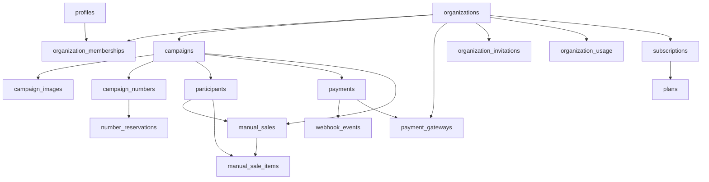

# Modelo de Dados

> Language: pt-BR | [English](../../en/architecture/data-model.md)
>
> Status: ACCEPTED
>
> Documentation Standard v1.0

## Finalidade

Referência completa do esquema de banco de dados do RaffleHub. Toda a lógica de negócios vive no PostgreSQL via funções SECURITY DEFINER. O client nunca escreve diretamente nas tabelas.

## Schemas / Espaços de Nomes

| Schema / Armazenamento | Finalidade | Proprietário | Classificação |
| --- | --- | --- | --- |
| `public` | Todas as tabelas, funções e políticas RLS da aplicação | rafflehub | Confirmado |
| `auth` | Supabase Auth (gerenciado externamente) | supabase | Confirmado |
| Armazenamento: `org-assets` | Imagens de campanhas, logos de organizações | rafflehub | Confirmado |

## Enums

| Enum | Valores | Usado Por |
| --- | --- | --- |
| `org_role` | OWNER, ADMIN, MEMBER, VIEWER | organization_memberships |
| `org_status` | ACTIVE, SUSPENDED, INACTIVE | organizations |
| `membership_status` | ACTIVE, INVITED, SUSPENDED, REMOVED | organization_memberships |
| `invitation_status` | INVITED, ACCEPTED, EXPIRED, REVOKED | organization_invitations |
| `campaign_status` | DRAFT, PUBLISHED, PAUSED, FINISHED, ARCHIVED | campaigns |
| `campaign_image_type` | COVER, GALLERY | campaign_images |
| `number_status` | AVAILABLE, RESERVED, SOLD, BLOCKED | campaign_numbers |
| `reservation_status` | ACTIVE, EXPIRED, CANCELLED, COMPLETED | number_reservations |
| `payment_method` | PIX, CASH, CARD, TRANSFER, OTHER | manual_sales |
| `payment_method_online` | PIX, CREDIT_CARD, BOLETO | payments |
| `payment_status` | PENDING, PROCESSING, CONFIRMED, FAILED, CANCELLED, EXPIRED, REFUNDED | payments |
| `payment_gateway_provider` | INFINITY_PAY, MERCADO_PAGO, PAGBANK | payment_gateways |
| `subscription_status` | TRIALING, ACTIVE, PAST_DUE, CANCELLED, EXPIRED, SUSPENDED | subscriptions |

## Entidades Principais

| Entidade | Armazenamento | Responsabilidade | Classificação |
| --- | --- | --- | --- |
| `profiles` | profiles | Perfil do usuário (nome, e-mail, avatar, last_seen) | Confirmado |
| `organizations` | organizations | Raiz do tenant (nome, slug, status, branding, localidade) | Confirmado |
| `organization_memberships` | organization_memberships | Vinculação de usuário a organização com função | Confirmado |
| `organization_invitations` | organization_invitations | Convites pendentes com hash de token | Confirmado |
| `plans` | plans | Planos de assinatura (preços, dias de trial) | Confirmado |
| `subscriptions` | subscriptions | Estado de assinatura da organização | Confirmado |
| `campaigns` | campaigns | Campanhas de rifa (produto, números, preço, status) | Confirmado |
| `campaign_images` | campaigns | Imagens de galeria/capa por campanha | Confirmado |
| `campaign_numbers` | campaign_numbers | Bilhetes numerados individuais com status | Confirmado |
| `number_reservations` | number_reservations | Reservas temporárias de números | Confirmado |
| `participants` | participants | Registros de compradores/contatos por campanha | Confirmado |
| `manual_sales` | manual_sales | Vendas offline iniciadas por administradores | Confirmado |
| `manual_sale_items` | manual_sale_items | Números pertencentes a uma venda manual | Confirmado |
| `payments` | payments | Registros de pagamentos online | Confirmado |
| `payment_gateways` | payment_gateways | Configuração de gateway por organização | Confirmado |
| `webhook_events` | webhook_events | Log de eventos de webhook idempotente | Confirmado |
| `audit_logs` | audit_logs | Trilha de eventos de segurança e gestão | Confirmado |
| `app_settings` | app_settings | Configurações globais em pares chave-valor | Confirmado |
| `organization_usage` | organization_usage | Contadores de consumo atuais | Confirmado |

## Relacionamentos (Alto Nível)

## Preocupações Transversais de Dados

| Preocupação | Abordagem | Classificação |
| --- | --- | --- |
| Multi-tenancy / isolamento | Políticas RLS em todas as tabelas; FK `organization_id` em todas as tabelas no escopo do tenant; funções SECURITY DEFINER verificam associação `org_id` | Confirmado |
| Exclusão soft / arquivo | Status da campanha ARCHIVED (não excluída); organizações usam campo de status (ACTIVE/SUSPENDED/INACTIVE) | Confirmado |
| Dados pessoais / retenção | Dados de participantes (nome, telefone, e-mail, documento) armazenados por campanha; sem retenção/exclusão automatizada | Confirmado |
| Criptografia em repouso (nivel da aplicação) | Credenciais do gateway de pagamento criptografadas via `pgp_sym_encrypt` com chave de `app_settings('payment_encryption_key')` | Confirmado |
| Trilha de auditoria | Tabela `audit_logs` gravada pela função auxiliar `write_audit()`; rastreia ator, ação, entidade, metadados | Confirmado |
| Idempotência | Eventos de webhook usam restrição `UNIQUE(provider, provider_event_id)`; reservas usam `pg_advisory_xact_lock` | Confirmado |
| Bloqueio otimista | Transições de status da campanha validadas em `set_campaign_status()` com mapa `CAMPAIGN_TRANSITIONS` | Confirmado |

## Documentação Relacionada

| Documento | Caminho |
| --- | --- |
| Visão geral da arquitetura | [overview.md](overview.md) |
| Componentes | [components.md](components.md) |
| Funções RPC | [../contracts/rpc-functions.md](../contracts/rpc-functions.md) |
| Segurança | [../security/overview.md](../security/overview.md) |
| Migrações | [../operations/migrations.md](../operations/migrations.md) |
