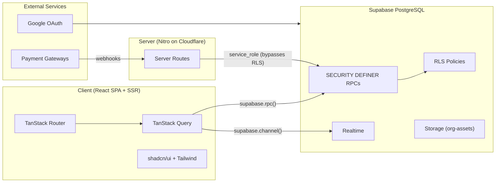
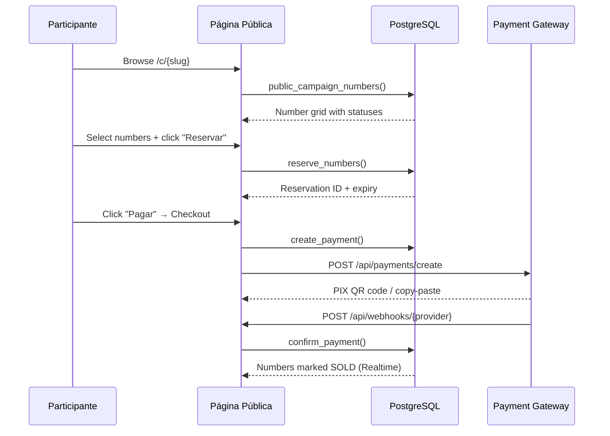

# Visão Geral da Arquitetura

> Language: pt-BR | [English](../../en/architecture/overview.md)
>
> Status: ACCEPTED
>
> Documentation Standard v1.0

## Finalidade

RaffleHub é uma plataforma SaaS multi-tenant para gerenciamento de rifas no mercado brasileiro. Organizações criam campanhas, definem produtos com bilhetes numerados e participantes navegam, selecionam, reservam e pagam números online.

## Contexto

| Campo | Valor |
| --- | --- |
| Mercado-alvo | Brasil (localidade pt-BR, moeda BRL, pagamentos via PIX) |
| Usuários | Administradores de organizações (gerenciando rifas), participantes finais (comprando números) |
| Hospedagem | Cloudflare Workers (via Nitro com SSR) |
| Banco de dados | Supabase (PostgreSQL com RLS) |
| Autenticação | Lovable Cloud Auth (Google OAuth via Supabase Auth) |

## Objetivos

| Objetivo | Observações |
| --- | --- |
| Isolamento multi-tenant | Os dados de cada organização são isolados via RLS e funções SECURITY DEFINER |
| Atualizações em tempo real | A grade de números e o status de pagamento são atualizados em tempo real via Supabase Realtime |
| Campanhas públicas | Campanhas publicadas são acessíveis sem autenticação |
| Controle de acesso baseado em funções | 4 funções de organização + GLOBAL_ADMIN a nível de plataforma |
| Processamento de pagamentos | PIX, cartão de crédito, boleto via múltiplos provedores de gateway |

## Não-Objetivos

| Não-objetivo | Justificativa |
| --- | --- |
| Aplicativos móveis nativos | Somente web via design responsivo |
| Domínio personalizado por organização | Domínio único com roteamento baseado em slug |
| Chat em tempo real | Não está no escopo do gerenciamento de rifas |

## Limites do Sistema

| Dentro do sistema | Fora do sistema |
| --- | --- |
| Gerenciamento de campanhas | Supabase Auth (Google OAuth) |
| Geração e reserva de números | Gateways de pagamento (InfinityPay, Mercado Pago, PagBank) |
| Rastreamento de participantes e vendas | Supabase Storage (imagens de campanhas) |
| Processamento de pagamentos (orquestração) | Cloudflare CDN/Workers |
| Registro de auditoria | E-mail/SMS (futuro) |

## Visão Geral da Arquitetura

## Componentes Principais

| Componente | Responsabilidade | Documentação |
| --- | --- | --- |
| Frontend (React) | Renderização de UI, roteamento, gerenciamento de estado, assinaturas em tempo real | [components.md](components.md) |
| Rotas do Servidor (Nitro) | Receptores de webhooks, criação de pagamentos, proxy de imagens | [contracts/api-routes.md](../contracts/api-routes.md) |
| Funções PostgreSQL | Toda a lógica de negócios via funções SECURITY DEFINER | [contracts/rpc-functions.md](../contracts/rpc-functions.md) |
| Supabase Realtime | Atualizações push para status de números e mudanças de pagamento | — |
| Supabase Storage | Armazenamento de imagens de campanhas (capa + galeria) | — |

## Relacionamentos entre Componentes

| De | Para | Relacionamento | Contrato |
| --- | --- | --- | --- |
| Frontend | Funções PostgreSQL | chamadas via `supabase.rpc()` | RPC (consultas parametrizadas) |
| Frontend | Supabase Realtime | assina mudanças na tabela | Canal Realtime |
| Rotas do Servidor | Funções PostgreSQL | chamadas via cliente service_role | RPC (ignora RLS) |
| Gateways de Pagamento | Rotas do Servidor | POST de payloads de webhook | HTTP POST |
| Funções PostgreSQL | audit_logs | grava trilha de auditoria | INSERT direto |

## Fluxo de Dados

### Fluxo de Compra Público

## Dependências

| Dependência | Finalidade | Impacto em caso de falha | Classificação |
| --- | --- | --- | --- |
| Supabase | Banco de dados, Autenticação, Storage, Realtime | Interrupção total | Confirmado |
| Cloudflare Workers | Hospedagem, CDN | Site indisponível | Confirmado |
| Google OAuth | Autenticação de usuários | Login desabilitado | Confirmado |
| Gateways de pagamento | Processamento PIX/Cartão/Boleto | Pagamentos bloqueados | Confirmado |

## Interfaces

| Interface | Provedor | Consumidores | Contrato |
| --- | --- | --- | --- |
| Funções RPC | PostgreSQL | Frontend, Rotas do Servidor | Funções SECURITY DEFINER |
| Endpoints de Webhook | Gateways de Pagamento | Rotas do Servidor | HTTP POST (JSON) |
| Canais Realtime | Supabase | Frontend | WebSocket (postgres_changes) |
| API de Storage | Supabase | Rotas do Servidor (proxy) | HTTP GET |

## Limites de Segurança

| Limite | O que é protegido | Resumo dos controles |
| --- | --- | --- |
| Isolamento de organização | Todos os dados no escopo da organização | Políticas RLS + funções SECURITY DEFINER |
| Acesso baseado em funções | Operações administrativas | Verificações `has_permission()` em cada RPC |
| Acesso público | Navegação de campanhas | Apenas `public_campaign()` e `public_campaign_numbers()` expostos |
| Credenciais de pagamento | Chaves de API dos gateways | Criptografia PGP em repouso (`pgp_sym_encrypt`) |
| Dados do usuário | Dados pessoais (nome, telefone, e-mail, documento) | RLS + sem exposição no client de dados de outros usuários |

## Domínios de Falha

| Domínio | Inclui | Efeito da falha |
| --- | --- | --- |
| Banco de dados | PostgreSQL, RLS, RPCs | Todas as operações bloqueadas |
| Autenticação | Supabase Auth, Google OAuth | Login/cadastro desabilitado |
| Realtime | Supabase Realtime | Sem atualizações ao vivo (UI desatualizada) |
| Pagamentos | APIs dos gateways, webhooks | Processamento de pagamentos bloqueado |
| Storage | Supabase Storage | Upload/visualização de imagens quebrada |

## Restrições Arquiteturais

| ID | Descrição | Origem | Impacto | Status Atual |
| --- | --- | --- | --- | --- |
| CON-001 | Todas as escritas devem passar por funções SECURITY DEFINER | Requisito de segurança | Sem escritas diretas em tabelas pelo client | Ativo |
| CON-002 | `exactOptionalPropertyTypes: true` em TypeScript | tsconfig | Tratamento estrito de opcionais em todas as chamadas de serviço | Ativo |
| CON-003 | Bun com idade mínima de 24h para releases | Segurança da cadeia de suprimentos | Atrasa atualizações de dependências | Ativo |
| CON-004 | Único deploy em Cloudflare Workers | Escolha de hospedagem | Sem ambiente de staging separado | Ativo |

## Compromissos

| Decisão / abordagem | Benefício | Custo |
| --- | --- | --- |
| SECURITY DEFINER para todas as mutações | Lógica de negócios centralizada, impõe RLS | Gerenciamento complexo de funções, mais difícil de depurar |
| Supabase RPC ao invés de REST | Tipagem segura, integração com RLS, capacidade em tempo real | Acoplamento ao fornecedor |
| TanStack Query para busca de dados | Cache automático, refetching, atualizações otimistas | Complexidade no lado do client |
| Zustand apenas para tenant | Estado mínimo no client, evita overhead de gerenciamento de estado | Limitado a uma única preocupação |

## Limitações Conhecidas

| Limitação | Impacto | Classificação |
| --- | --- | --- |
| Stubs de gateway de pagamento (não totalmente implementados) | Não é possível processar pagamentos reais | Confirmado |
| Sem notificações por e-mail/SMS | Usuários dependem de polling para atualizações de status | Confirmado |
| Sem ambiente de staging separado | Todos os testes em produção | Confirmado |
| Sem suíte de testes automatizados | Apenas verificação manual | Confirmado |

## Documentação Relacionada

| Documento | Caminho |
| --- | --- |
| Modelo de dados | [data-model.md](data-model.md) |
| Componentes | [components.md](components.md) |
| Funções RPC | [../contracts/rpc-functions.md](../contracts/rpc-functions.md) |
| Rotas de API | [../contracts/api-routes.md](../contracts/api-routes.md) |
| Segurança | [../security/overview.md](../security/overview.md) |
| Implantação | [../operations/deployment.md](../operations/deployment.md) |
