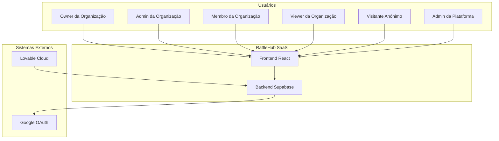

# Contexto do Sistema

> Language: pt-BR | [English (EN)](../en/architecture/system-context.md)
>
> Status: ACCEPTED
>
> Documentation Standard v1.0

## Propósito

Define a posição do RaffleHub em seu ecossistema: usuários, sistemas externos, limites de confiança e padrões de interação.

## Diagrama de Contexto do Sistema

## Usuários

| Usuário | Autenticação | Nível de Acesso | Caso de Uso Principal |
| --- | --- | --- | --- |
| Owner da Organização | Google OAuth | Controle total | Configurações, billing, membros, campanhas, números, vendas |
| Admin da Organização | Google OAuth | Gestão de campanhas + membros | Criar/gerenciar campanhas, gerenciar membros, números, vendas |
| Membro da Organização | Google OAuth | Acesso operacional | Operações de campanhas, números, vendas, busca de participantes |
| Viewer da Organização | Google OAuth | Somente leitura | Ver campanhas, números, participantes, vendas |
| Visitante Anônimo | Nenhum | Apenas campanhas públicas | Navegar campanhas publicadas, ver números |
| Admin da Plataforma | Google OAuth + GLOBAL_ADMIN | Multi-tenant | Gerenciar todas as organizações, usuários, métricas |

## Sistemas Externos

| Sistema | Direção | Protocolo | Finalidade | Classificação |
| --- | --- | --- | --- | --- |
| Google OAuth | Saída | HTTPS (OAuth 2.0) | Autenticação de usuários | Confirmado |
| Plataforme Supabase | Bidirecional | HTTPS + WebSocket | Backend-as-a-Service | Confirmado |
| Lovable Cloud | Entrada (deploy) | Git (SSH/HTTPS) | Hospedagem e CI/CD | Confirmado |

## Limites de Confiança

| Limite | Descrição | Controles |
| --- | --- | --- |
| Browser ↔ Server | Todas as RPCs autenticadas | JWT Bearer token, CSRF middleware |
| Server ↔ Supabase | Service role key | Variável de ambiente, não exposta ao cliente |
| Tenant ↔ Tenant | Isolamento de dados | Políticas RLS + checks de permissão nas RPCs |
| Anônimo ↔ Autenticado | Recursos públicos vs protegidos | Checks de auth nas RPCs, políticas RLS |

## Classificação de Dados

| Tipo de Dado | Classificação | Armazenamento | Acesso |
| --- | --- | --- | --- |
| Credenciais de usuário (tokens OAuth) | Confidencial | Supabase Auth | Apenas Supabase Auth |
| Tokens JWT | Confidencial | localStorage do browser | Auto-refresh |
| Dados da organização | Interno | PostgreSQL (organizations) | Membros da org + Platform Admin |
| Dados de campanha | Interno | PostgreSQL (campaigns) | Membros da org + Anônimo (público) |
| Dados de números/vendas | Interno | PostgreSQL (campaign_numbers, manual_sales) | Membros da org |
| Logs de auditoria | Interno | PostgreSQL (audit_logs) | Membros com audit.view |
| Imagens | Interno | Supabase Storage (org-assets) | Membros via signed URLs |

## Documentação Relacionada

| Documento | Caminho |
| --- | --- |
| Visão Geral da Arquitetura | [overview.md](overview.md) |
| Modelo de Dados | [data-model.md](data-model.md) |
| Segurança | [../security/overview.md](../security/overview.md) |
| Autenticação | [../application/authentication.md](../application/authentication.md) |
