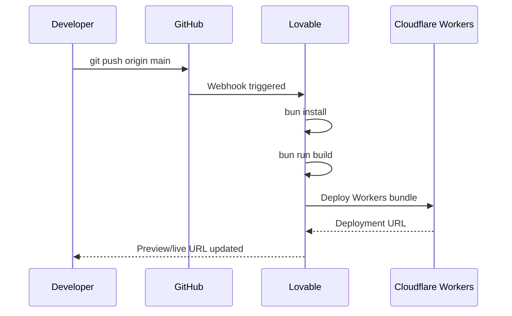

# Implantação

> Language: pt-BR | [English](../../en/operations/deployment.md)
>
> Status: ACCEPTED
>
> Documentation Standard v1.0

## Finalidade

RaffleHub é implantado como uma aplicação Cloudflare Workers utilizando Nitro como sistema de build. A plataforma Lovable gerencia a implantação via push Git para a branch conectada.

## Alvo de Implantação

| Campo | Valor |
| --- | --- |
| Plataforma | Cloudflare Workers |
| Sistema de build | Nitro (via Vite + TanStack Start) |
| Runtime | Workers (V8 isolates) |
| Configuração | `.wrangler/deploy/config.json` |
| Preset | `cloudflare-module` |

## Processo de Build

```bash
# Desenvolvimento
bun run dev

# Build de produção
bun run build

# Visualizar build de produção
bun run preview
```

### Etapas do Build

1. **Build do cliente** — Vite compila o React SPA com TanStack Router
2. **Build SSR** — Nitro compila o server-side rendering
3. **Build Nitro** — Gera o bundle do Cloudflare Workers
4. **Saída** — Diretório `.output/` com `public/` (estático) e `server/` (Workers)

### Saída do Build

| Saída | Propósito |
| --- | --- |
| `.output/public/` | Ativos estáticos (JS, CSS, imagens) |
| `.output/server/index.mjs` | Ponto de entrada do Cloudflare Workers |
| `.output/server/wrangler.json` | Configuração Wrangler gerada |
| `.wrangler/deploy/config.json` | Configuração de deploy do Lovable |

## Gerenciador de Pacotes

Bun com proteção de supply-chain:

```toml
# bunfig.toml
[install]
minimumReleaseAge = "24h"
```

Todos os pacotes devem ter pelo menos 24 horas antes da instalação (exceto pacotes específicos do Lovable).

## Variáveis de Ambiente

| Variável | Escopo | Propósito |
| --- | --- | --- |
| `VITE_SUPABASE_URL` | Cliente | URL do projeto Supabase |
| `VITE_SUPABASE_ANON_KEY` | Cliente | Chave anônima/pública do Supabase |
| `SUPABASE_SERVICE_ROLE_KEY` | Servidor | Chave de service role do Supabase (bypassa RLS) |

Veja [environment.md](environment.md) para a referência completa de configuração.

## Fluxo de Implantação



## Rollback

| Ação | Como |
| --- | --- |
| Desfazer mudança de código | Reverter commit e fazer push |
| Rollback de implantação | Painel do Lovable → reimplantar commit anterior |
| Emergência | Desativar rota no painel do Cloudflare |

Posição de rollback: **Seguro** — rollback baseado em Git, sem conflitos de migração do banco de dados.

## Documentação Relacionada

| Documento | Caminho |
| --- | --- |
| Ambiente | [environment.md](environment.md) |
| Arquitetura | [../architecture/overview.md](../architecture/overview.md) |
| Rotas da API | [../contracts/api-routes.md](../contracts/api-routes.md) |
