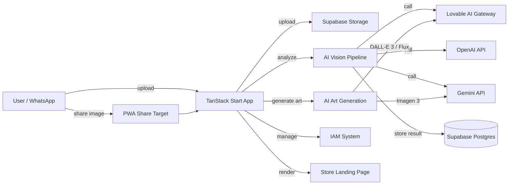

# Architecture

> Language: EN | [Português (pt-BR)](../pt-BR/arquitetura.md)
>
> Status: ACCEPTED
>
> Documentation Standard v1.0

## Purpose

This document describes the architecture of the AI WhatsApp Image Analyzer — a TanStack Start SSR application with Supabase backend, multi-provider AI integration, IAM system, and PWA capabilities.

## Context

Users interact with the application through a web browser (desktop or mobile). On mobile, images can be shared directly from WhatsApp via the Web Share Target API. The application processes images through AI vision models, stores results in Supabase, and presents structured analysis.

| Context element | Role |
| --- | --- |
| End user | Shares promotional images for analysis |
| Business owner | Manages portfolio via store landing page |
| Global admin | Manages IAM system (groups, users, tokens, quotas) |
| Analyst | Views analysis results, approves art submissions |
| Consumer | Submits art for moderation |
| Supabase | Backend infrastructure (Auth, Storage, DB, Edge Functions) |
| AI Providers | Vision analysis and image generation |

## Goals

| Goal | Notes |
| --- | --- |
| Automated image analysis | Extract structured data from promotional images via AI |
| Multi-provider AI support | Lovable gateway, OpenAI, Gemini with per-group quotas |
| IAM with role-based access | Global admin, analyst, consumer with BRL quotas |
| PWA with Web Share Target | Receive images directly from WhatsApp |
| Store landing page | WhatsApp-based business portfolio display |
| Art generation | Create promotional images from analyzed content |

## Non-Goals

| Non-goal | Rationale |
| --- | --- |
| Real-time streaming analysis | Batch processing model chosen |
| Multi-tenant SaaS | Single-project Supabase deployment |
| Custom ML model training | Relies on pre-trained vision models |

## System Boundary

| Inside the system | Outside the system |
| --- | --- |
| TanStack Start SSR app | WhatsApp (source of images) |
| Supabase (Auth, Storage, DB, Edge Functions) | AI providers (OpenAI, Gemini, Lovable gateway) |
| IAM system | Supabase project dashboard |
| Store landing page | End-user devices |
| Art generation pipeline | |

## Architecture Overview

## Main Components

| Component | Responsibility | Documentation |
| --- | --- | --- |
| TanStack Start App | SSR routing, UI rendering, server functions, middleware | [architecture.md](architecture.md) |
| AI Vision Pipeline | Image download, provider selection, prompt execution, JSON parsing/validation | [architecture.md](architecture.md) |
| AI Art Generation | Reference image processing, DALL-E 3/Flux/Imagen 3 calls, gallery management | [architecture.md](architecture.md) |
| IAM System | Roles, groups, quotas, API tokens, usage tracking | [architecture.md](architecture.md) |
| Store Landing Page | Business portfolio rendering with WhatsApp contact | [architecture.md](architecture.md) |
| Supabase Backend | Auth, Storage, Postgres, Edge Functions, RLS | [infrastructure/supabase.md](infrastructure/supabase.md) |

## Component Relationships

| From | To | Relationship | Contract |
| --- | --- | --- | --- |
| TanStack Start App | Supabase Backend | calls | REST (Supabase JS client) |
| TanStack Start App | Lovable AI Gateway | calls | REST (chat completions, images) |
| TanStack Start App | OpenAI API | calls | REST (chat completions, images) |
| TanStack Start App | Gemini API | calls | REST (generateContent, predict) |
| AI Vision Pipeline | Supabase Storage | reads | S3-compatible download |
| AI Vision Pipeline | Supabase Postgres | writes | Drizzle ORM |
| AI Art Generation | Supabase Storage | writes | S3-compatible upload |
| IAM System | Supabase Postgres | reads/writes | Drizzle ORM |
| Edge Function | Supabase Postgres | reads/writes | Supabase JS client |

## Data Flow

### Primary: Image Analysis

1. User uploads image (drag-drop, file picker, or Web Share Target)
2. Image uploaded to Supabase Storage bucket `images`
3. Signed URL created (7-day expiry)
4. Perceptual hash (pHash 8x8) computed for deduplication
5. `image_analysis` record created with status `pending`
6. Server function `analyzeImage` invoked with provider selection
7. AI provider selected: Lovable gateway / OpenAI / Gemini (per group quota)
8. Image downloaded from Storage, converted to dataURL
9. Vision prompt executed with streaming SSE response
10. JSON response parsed (regex fence/braces extraction)
11. Response validated against Zod schema
12. `image_analysis` record updated (status `completed`, searchable_text, keywords)
13. Group quota debited (R$0.05 per analysis)
14. Usage logged to `ai_usage_logs`

### Secondary: Art Generation

1. User requests art generation from analysis result
2. Reference image retrieved from analysis
3. Provider selected: DALL-E 3/Flux via Lovable gateway OR Imagen 3 via Gemini
4. Image generated (b64_json response)
5. Generated image uploaded to `generated-arts/{uuid}.jpg`
6. Signed URL created (30-day expiry)
7. `image_gallery` updated in analysis JSONB
8. Group quota debited (R$0.15 per generation)

## Dependencies

| Dependency | Purpose | Failure impact | Classification |
| --- | --- | --- | --- |
| Supabase | Auth, Storage, DB, Edge Functions | Complete application failure | Confirmed |
| Lovable AI Gateway | Primary AI provider | Fallback to OpenAI/Gemini | Confirmed |
| OpenAI API | Fallback AI provider | Reduced provider options | Confirmed |
| Google Gemini API | Direct Gemini access, Imagen 3 | No Gemini-specific features | Confirmed |
| TanStack Start | SSR framework | Build failure | Confirmed |
| Bun | Runtime/package manager | Development workflow affected | Confirmed |

## Interfaces

| Interface | Provider | Consumers | Contract |
| --- | --- | --- | --- |
| Supabase REST API | Supabase | TanStack Start App, Edge Function | [infrastructure/supabase.md](infrastructure/supabase.md) |
| Lovable AI Gateway | Lovable | TanStack Start App | REST chat completions, images |
| OpenAI API | OpenAI | TanStack Start App | REST chat completions, images |
| Gemini API | Google | TanStack Start App, Edge Function | REST generateContent, predict |
| Web Share Target | Browser | TanStack Start App | POST /share-target |

## Security Boundaries

| Boundary | What is protected | Controls summary |
| --- | --- | --- |
| Supabase RLS | Database rows | Per-table policies for anon/authenticated |
| IAM roles | Admin operations | Role checks (global_admin, analyst, consumer) |
| CSRF middleware | Server functions | Token validation on handlerType=serverFn |
| API token auth | Edge Function | SHA-256 hash lookup, expiry check |
| Supabase Auth | User sessions | JWT-based authentication |

## Failure Domains

| Domain | Includes | Failure effect |
| --- | --- | --- |
| AI Providers | Lovable gateway, OpenAI, Gemini | Analysis/generation unavailable |
| Supabase | Auth, Storage, DB, Edge Functions | Complete application failure |
| Client Browser | PWA, Service Worker | Web Share Target unavailable |

## Quality Attributes

| Attribute | Requirement | Target | Current State | Evidence |
| --- | --- | --- | --- | --- |
| Availability | Application accessible | 99% uptime | Unknown | No SLI defined |
| Response time | Image analysis completion | < 30s | Unknown | No metrics |
| Accuracy | JSON schema validation | 100% valid output | Implemented | Zod validation |
| Scalability | Concurrent analyses | Not Defined | Unknown | Single Supabase project |

## Architectural Constraints

| ID | Description | Source | Impact | Current Status |
| --- | --- | --- | --- | --- |
| CON-001 | Connected to Lovable — no force-push of published history | Lovable | Git workflow constraints | Active |
| CON-002 | Supabase project single-region | Supabase | No multi-region failover | Active |
| CON-003 | AI model availability depends on external providers | External | Analysis unavailable during outages | Active |

## Trade-offs

| Decision / approach | Benefit | Cost |
| --- | --- | --- |
| Multi-provider AI | Redundancy, per-group flexibility | Increased complexity in provider selection |
| Supabase as single backend | Rapid development, integrated services | Vendor lock-in, single-region |
| PWA with Web Share Target | Native-like image sharing from WhatsApp | Browser support limitations |
| IAM in localStorage fallback | Works without database IAM tables | Data inconsistency risk |

## Known Limitations

| Limitation | Impact | Classification |
| --- | --- | --- |
| No real-time notifications | Users must poll for results | Confirmed |
| Single Supabase project | No multi-region failover | Confirmed |
| Perceptual hash is 8x8 | Low collision resistance for similar images | Confirmed |
| Quota debiting is synchronous | Analysis blocked if quota check fails | Inferred |

## Related ADRs

| ADR | Title | Status |
| --- | --- | --- |
| ADR-001 | [Tech Stack Selection](decisions/adr-001-tech-stack.md) | Accepted |

## Related Contracts

| Contract | Role |
| --- | --- |
| AI Vision Analysis | Inbound: image + params, Outbound: structured JSON |
| AI Art Generation | Inbound: analysis + prompt, Outbound: generated image |
| IAM Quota Check | Inbound: group_id, Outbound: quota status |

## Related Documentation

| Document | Path |
| --- | --- |
| Project overview | [project-overview.md](project-overview.md) |
| System context | [system-context.md](system-context.md) |
| Data flow | [data-flow.md](data-flow.md) |
| Security | [security/security.md](security/security.md) |
| Infrastructure | [infrastructure/supabase.md](infrastructure/supabase.md) |
| Operations | [operations/service-profile.md](operations/service-profile.md) |
