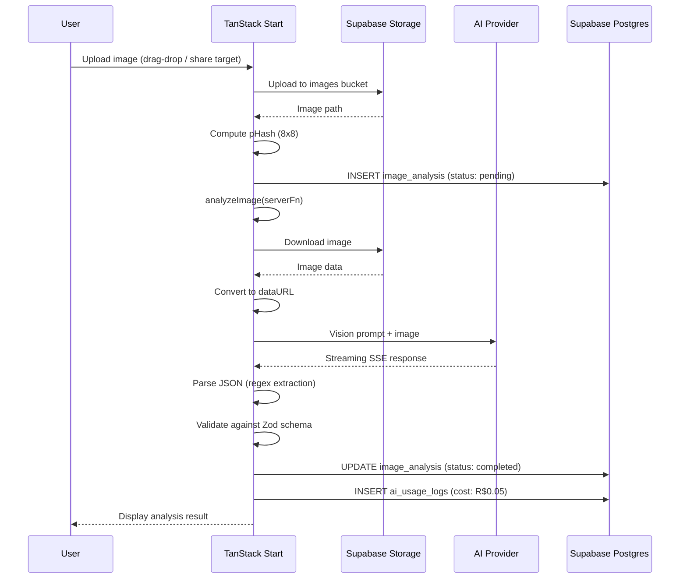
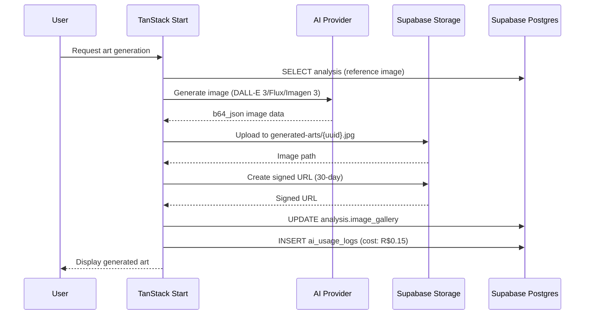
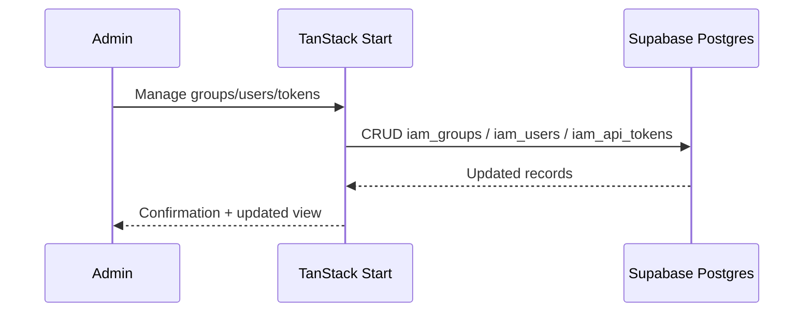
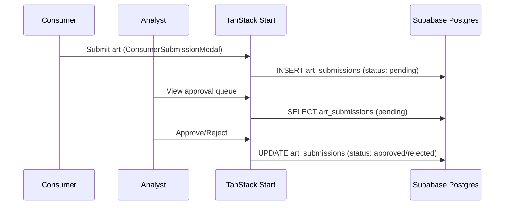
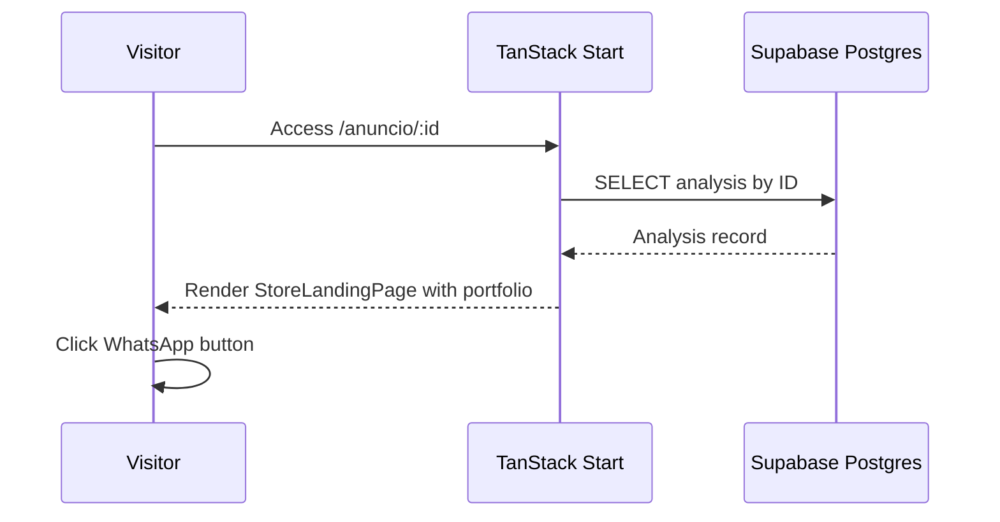

# Data Flow

> Language: EN | [Português (pt-BR)](../pt-BR/fluxo-de-dados.md)
>
> Status: ACCEPTED
>
> Documentation Standard v1.0

## Purpose

Describes the primary data flows through the AI WhatsApp Image Analyzer system.

## Flow 1: Image Analysis (Primary)

### Data Entities

| Entity | Source | Destination | Format |
| --- | --- | --- | --- |
| Image file | User device | Supabase Storage | JPEG/PNG/WebP |
| Signed URL | Supabase Storage | App server | URL (7-day expiry) |
| pHash | App computation | image_analysis.phash | 8x8 binary matrix |
| Vision prompt | iam_prompts / ANALYSIS_PROMPT | AI provider | String |
| AI response | AI provider | App server | Streaming SSE JSON |
| Analysis result | App validation | image_analysis.analysis | JSONB |
| Usage log | App server | ai_usage_logs | Row (cost, model, status) |

### Schema: image_analysis

| Column | Type | Purpose |
| --- | --- | --- |
| id | uuid | Primary key |
| image_url | text | Signed URL of image |
| image_path | text | Storage path |
| image_type | text | MIME type |
| business_name | text | Extracted business name |
| category | text | Image category |
| title | text | Extracted title |
| summary | text | AI-generated summary |
| searchable_text | text | Full-text search content |
| keywords | text[] | Extracted keywords |
| confidence | numeric | AI confidence (0-1) |
| analysis | jsonb | Full structured JSON |
| phash | text | Perceptual hash |
| processing_version | text | Prompt/model version |
| model_used | text | AI model identifier |
| status | text | pending/processing/completed/failed |
| error_message | text | Error details if failed |
| created_at | timestamptz | Record creation time |

## Flow 2: Art Generation

## Flow 3: IAM Management

## Flow 4: Art Moderation

## Flow 5: Store Landing Page

## Related Documentation

| Document | Path |
| --- | --- |
| Architecture | [architecture.md](architecture.md) |
| System context | [system-context.md](system-context.md) |
| Contracts | [contracts/](contracts/) |
