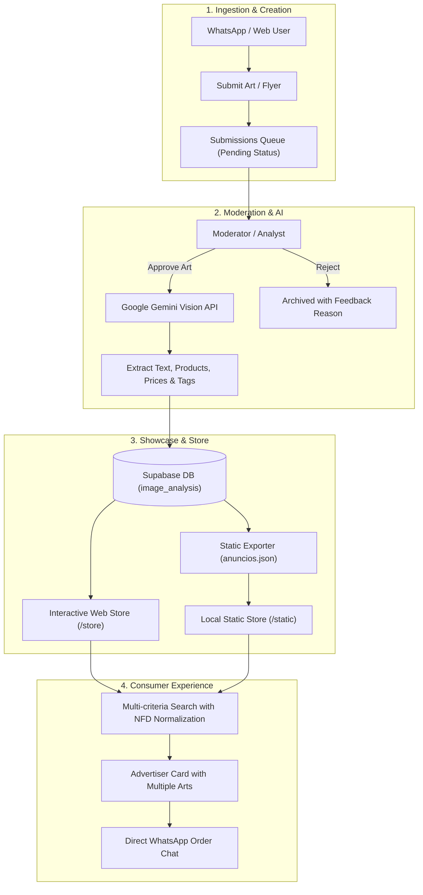
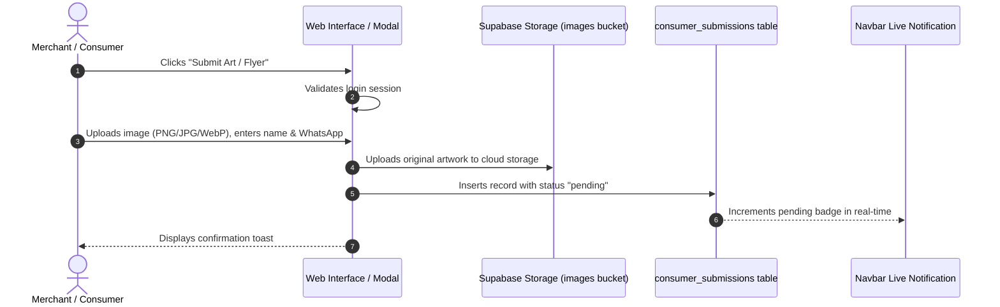
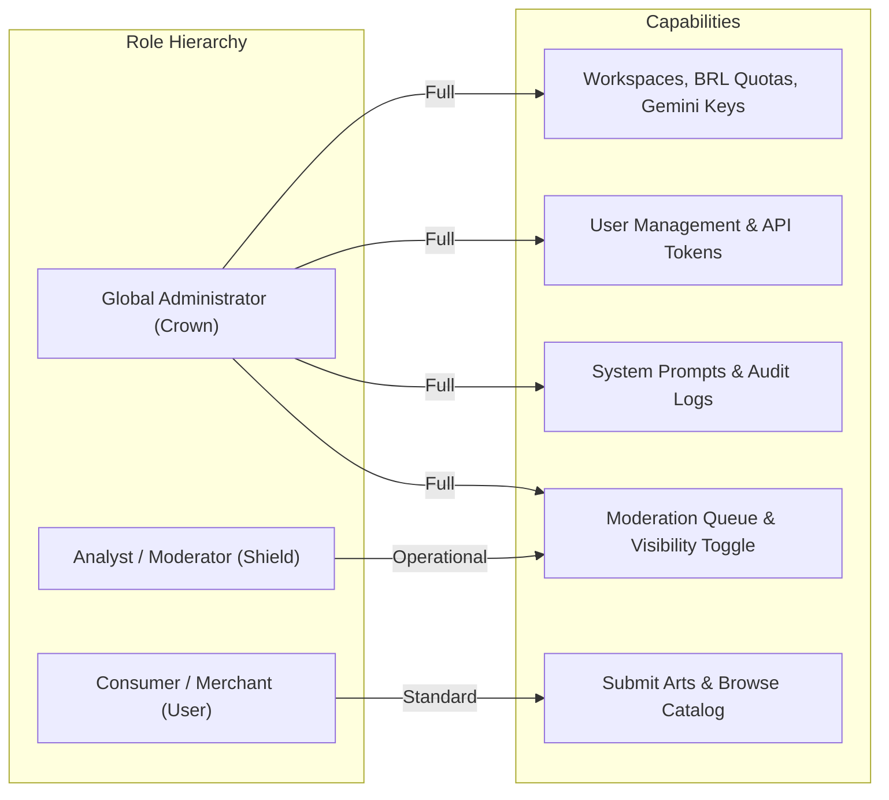

# How the System Works — Complete Application Manual

> **Official Operation, Governance & Technical Evidence Guide**  
> The **AI WhatsApp Image Analyzer** is an integrated commercial and enterprise platform that converts flyers, menus, and promo pictures received via WhatsApp into structured, interactive digital catalogs.

---

## 📑 Manual Contents

1. [End-to-End Architecture Overview](#1-end-to-end-architecture-overview)
2. [Smart Search Engine & Test Evidence](#2-smart-search-engine--test-evidence)
3. [Art & Flyer Submission Flow](#3-art--flyer-submission-flow)
4. [Art Approval & Moderation Queue](#4-art-approval--moderation-queue)
5. [User Registration, Workspaces & IAM Governance](#5-user-registration-workspaces--iam-governance)
6. [Operational Manual by User Role](#6-operational-manual-by-user-role)
7. [Autonomous Static Version (GitHub Pages)](#7-autonomous-static-version-github-pages)

---

## 1. End-to-End Architecture Overview

The system features a dual architecture:
- **Enterprise Web App (React + Vite + Supabase + Gemini)**: Dynamic platform with RBAC authentication, multimodal AI OCR, creative prompt generator, moderation queue, and token telemetry.
- **Autonomous Static Showcase (Pure HTML5/CSS3/JS)**: Standalone catalog hosted on GitHub Pages with local optimized images, 100% client-side search, zero database dependency, and WhatsApp CTA.

---

## 2. Smart Search Engine & Test Evidence

### How Multi-criteria Search Works
The search engine operates in both React and Static versions with **sub-10ms latency**:
1. **NFD Character Normalization**: Strips accents and diacritics so queries like `cardápio` and `cardapio` match identically.
2. **7-Dimensional Deep Scan**:
   - Business name (`businessName`)
   - Category (`category`)
   - AI-generated summary (`summary`)
   - OCR keywords and tags (`keywords`, `tags`)
   - Product names & descriptions (`products.name`, `products.description`)
   - Prices (`products.price`)
   - Phone numbers (`phone`, `formattedPhone`)

### 📊 Verified Search Evidence Table

| Search Query | Ads Found | Status | Featured Businesses | Detection Match Criteria |
| :--- | :---: | :---: | :--- | :--- |
| **`JBL`** | **1** | ✅ Success | JBL (Produto) | Product name, audio tags, summary |
| **`Márcio`** | **2** | ✅ Success | Márcio Das Máquinas, A Engenharia | Business name and technical contact |
| **`máquina de lavar`** | **1** | ✅ Success | Márcio Das Máquinas | Specialized appliance repair OCR |
| **`cardápio`** | **3** | ✅ Success | Cardápio de Quinta-Feira, Salgados do Tchuco, Analu Gastronomia | Flyer OCR text & food category |
| **`hotdog`** | **1** | ✅ Success | Cardápio de Quinta-Feira | Menu item extracted by AI |
| **`caldo verde`** | **1** | ✅ Success | Cardápio de Quinta-Feira | Product item & culinary tags |
| **`cuscuz`** | **1** | ✅ Success | Cardápio de Quinta-Feira | Regional dish with price |
| **`pizza`** | **1** | ✅ Success | PMG Alimentos e Bebidas | Food product in pricing table |
| **`hambúrguer`** | **1** | ✅ Success | PMG Alimentos e Bebidas | Diner and burger ingredients |
| **`conserto`** | **1** | ✅ Success | Márcio Das Máquinas | Maintenance service description |
| **`eletrônicos`** | **1** | ✅ Success | JBL (Produto) | Commercial segment & category |
| **`alimentação`** | **7** | ✅ Success | Cardápio de Quinta-Feira, Clara Doces, Salgados do Tchuco, Gato de Botas Sushi | Broad sector category |
| **`assistência técnica`** | **1** | ✅ Success | Márcio Das Máquinas | Registered corporate category |
| **`salgados`** | **4** | ✅ Success | Clara Doces e Salgados, Salgados do Tchuco | Snack tags and party packs |
| **`doces`** | **2** | ✅ Success | Clara Doces e Salgados, PMG Alimentos | Confectionery and desserts |
| **`delivery`** | **3** | ✅ Success | Cardápio de Quinta-Feira, Gato de Botas Sushi, PMG Alimentos | Express delivery mentions |

---

## 3. Art & Flyer Submission Flow

### Creative Prompt Generator ("Redo with AI")
- Integrated in `ArtPromptGenerator.tsx`.
- Converts flyer text and layout into **High-Definition Prompts for Midjourney, Flux, and DALL-E 3**.
- Allows merchants to generate high-res professional visual versions of their flyers.

---

## 4. Art Approval & Moderation Queue

1. **Real-time Pending Counter**: Moderation badge displayed in navbar for moderators and admins.
2. **Review Deck (`IamSubmissionsQueue.tsx`)**: Inspect full flyer image, contact phone, and store details.
3. **Decisions**:
   - **Approve**: Triggers Gemini OCR extraction, creates `image_analysis` record, publishes to live store.
   - **Reject**: Archives submission with mandatory review reason.

---

## 5. User Registration, Workspaces & IAM Governance

### Workspaces & Financial AI Quotas (`IamGroupsCrud.tsx`)
- Corporate groups by branch/unit.
- Financial quota in Brazilian Reais (BRL) with daily request caps.
- Dedicated Google Gemini API key with live model validation and inspection.
- Model selector: `gemini-2.5-flash`, `gemini-1.5-pro` or Lovable vision.

---

## 6. Operational Manual by User Role

### For Consumers & Visitors
1. Search products or store names (e.g., *pizza*, *hotdog*, *conserto*).
2. Flip through multiple flyers per business using card carousel dots.
3. Tap **"Chat on WhatsApp"** to reach the store directly.

### For Merchants
1. Sign in with your email.
2. Submit your artwork via the top button.
3. Once approved, your products and prices will be featured in the showcase.

### For Moderators
1. Access the **Moderation** tab.
2. Validate flyer readability and phone number.
3. Click **Approve** to publish with automated AI OCR.

### For Administrators
1. Access **IAM & Governance**.
2. Track daily costs in BRL, success rates, and token volume.
3. Configure Gemini models and branch quotas.
4. Export updated data to static catalog using **"Export Static"**.
